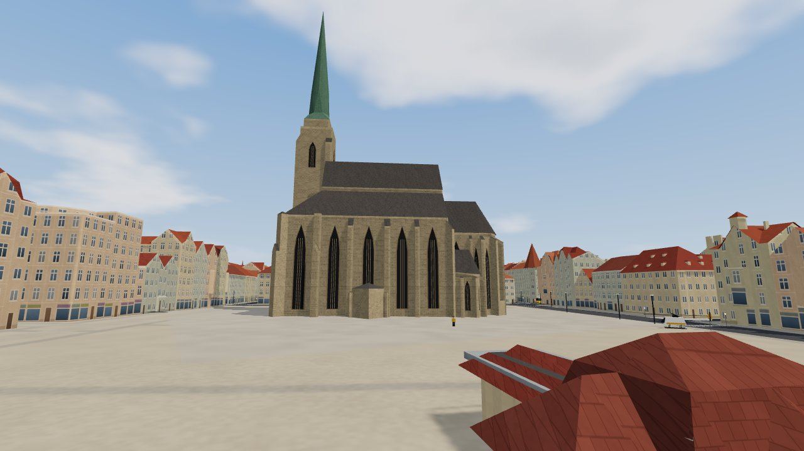
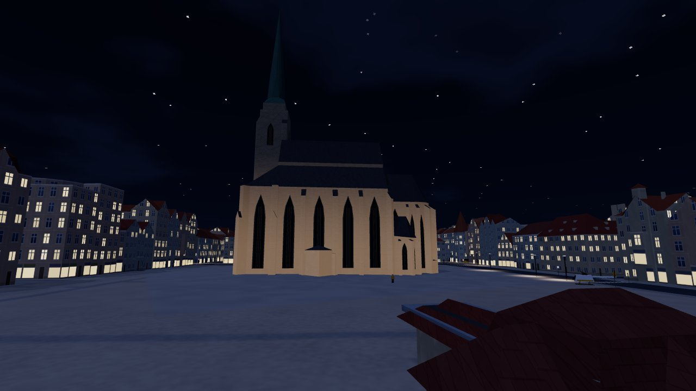
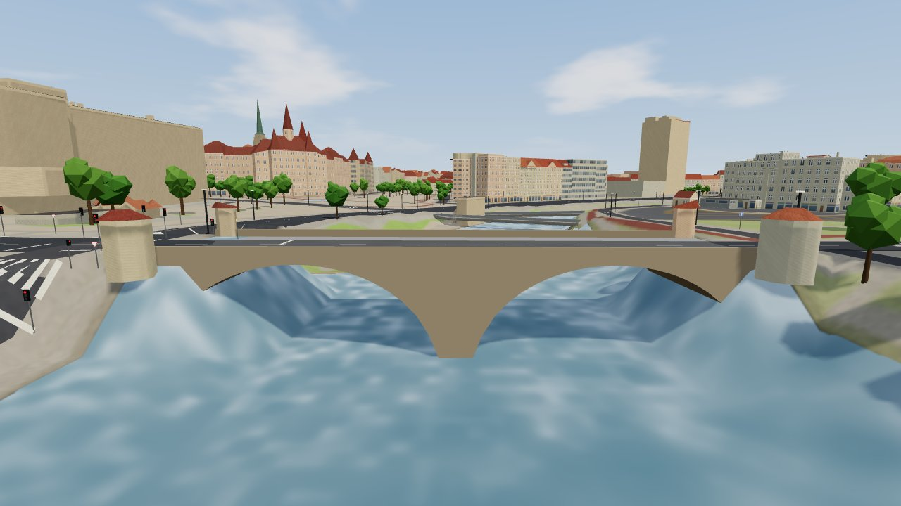
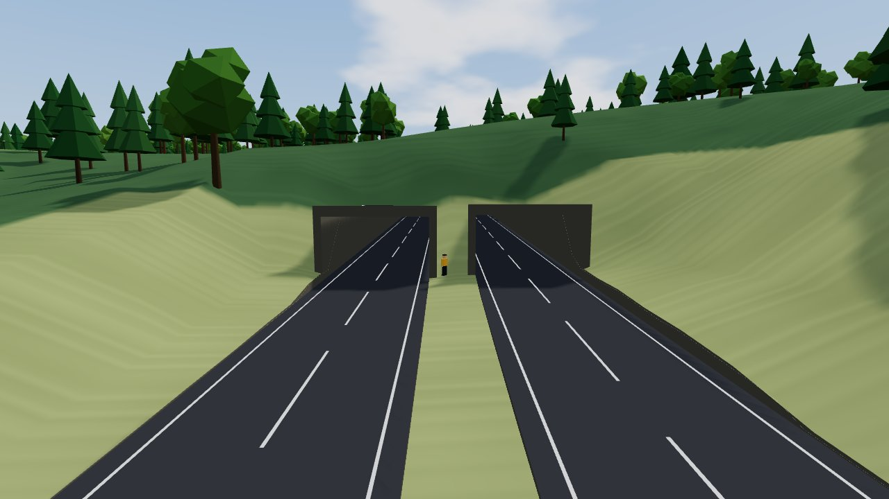
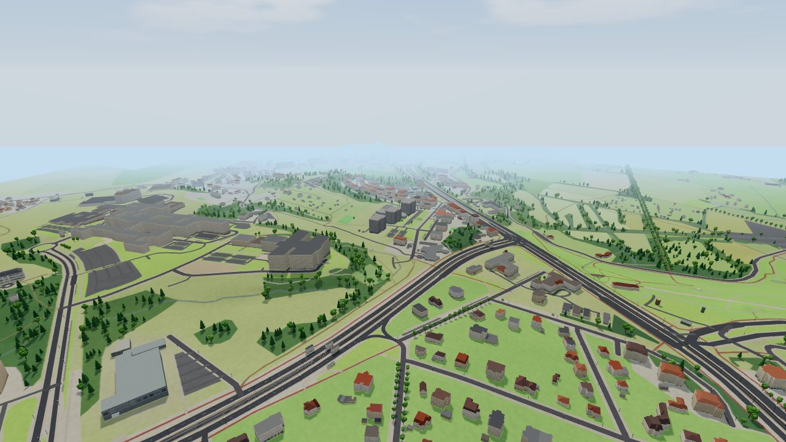
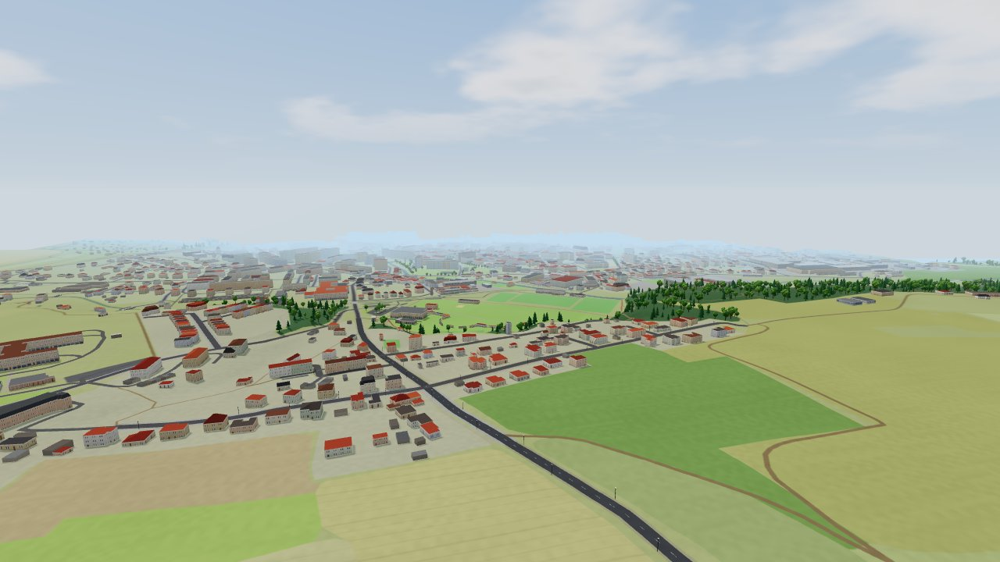
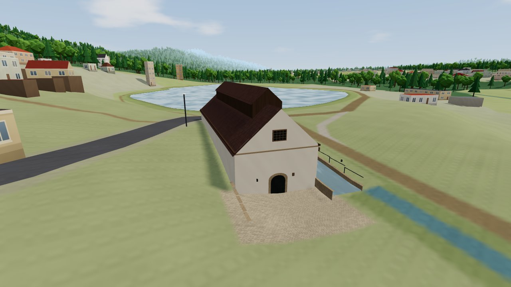
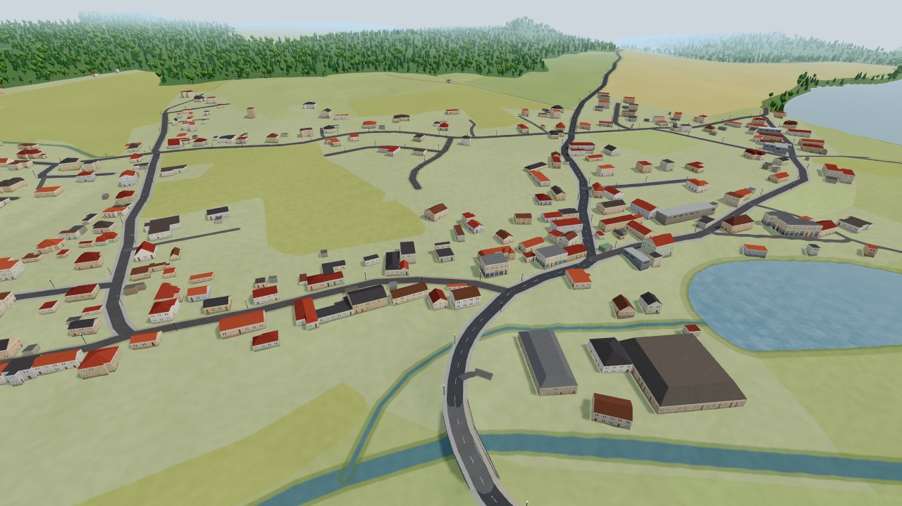

# E13 · Příprava a měření

Výchozí revize `3e8aa3e`, větev `etapa/E13`. Etapa přidala měření práce snímku a podklady
pro porovnání dalších etap. Ověření proběhlo 17. listopadu 2026. Zadání a kritéria jsou
v [zadání E13](codex/E13.md).

## Měření práce snímku

Panel F9 nebo **Měření** ukazuje posledních 60 sekund. Odděluje výpočet hry, přípravu
vykreslení na procesoru a práci grafického čipu. `?adapt=0` drží výchozí kvalitu daného
zařízení. Údaje GPU využívají časovací dotazy, jejichž výsledky se čtou, až jsou k dispozici.
[Specifikace časovacích dotazů WebGL 2](https://registry.khronos.org/webgl/extensions/EXT_disjoint_timer_query_webgl2/).

Automatický záznam pořídíš nad produkčním sestavením. Výchozí soubor je
`data-raw/e13/measure-work.json`; jinou cestu lze zadat pomocí `--output=CESTA`.

```sh
npm run build
npm run preview -- --port 4173
# V druhém terminálu
node tools/measure_map.mjs 'http://127.0.0.1:4173/?debug' --work
```

Na Macu s Apple M4, macOS 27.2.1 a Chromiem 159.0.8154.6 přes ANGLE Metal proběhly tři
běhy. Každý zahrnoval deset sekund jízdy v Plzni a deset sekund letu na východním okraji
mapy. Rozlišení bylo 1920 × 1080, měřítko obrazu 1, stíny zapnuté a herní čas na
začátku 10:00. Okolí výchozího bodu bylo dostavěné. Chromium běželo s
`--disable-gpu-vsync --disable-frame-rate-limit`.

| Scénář | Medián práce snímku | P95 | P99 | Medián času GPU | Největší rozdíl práce snímku mezi běhy |
| --- | ---: | ---: | ---: | ---: | ---: |
| Jízda v Plzni | 3,40–3,50 ms | 4,70 ms | 5,10–5,30 ms | 5,26–5,42 ms | 3,9 % |
| Let na východě | 3,90 ms | 4,60–4,90 ms | 5,50 ms | 5,53–5,76 ms | 6,5 % |

Rozdíl je maximum dělené minimem mínus jedna pro každou ze tří časových statistik.
Grafický čip dodal 713–921 platných vzorků za scénář. Čas procesoru a čas GPU se
vykazují zvlášť, protože se jejich práce může překrývat. Při prvním běhu jízdy byl jeden
interval mezi snímky dlouhý 112 ms. Při dalších bězích byly nejdelší intervaly všech
scénářů 7,6–10,1 ms. Příčina jednotlivého výkyvu nebyla zachycena.

## Rozpočet vykreslování

Výchozí hodnoty vznikly příkazem `UPDATE_BUDGETS=1 npm run test:e2e -- budget --trace off`
nad vizuálním stavem E12. V testu jsou tři pevné kamery, dostavěné okolí a Chromium
se SwiftShaderem. Test povoluje růst každé hodnoty nejvýše o 10 %. Rozpočet se mění
stejným příkazem a změna se zdůvodní v protokolu příslušné etapy.

| Pohled | Volání | Trojúhelníky |
| --- | ---: | ---: |
| Náměstí Republiky | 262 | 405 706 |
| Lochotín | 228 | 361 699 |
| Pole u Rokycan | 166 | 261 536 |

Při zkoušce se na náměstí dočasně vykreslilo 40 kopií oblohy. Test selhal při 302
voláních s limitem 288. Po odebrání kopií znovu prošel.

## Referenční pohledy

Všech osm JPEG má 1280 × 720 px, kvalitu 85 a velikost nejvýše 162 kB. Místa i kompozice
byly zkontrolovány pohledem. Dvojí pořízení na stejném stroji dalo stejné soubory. Kamery
a časy jsou v [popisu pohledů](../tools/reference-views.json). Pro další srovnání spusť
`node tools/reference_views.mjs http://127.0.0.1:4173/ CÍLOVÁ_SLOŽKA`.

| Pohled | Pohled |
| --- | --- |
|  |  |
|  |  |
|  |  |
|  |  |

## Ověření a kontrola pro autora

Prošlo 30 testů Node, 13 testů Pythonu, produkční sestavení a všech 37 prohlížečových
testů v Chromiu se SwiftShaderem. Kontrola syntaxe nástrojů v Pythonu prošla. Audit npm
nenašel zranitelnosti. Dotykové ovládání panelu bylo ověřeno v emulaci telefonu.
Výsledek ze skutečného telefonu
doplní autor. Projeď minutu po městě na počítači i telefonu a prohlédni osm pohledů.
[Návod k měření](E13/mereni-na-zarizeni.md). Doporučený model pro kontrolu je **6.1 Sol,
Medium**.
