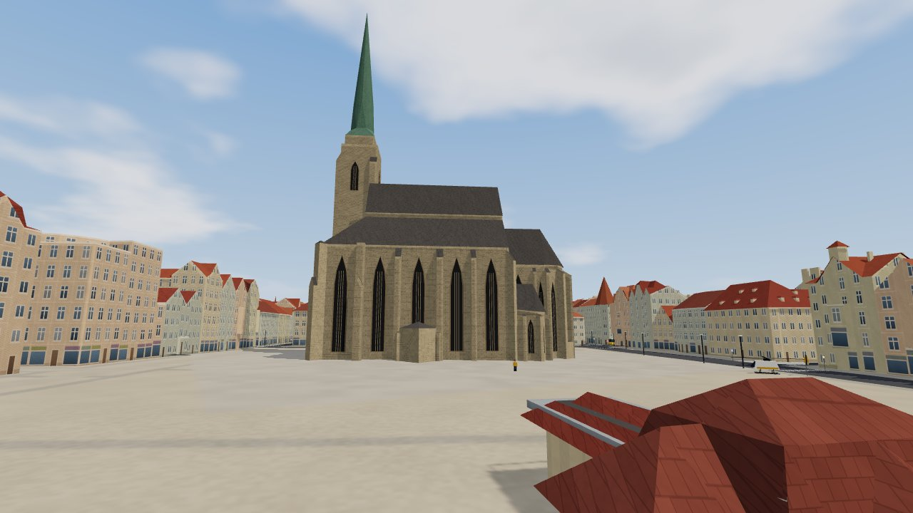
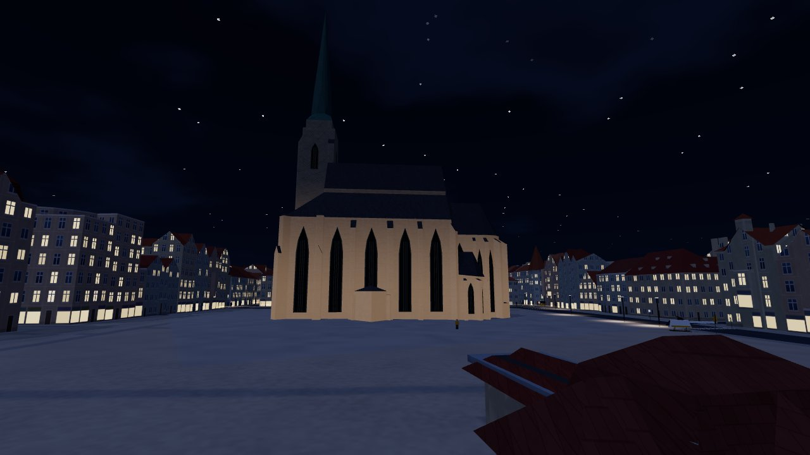
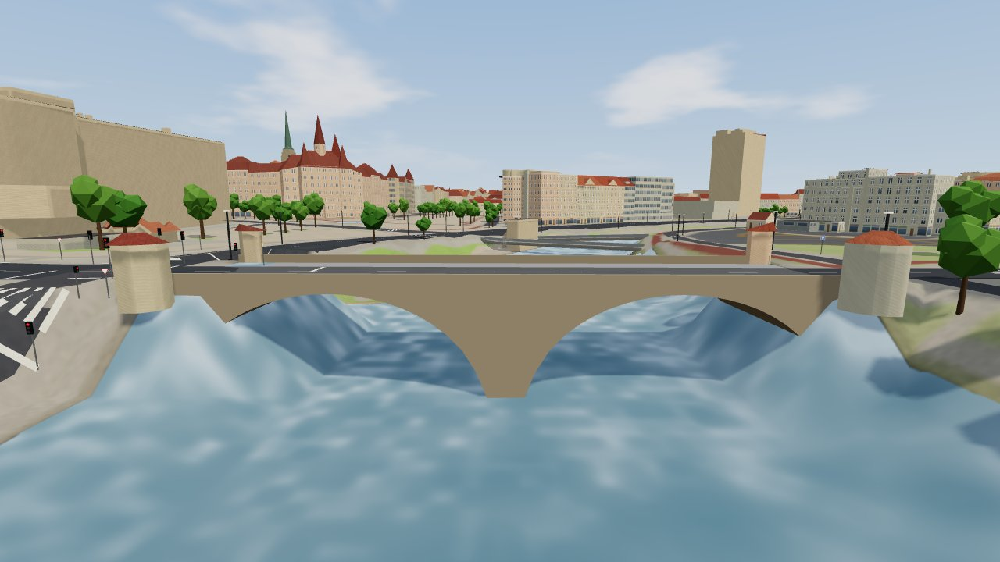
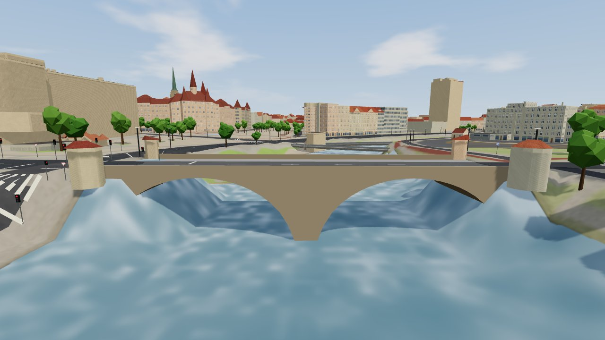
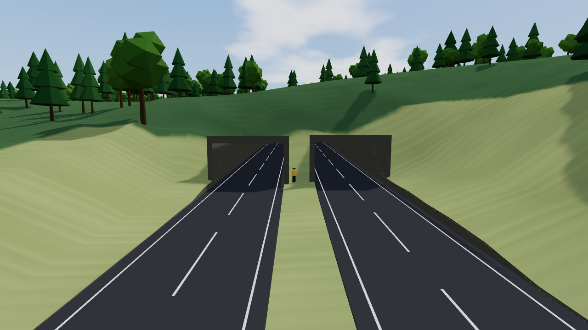
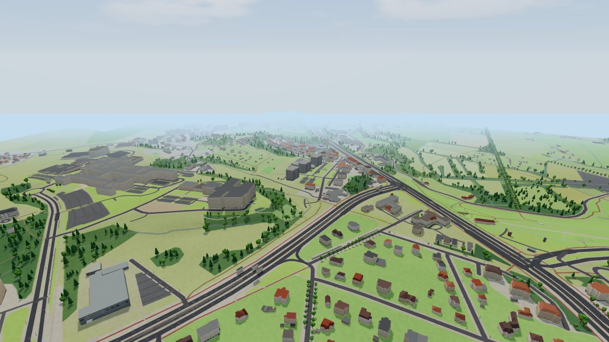
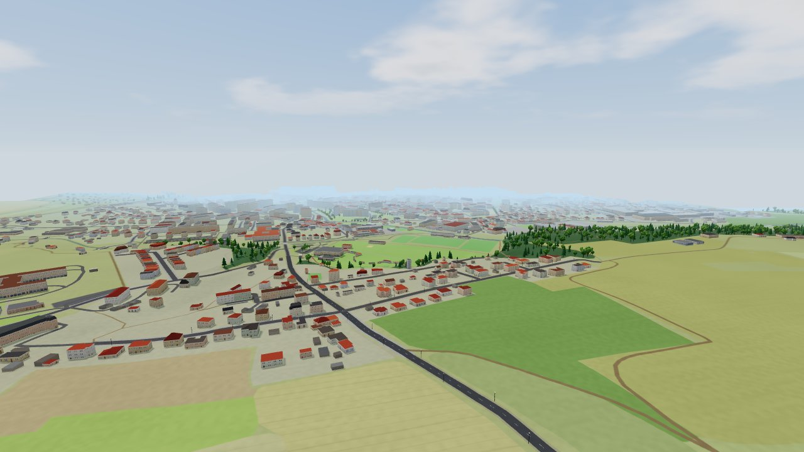
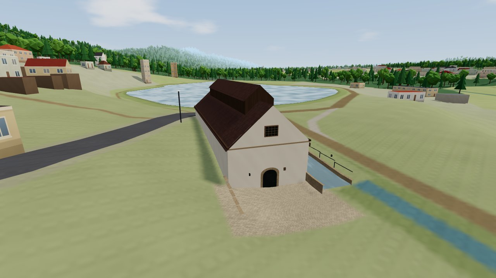
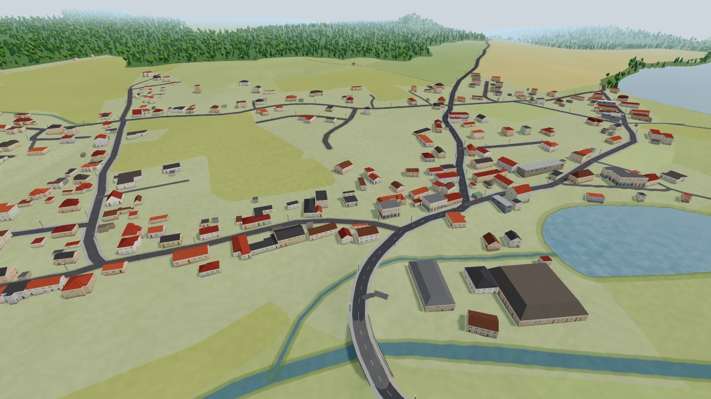
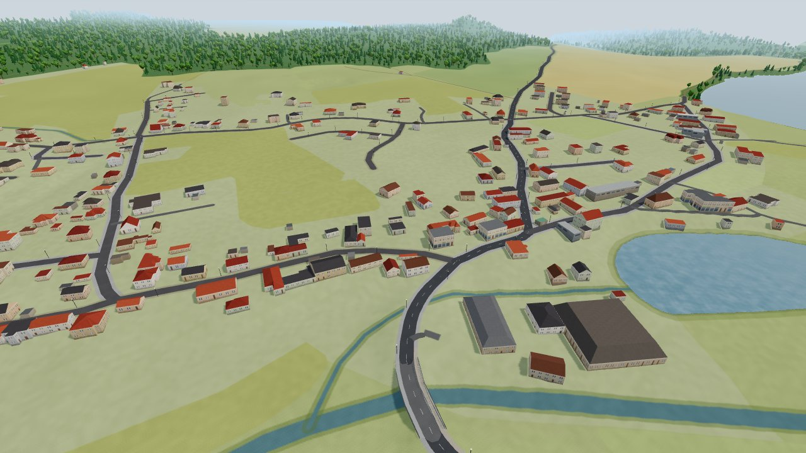

# Referenční pohledy E14

Revize hry `146a263`, datum 17. listopadu 2026. Kamery, herní datum, časy i kvalita
jsou stejné jako v E13. Všechny JPEG mají 1280 × 720 px, kvalitu 85 a nejvýše 162 223 B.
Druhé pořízení na stejném stroji dalo všech osm souborů shodných po bajtech.

Všech osm dvojic bylo prohlédnuto. Geometrie, kompozice, obloha, barvy, voda, okna
i noční světla zůstávají stejné. Přechod na `PCFShadowMap` nepatrně změnil filtrování
a hrany stínů. Expozice, tónování, barvy a intenzity světel se v kódu nemění.

Největší průměrná odchylka RGB je 0,469 na škále 0–255; největší absolutní změna
průměrného váženého jasu je 0,0301. Nejvýše 0,0212 % pixelů má v některém kanálu
rozdíl větší než 16. Čísla jsou popis porovnání, nikoli nově nastavená tolerance testů.
[Úplné výsledky a definice výpočtu](porovnani-snimku.json).

| Pohled | Průměrná odchylka RGB (0–255) | Změna průměrného jasu (0–255) |
| --- | ---: | ---: |
| Náměstí Republiky v 10:00 | 0.469 | +0.0238 |
| Náměstí Republiky ve 22:00 | 0.150 | -0.0144 |
| Wilsonův most | 0.335 | +0.0301 |
| Západní portály Valíku | 0.125 | -0.0065 |
| Lochotín z výšky 300 metrů | 0.377 | +0.0051 |
| Pole severně od Rokycan | 0.150 | -0.0004 |
| Vodní hamr v Dobřívě | 0.112 | +0.0022 |
| Údolí Klabavy | 0.274 | -0.0104 |

| Před: E13 | Po: E14 |
| --- | --- |
|  |  |
|  |  |
|  |  |
|  |  |
|  |  |
|  |  |
|  |  |
|  |  |

Pořízení:

```sh
node tools/reference_views.mjs http://127.0.0.1:4173/ docs/E14/reference
```
