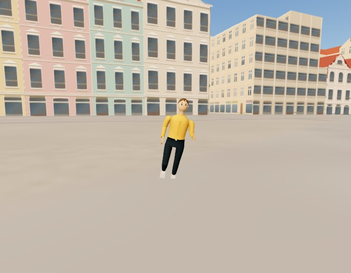

# E38 · Ovládání pěší postavy

Výchozí revize `9dc875b`. Úprava používá stávající model, animaci a vstupní zařízení hry. Na náměstí podrž Shift a W, potom zahni doleva nebo doprava. Postava se podle rychlosti nakloní dovnitř zatáčky a na rovince se narovná.

| Před úpravou | Po úpravě |
| --- | --- |
|  |  |

Volbu **Volné rozhlížení myší při chůzi** najdeš v nastavení. Po návratu do hry klikni levým tlačítkem do scény. Pohyb myší pak otáčí kameru i při chůzi stranou nebo vzad. Esc uvolní kurzor. Dalším stiskem otevřeš menu. Kurzorem můžeš hned ovládat i mapu nebo fotorežim. Po návratu k chůzi ho opět zachytíš kliknutím.

Na dotykové páčce zůstává prvních 70 % dráhy pro přesnou chůzi. Mezi 70 a 100 % postupně přibývá běh. Na rovině při vychýlení na 84 a 86 % odpovídají cílové rychlosti přibližně 3,5 a 4,0 m/s. Na dorazu je to 6,4 m/s. Na klávesnici se běhá se Shiftem.

## Ověření

Prohlížečové zkoušky ovládají sestavenou hru přes klávesnici, myš a emulované dotykové události. Měří náklon kostry při běhu na obě strany, rychlost v pěti polohách páčky a po jejím puštění. U volné kamery kontrolují uložení nastavení, běh vzad, uvolnění kurzoru a tažení při odmítnutí zámku prohlížečem. Dotykové ovládání bylo ověřeno emulací v Chromiu.

Prošlo všech 328 jednotkových testů, produkční sestavení a 28 cílených zkoušek v Chromiu na WebGL 2 a WebGPU včetně chůze po mostech, celé obrazovky a fotorežimu.

Nástroj `tools/measure_map.mjs --work --paced` na nízké předvolbě při 1920 × 1080 na Apple Metal a WebGPU naměřil při jízdě 59,2 snímku za sekundu a při přeletu 60 v obou verzích. U jízdy se 95. percentil práce snímku na CPU změnil ze 4,8 na 4,3 ms, u přeletu z 2,6 na 2,7 ms.
