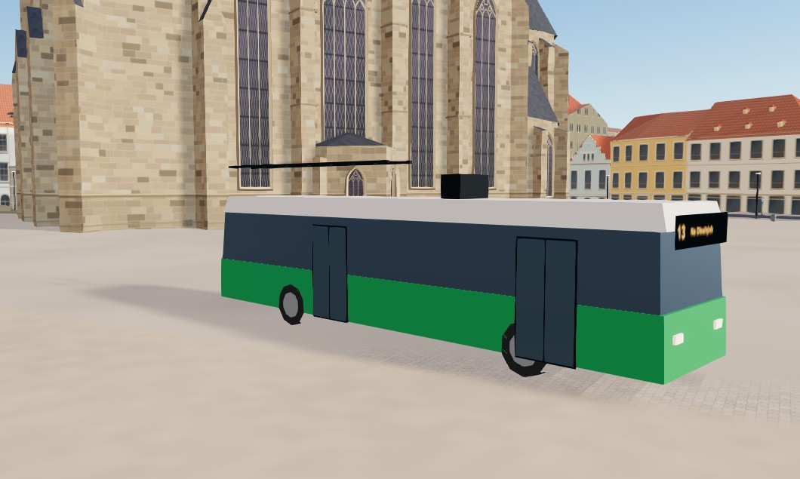
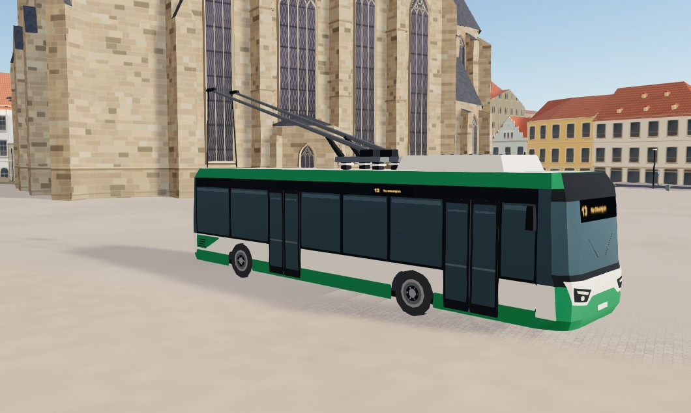
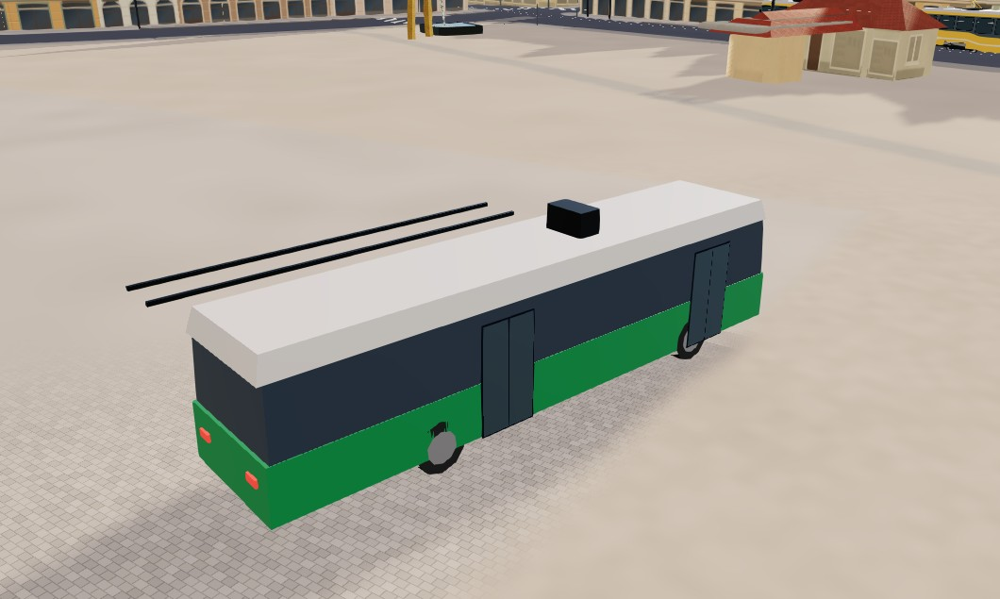
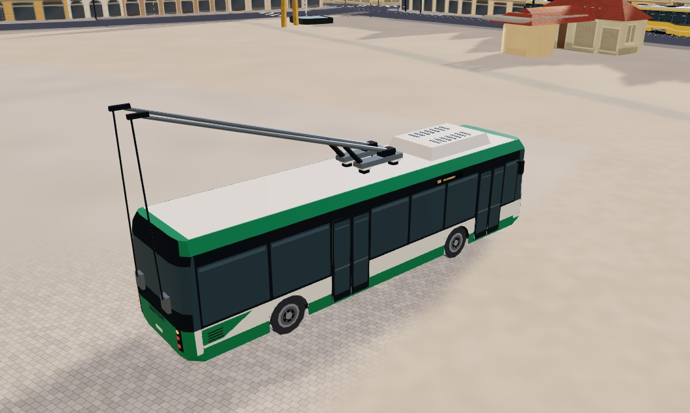

# E39 · Zelenobílý trolejbus

Výchozí revize `f1c6e3d`. Krátké trolejbusy na městských linkách používají vlastní herní model dlouhý 11,8 m. Čelo má široké čelní sklo, tvarované světlomety a panel se skutečnou linkou a cílem spoje. Ze strany jsou patrné rámy jednotlivých oken, prosklená křídla dveří a podběhy. Na střeše jsou dvě samostatné tyče s botkami, pružinami, izolátory a stahovacími lanky. Poloha sběračů je pevná.

## Porovnání z pevné kamery

Obě verze stojí pro srovnání na stejné dlažbě na náměstí Republiky, ve stejnou denní dobu a na střední grafickou kvalitu.

| Pohled | Před úpravou | Po úpravě |
| --- | --- | --- |
| Z ulice |  |  |
| Shora od zádi |  |  |

U hlavního nádraží lze nastoupit do linky 49 směrem Areál FN a vystoupit v Pařížské. [Otevřené dveře na lince 49 při denním osvětlení](E39/nadrazi.jpg)

## Ověření

Na nízké předvolbě, při 1920 × 1080 na Apple Metal a WebGPU, naměřil nástroj `tools/measure_map.mjs --work --paced` při jízdě v obou verzích 59,2 snímku za sekundu. Při přeletu naměřil 60. U jízdy se 95. percentil práce snímku na CPU změnil ze 4,8 na 4,5 ms, u přeletu činil v obou verzích 2,7 ms.

Prošlo 329 testů JavaScriptu, produkční sestavení a 26 cílených zkoušek v Chromiu na WebGL 2 i WebGPU. Ty zahrnují jízdu cestujícího na lince 49, celou řidičskou směnu na lince 16 a počty vykreslovacích volání a trojúhelníků na všech čtyřech předvolbách.
