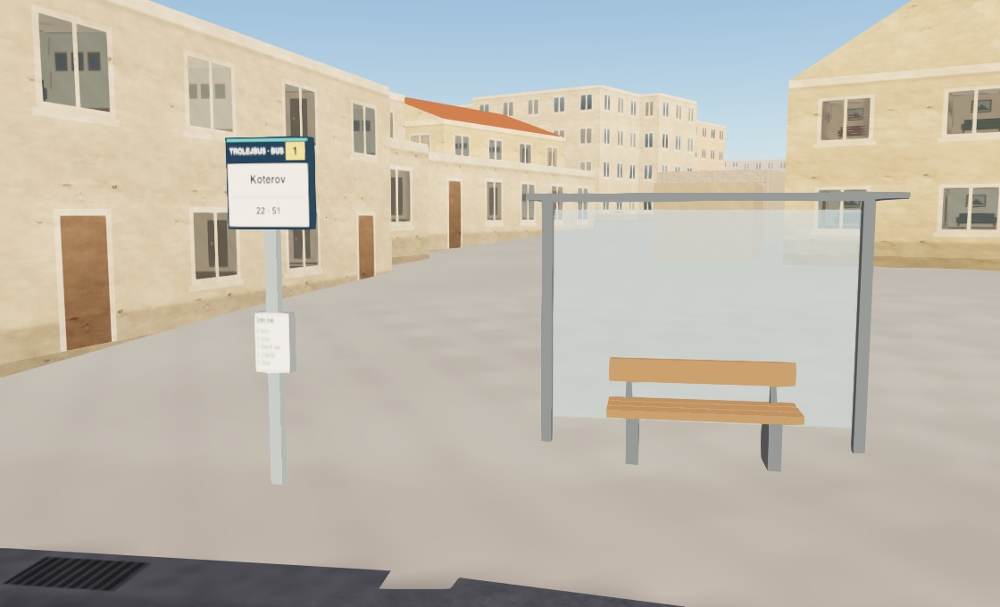
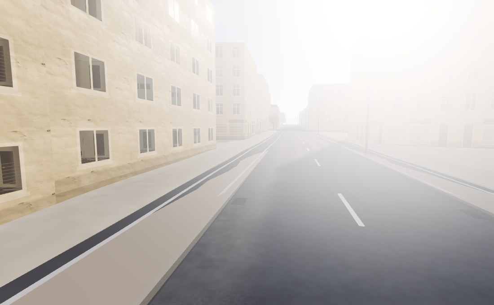
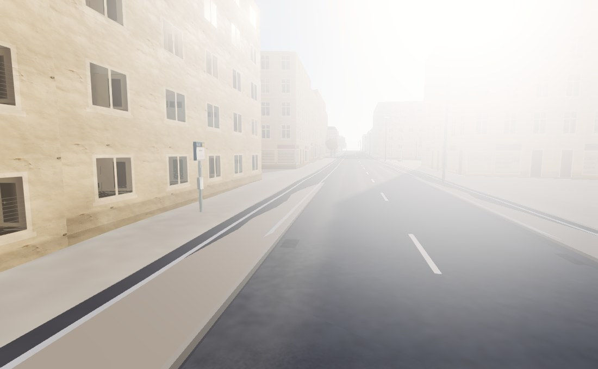

# E40 · Zastávky MHD

Výchozí revize `99eb664`. Všech 705 stanovišť na 319 různě pojmenovaných zastávkách přibaleného jízdního řádu má ve světě oboustranný označník. Tabule nese název, číslo stanoviště, druh dopravy a čísla linek. Na malé spodní tabulce jsou vybrané směry. Když hráč přijde pěšky k označníku, zobrazí se odjezdy příslušného stanoviště v herním čase. Čtyři ručně umístěné označníky hlavního nádraží využívají společný model a své původní polohy.

| Jedlová ze stejného místa | |
| --- | --- |
| Před úpravou | Po úpravě |
|  |  |

## Podklady a přesnost

Názvy, čísla stanovišť, linky a cíle pocházejí z místního jízdního řádu PMDP (CC BY 4.0). Místní výřez OpenStreetMap z 15. listopadu 2026 (© přispěvatelé, ODbL) poskytl 524 pojmenovaných bodů přiřazených nejvýše 22 metrů od souřadnice jízdního řádu. Každý bod se přiřazuje nejvýše jednomu stanovišti. Model, barvy a grafika označníků jsou vlastní. [Jízdní řády PMDP](https://opendata.plzen.eu/public/opendata/detail/187) · [OpenStreetMap](https://www.openstreetmap.org/copyright)

U ostatních stanovišť hra vychází z polohy v jízdním řádu a odsazuje označník na volné místo u trasy. Poloha sloupku a rozmístění vybavení u konkrétního obrubníku jsou přibližné. Z doloženého vybavení se do volného prostoru vešlo 229 nových přístřešků a 234 laviček. Hra zachovává dosavadní ruční vybavení u nádraží. V místech bez údaje o vybavení zůstává samotný označník. Při výpadku doplňkové vrstvy OSM fungují označníky i výběr odjezdů dál.

Vrstva se vyrábí příkazem `python3 tools/build_stop_survey.py <výřez.osm.pbf> <výstup.json>`. Výstup v kandidátním adresáři byl shodný s distribuovaným souborem.

## Kontrola ve hře

V mapě vyhledej **Koterov** a dojdi pěšky ke stanovišti **1**. Na obou stranách tabule jsou linky **22 a 51**. U hlavního nádraží můžeš porovnat odjezdy od dvou označníků na sousedních stanovištích.

Prošlo 331 testů JavaScriptu, 30 testů datových nástrojů, produkční sestavení a 38 cílených zkoušek v Chromiu (WebGPU a WebGL 2). Zkoušky kontrolují úplnost označníků vůči celému jízdnímu řádu, shodu stanoviště u sloupku, výpadek vrstvy OSM, pěší trasu přes terminál, přestup a směny tramvaje, trolejbusu i autobusu. Při nárazu se uvolněný označník vykresluje se stejným nápisem jako před poškozením.

Na všech čtyřech grafických předvolbách prošly původní limity počtu volání a trojúhelníků. Nápisy na jedné dlaždici sdílejí texturu. Vybavení se vykresluje v blízkosti hráče, při přeletu rozhoduje vodorovná vzdálenost.

Při místním měření nástrojem `tools/measure_map.mjs --work --paced` v rozlišení 1920 × 1080 na Apple Metal a nízké předvolbě vyšla před úpravou i po ní jízda autem na 59,2 snímku/s a přelet na 60 snímků/s. Při jízdě stoupl počet volání ze 146 na 150 a počet trojúhelníků z 323 196 na 330 416. Při přeletu naměřily obě verze 55 volání a 149 880 trojúhelníků. V dotykovém režimu Chromia (780 × 390) se u stanoviště Koterov 1 zobrazil odjezd linky 51 na Slovany.
