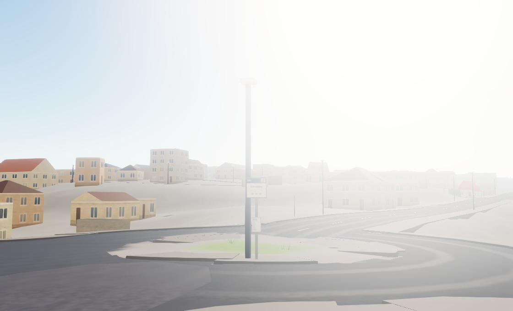
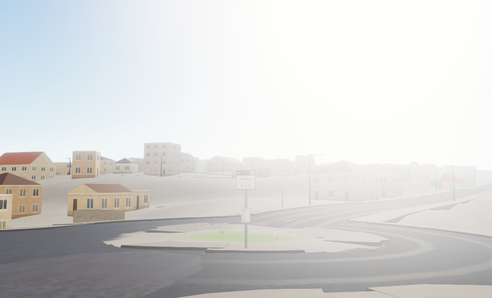
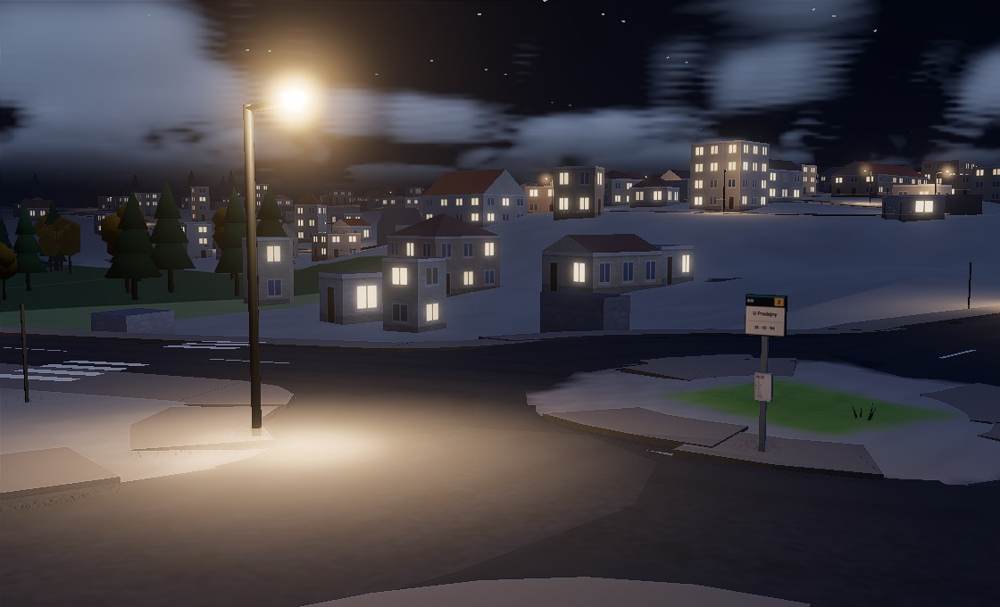

# E41 · Sloupy veřejného osvětlení

Výchozí revize `e4fb811`. Na mapě má přednost sloup zaměřený v OpenStreetMap. Ve vzdálenosti do 24 metrů od něj hra vynechá automatickou lampu. Ve zbývajících ulicích lampy nadále doplňuje podle třídy a šířky vozovky. Výložník, noční světlo i osvětlená plocha mají společný směr. Samostatná svítidla mimo silnici svítí pod sebe.

## Kontrola celé mapy

| Kontrola | Před | Po |
| --- | ---: | ---: |
| Samostatné herní sloupy | 43 822 | 43 578 |
| Paty sloupů uvnitř herní vozovky | 1 007 | 0 |
| Automatické lampy se světlem odvráceným od osy ulice | 38 037 | 0 |
| Nejbližší sloup od označníku U Prodejny, stanoviště 2 | 0,37 m | 9,23 m |

Kontrola prošla všechny dlaždice. Každý výsledný sloup má vlastní identifikátor. V celém světě stojí označníky alespoň 1,5 metru od sloupů. Stejný odstup platí vůči středu lavičky, u přístřešku je to 2,4 metru.

| U Prodejny před úpravou | Po úpravě |
| --- | --- |
|  |  |

Ve hře vyhledej na mapě **U Prodejny**, stanoviště **2**, a nastav čas na 22.00. Z chodníku je vidět celý označník a světelná stopa pod výložníkem vedlejší lampy.

## Podklady a odchylky

Místní výřez OpenStreetMap z 15. listopadu 2026 obsahuje 2 355 bodů osvětlení v herních hranicích. Skript `tools/build_lamp_survey.py` vybral 2 349 samostatných sloupů v základní výškové vrstvě. Svítidla na fasádách a body v jiné výškové vrstvě vynechává. Pokud se datum výřezu liší od data mapy, sestavení vrstvy se zastaví. Hra při chybějícím nebo nekompatibilním souboru použije automatické lampy. Model výložníku je vlastní. [Licence dat OpenStreetMap](https://www.openstreetmap.org/copyright)

Ve hře je 2 110 sloupů přímo na souřadnici podkladu. U dalších 229 hra našla volné místo do šesti metrů. Deset bodů vynechala kvůli překážce. Ostatních 41 239 poloh je dopočítaných. Výška, tvar svítidla a intenzita světla jsou herní odhad.

## Výkon

Měření nástrojem `tools/measure_map.mjs --work --paced` proběhlo lokálně na Apple Metal v rozlišení 1920 × 1080 na nízké předvolbě.

| Ukazatel | Jízda před | Jízda po | Přelet před | Přelet po |
| --- | ---: | ---: | ---: | ---: |
| Snímky za sekundu | 59,2 | 59,1 | 60,0 | 60,0 |
| Vykreslovací volání | 144 | 140 | 55 | 55 |
| Trojúhelníky | 324 014 | 323 590 | 149 880 | 149 880 |
| Práce na snímku, 95. percentil (ms) | 4,3 | 4,6 | 2,6 | 2,8 |
| GPU, 95. percentil (ms) | 12,06 | 8,98 | 8,45 | 8,39 |

První verze výložníku překročila rozpočet na náměstí na nízké předvolbě. Výsledný model má otevřené konce trubek v místě spoje. Silniční sloupy obou výšek se v každé dlaždici kreslí společně. Automatické testy měří původní limity.

Produkční sestavení, 334 testů JavaScriptu, 31 testů datových nástrojů a 32 cílených zkoušek v Chromiu prošlo. Na WebGL 2 a WebGPU se ověřilo svícení, ulomení a ranní oprava lampy, odstup u stanoviště i výpadek zdrojové vrstvy. Prošly rozpočty všech čtyř předvoleb.
