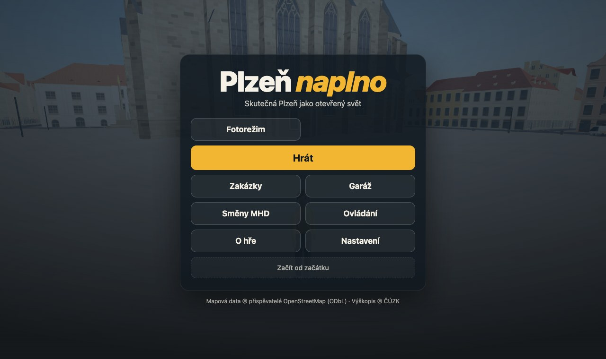
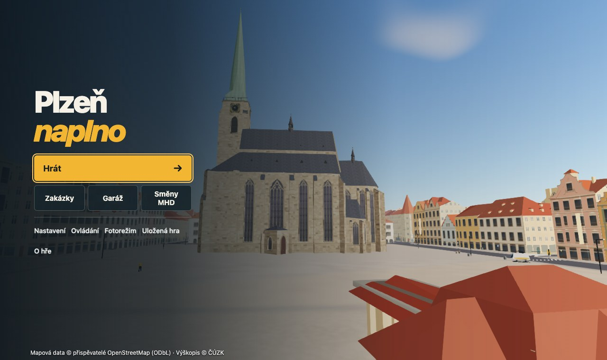
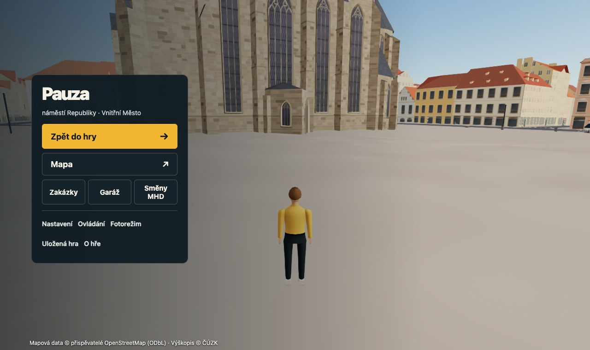

# E42 · Úvodní nabídka a pauza

Výchozí revize `eb441a4`. Při prvním spuštění je za názvem hry pohled přes náměstí Republiky na katedrálu. S uloženou hrou se zobrazí okolí poslední polohy, její název a tlačítko **Pokračovat**. Obraz na pozadí pochází přímo z herní kamery a používá stávající modely i mapová data.

| Původní nabídka | Nová úvodní obrazovka |
| --- | --- |
|  |  |

## Pauza během hraní

Pauza ponechá na obrazovce výhled hráče. U názvu ulice ukazuje nastavený cíl, probíhající zakázku nebo zastávku směny. **Mapa** dovoluje změnit cíl při zastaveném čase. Po zavření mapy se výběr vrátí na její tlačítko v pauze. Ze zakázek, garáže, směn a nastavení vede zpět tlačítko se šipkou nebo Esc. Smazání postupu najdeš pod **Uložená hra → Začít od začátku** a musíš ho potvrdit.

## Jak to vyzkoušet

1. Nastup do auta a stiskni Esc. Otevři **Mapa**, vyhledej lávku přes Strouhu a potvrď navigaci.
2. V pauze se objeví název lávky. Po dalším Esc pokračuješ za volantem.
3. Na telefonu otevři nabídku během rozvozu. Prohlédni si mapu, zavři ji a klepni na **Zpět do hry**.

Dotykové ovládání bylo zkoušeno v Chromiu s emulovaným telefonem na šířku (780 × 390) i na výšku (360 × 740). Prohlížeč může první Esc použít k uvolnění zachyceného kurzoru nebo ukončení celé obrazovky. Pro otevření nabídky je ve hře také tlačítko.

## Měření

Chromium na Apple Metal, WebGPU, nízká předvolba, 1920 × 1080. Obě sestavení prošla stejnou trasou jízdy a přeletu pomocí `tools/measure_map.mjs --work --paced`.

| Ukazatel | Před úpravou | Po úpravě |
| --- | ---: | ---: |
| První načtení, medián tří spuštění | 2,87 s | 2,90 s |
| Jízda autem | 59,3 sn./s | 59,1 sn./s |
| Práce na snímku při jízdě, 95. percentil | 4,9 ms | 4,5 ms |
| Let vrtulníkem | 60,0 sn./s | 60,0 sn./s |
| Práce na snímku při letu, 95. percentil | 2,8 ms | 2,8 ms |

Produkční sestavení, 334 jednotkových testů a 58 cílených zkoušek v Chromiu prošlo. Na WebGL 2 i WebGPU se ověřila mapa, návrat za volant, rozvoz, zastávka směny, fotorežim a práce s uloženým postupem. Testy mazání teď vstupují přes správu uložené hry a dál ověřují potvrzení, chybu zápisu i opětovné načtení.
