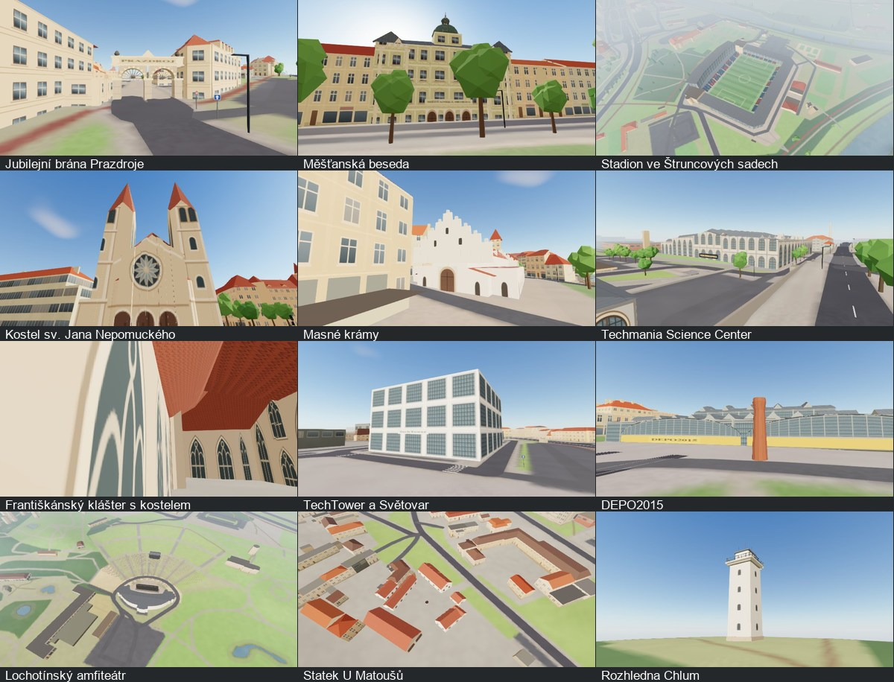

# E43 · Dvanáct plzeňských dominant

Výchozí revize `771eef1`. Fotografie posloužily jako předlohy pro vlastní kresbu a modelování. Osm areálů využívá měřené městské plochy. Na Světovaru, v amfiteátru, na statku a na Chlumu modely vycházejí z obrysů v herní mapě. Každý odkaz ve sloupci **Porovnání** otevře stejné dvě kamery před úpravou a po ní. Horní řada ukazuje přístup k místu, spodní pohled z výšky.

| Místo | Co si prohlédnout | Porovnání | Fotografická předloha |
| --- | --- | --- | --- |
| Plzeňský Prazdroj | Oba průjezdy, kamenné pilíře a železné vějíře pod oblouky. Za areálem vystupuje cihlový dřík vodárenské věže se světlým vodojemem a členitou střechou. | [Jubilejní brána](E43/prazdroj.jpg) · [Vodárenská věž](E43/vodarenska-vez.jpg) | [Brána z ulice](https://commons.wikimedia.org/wiki/File:Pilsner-Urquell-Main-Gate-Perspective.jpg) · [Vodárenská věž](https://commons.wikimedia.org/wiki/File:Plze%C5%88,_pivovar,_vod%C3%A1rensk%C3%A1_v%C4%9B%C5%BE.jpg) |
| Měšťanská beseda | Světlé secesní průčelí, trojice vstupů, pilastry, štíty a otevřená lucerna směrem do sadů. Při obletu jsou vidět i zadní křídla a střecha nad sálem. | [Beseda](E43/beseda.jpg) | [Visit Plzeň](https://www.visitplzen.eu/poznej-plzen/historicke-centrum/mestanska-beseda/) |
| Stadion ve Štruncových sadech | Červené a modré sektory, uličky, střechy tribun, branky a pruhovaný trávník s vyznačeným hřištěm. | [Stadion](E43/stadion.jpg) | [Pohled ze sektoru hostů](https://commons.wikimedia.org/wiki/File:Doosan_Arena_-_panoramatick%C3%BD_pohled_ze_sektoru_host%C5%AF.jpg) |
| Kostel sv. Jana Nepomuckého | Průčelí s rozetou, trojicí vstupů a dvěma zvonicemi. Městské měření určuje výšky obou jehlanů i obrys celé lodi. | [Chodské náměstí](E43/chodske.jpg) | [Kulturní Plzeň](https://kultura.plzen.eu/kulturni-infrastruktura/objekty-a-zarizeni/kostel-svateho-jana-nepomuckeho/) |
| Masné krámy | Bílá stupňovitá čela, malá okna a podélné červené střechy různých výšek. | [Masné krámy](E43/masne-kramy.jpg) | [Průčelí od Křižíkových sadů](https://commons.wikimedia.org/wiki/File:Plze%C5%88_-_K%C5%99i%C5%BE%C3%ADkovy_sady_-_D%C5%99ev%C4%9Bn%C3%A1_-_View_NNE_on_Masn%C3%A9_kr%C3%A1my_(Flesh_market_hall)_1392.jpg) |
| Techmania a 3D planetárium | Průmyslová okna, rytmus světlíků a haly rozdílných výšek. Planetárium má samostatnou budovu s klenutou střechou. | [Haly](E43/techmania.jpg) · [Planetárium](E43/planetarium.jpg) | [Techmania Science Center](https://techmania.cz/) |
| Františkánský klášter a kostel Nanebevzetí Panny Marie | Světlá západní fasáda s okrovými lizénami, lomená okna v křídlech kláštera, rajský dvůr a věž nad červenými střechami. | [Klášter](E43/klaster.jpg) | [Kostel i vnitřní nádvoří](https://www.visitplzen.eu/poznej-plzen/historicke-centrum/kostel-nanebevzeti-panny-marie/) |
| TechTower a Světovar | Velká tovární okenní pole, prosklené nástavby, navazující haly a dvojice nižších šikmých střech. | [Světovar](E43/svetovar.jpg) | [Fotografie přestavby od města Plzně](https://plzen.eu/o-meste/dotovane-projekty/iti-pmo-technologicky-park-dronet-plzen-svetovar/) |
| DEPO2015 | Dvě prosklená oblouková čela, žlutý pás nad vstupy, rezavý sloup na nádvoří a soustava zadních dílen. | [DEPO2015](E43/depo.jpg) | [Nádvoří a haly](https://www.visitplzen.eu/poznej-plzen/industrialni-pamatky/depo2015/) |
| Lochotínský amfiteátr | Vějíř hlediště se sedmi oddělenými sektory, stupně ve svahu, promítací plocha, jeviště a zadní budova. | [Amfiteátr](E43/amfiteatr.jpg) | [Hlediště a jeviště](https://kultura.plzen.eu/kulturni-infrastruktura/venkovni-prostor/amfiteatr-lochotin/) |
| Selský dvůr U Matoušů | Bílé štíty, dřevěná vrata a studna. Sedm obrysů kolem dvora nese střechy orientované podle příslušného stavení. | [Statek](E43/statek.jpg) | [Visit Plzeň](https://www.visitplzen.eu/poznej-plzen/muzea/selsky-dvur-u-matousu/) |
| Rozhledna Chlum | Světlý hranol s úzkými okny, přečnívající vyhlídková plošina, zábradlí, horní nástavba a antény. | [Chlum](E43/chlum.jpg) | [Fotografie rozhledny](https://www.visitplzen.eu/poznej-plzen/vylety-do-okoli/rozhledna-chlum/) |

## Rozsah a podklady

Jde o herní exteriéry. Rozvržení drobných ozdob, počet sedadel, členění oken a část střešních detailů jsou výtvarnou aproximací. Stávající okolní zástavba, porost a terén patří k původní mapě. Podrobné exteriéry zaměřených komplexů se načítají podle vzdálenosti. Při dalším oddálení se zobrazí měřená silueta. Původní podobu všech dvanácti míst lze pro srovnání zapnout parametrem `?dominanty=puvodni`.

Kresba a geometrické detaily jsou vlastní tvorba projektu Plzeň naplno. V distribuovaných souborech jsou pouze vlastní výtvarné podklady. Půdorysy jsou od přispěvatelů OpenStreetMap pod ODbL, terén z ČÚZK a městské měření z otevřené sady Plzně 2024. Seznam výše uvádí galerie a konkrétní fotografické předlohy. [Městské zaměření](https://opendata.plzen.eu/public/opendata/detail/37) · [Licence OpenStreetMap](https://www.openstreetmap.org/copyright)

## Ověření

V Chromiu prošlo 46 cílených zkoušek na WebGL 2 a WebGPU. Nová prohlídka navštíví 14 poloh ve dvanácti areálech, vrátí se k Prazdroji po výměně dlaždic a zkontroluje oba volné oblouky i pevný prostřední pilíř. Samostatné testy prověřily rozpočet všech tří předvoleb. Po poslední úpravě kolizí brány prošlo opět všech 12 zkoušek pro nová místa, Prazdroj a rozpočty vykreslování. Prošlo také produkční sestavení a všech 347 jednotkových testů.

Měřeno na Apple Metal, WebGPU, 1920 × 1080, nízká předvolba. Stejnou jízdu a let jako v E42 spustil nástroj `tools/measure_map.mjs --work --paced`. Kontrolní jízda s původními exteriéry proběhla při tomto měření. Jde o měření na počítači, rychlost na skutečném telefonu nebyla měřena.

| Ukazatel | Předchozí etapa E42 | Kontrola s původními exteriéry | Hotové modely |
| --- | ---: | ---: | ---: |
| První načtení, medián tří spuštění | 2,90 s | 2,93 s | 2,94 s |
| Jízda autem | 59,1 sn./s | 59,2 sn./s | 59,2 sn./s |
| Práce na snímku při jízdě, 95. percentil | 4,5 ms | 4,8 ms | 4,7 ms |
| Let vrtulníkem | 60,0 sn./s | 60,0 sn./s | 60,0 sn./s |
| Práce na snímku při letu, 95. percentil | 2,8 ms | 2,5 ms | 2,9 ms |

První zkušební sestavení startovalo 6,04 s. Příčinou přibližně tří sekund navíc bylo opakované prostorové dělení překrývajících se ozdob brány. Po omezení hloubky stromu mají kolize stejné plochy a hra opět startuje pod tři sekundy. Při jízdě zabralo GPU 11,21 ms oproti 9,50 ms v E42 a 12,45 ms při kontrolní jízdě s původním vzhledem. Fyzika zabrala 1,2 ms oproti 0,9 ms v E42 a 1,5 ms při kontrole. Tato dvě zvýšení vůči staršímu měření se projevila i s původními exteriéry. V hotové verzi se jízda i let vešly do rozpočtů logiky, fyziky, přípravy vykreslení a GPU.

Ve hře můžeš projet Jubilejní branou, navštívit dvůr U Matoušů v Bolevci nebo vrtulníkem obletět barevné sektory stadionu ve Štruncových sadech.
