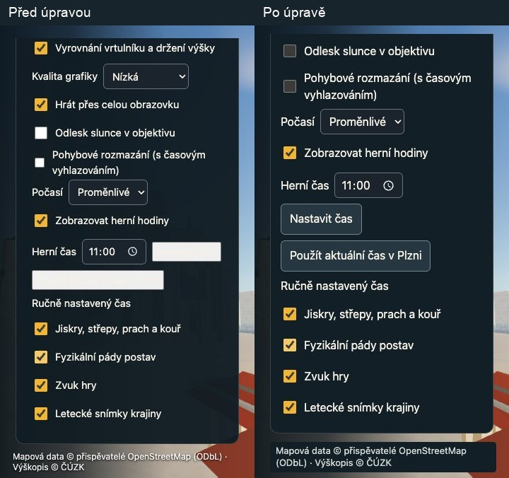
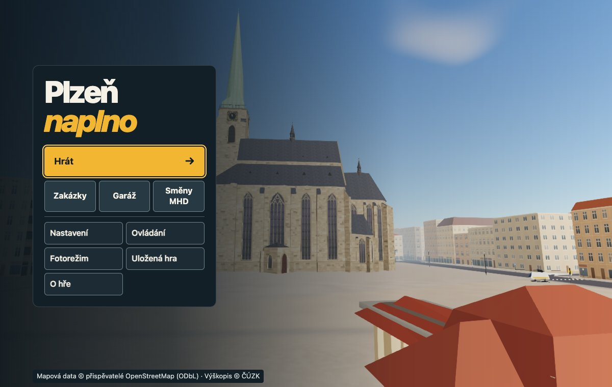

# E45 · Čitelnost herního menu

Výchozí revize `1bc066f`. V nastavení času a při převzetí hry z druhé karty mohla tlačítka převzít světlou výplň prohlížeče i světlý text hry. Stejná kombinace se objevovala ve fotorežimu. Tlačítka mají nyní výslovně nastavenou barvu textu i podkladu.

Úvod i pauza mají tmavý podklad pod názvy položek. Nedostupné akce mají čitelný šedý popisek a přerušovaný okraj. Odkazy, tlačítka i políčka mají při ovládání klávesnicí viditelné zvýraznění. V menším okně se popisy zalamují a zdroje mapy mají pod posuvnou nabídkou vlastní prostor. U vybrané směny se plný název nástupní i konečné zastávky zalomí pod výběrem spoje.

## Ověření

Prošlo produkční sestavení a 348 jednotkových testů. V Chromiu prošlo 42 zkoušek menu, času, směn MHD, ukládání a fotorežimu. Rozšířená kontrola dlouhého názvu vybrané směny prošla také samostatně na WebGL 2 a WebGPU.

Test při rozlišeních 320 × 568 a 780 × 360 otevřel všech sedm podnabídek. Ověřil kontrast textu viditelných tlačítek alespoň 4,5 : 1, minimální velikost jejich písma 16 px, dostupnost poslední položky a návrat zaměření po stisku Zpět. Posouvání dlouhého textu bylo ověřeno v emulaci telefonu dotykovým gestem.

Při standardním měření na Apple Metal v nízké předvolbě při 1920 × 1080 vyšel medián startu 2,93 s (E44 2,94 s). Jízda dosáhla 59,1 sn./s a let 60,0 sn./s. Práce na snímku v 95. percentilu činila 4,8 ms při jízdě a 2,7 ms při letu, oproti 4,6 a 2,8 ms v E44.
