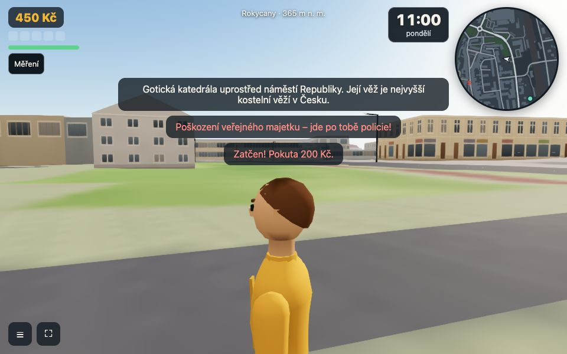
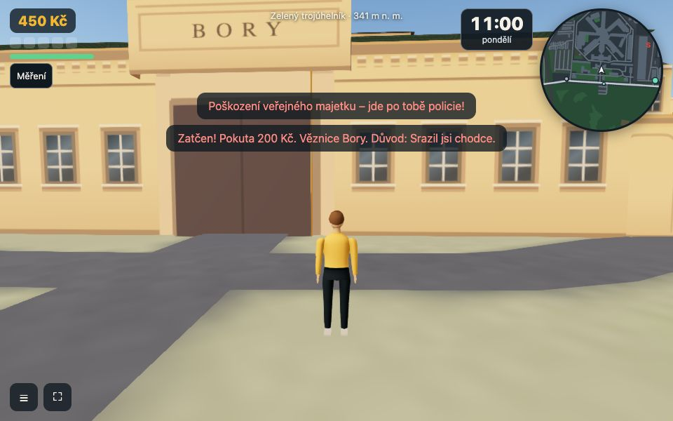

# E46 · Služebny a návrat po zatčení

Výchozí revize hlavní větve je `b400b34`. Po zatčení za běžný přestupek hra postaví hráče na pěší místo u nejbližší služebny vzdušnou čarou od místa dopadení. Sražení chodce vlastním řízeným autem vede po dopadení před bránu na Borech. Hvězdy dál řídí pronásledování. Další menší přestupek, pokles počtu hvězd ani uložení a načtení probíhající honičky nesmažou závažnější čin. Po úniku, zatčení nebo ošetření začíná nové pátrání od začátku.

Zpráva uvádí místo, příčinu a skutečně odečtenou pokutu. Po návratu stojí postava čelem ke služebně nebo bráně. Na velké mapě lze najít například „služebna Rokycany“ a přiblížením zobrazit modré značky. Pro srovnání jsou přiložené dva záběry po zatčení za stejný čin.

## Jak vznikl výběr míst

Prošli jsme všech 33 původních policejních bodů ve světových datech, včetně 15 bezejmenných, a porovnali je s veřejnými adresáři. Nový seznam má 25 míst pro návrat. Zahrnuje území celé mapy až po Dobřív. Plzeňský okrsek nebo obec obsluhovaná z jiného města nemusí mít vlastní služebnu. Při hraní se žádná externí služba nedotazuje.

| Oblast | Místa použitá pro návrat | Ověření |
| --- | --- | --- |
| Plzeň, Policie ČR | Střed, Bory, Skvrňany, Vinice, Plzeň 1, 2 a 4 | [Městské ředitelství](https://policie.gov.cz/plzensky-kraj/mestske-reditelstvi-policie-plzen) |
| Plzeň, městská policie | Lochotín, Slovany, Střed, Bory, Doubravka, Skvrňany a služebna celoměstských činností | [Adresář MP Plzeň](https://mpplzen.cz/kontakt/) |
| Plzeň, další služebny | Vinice, Radčice a služební místnost na hlavním nádraží | [Vinice](https://mpplzen.cz/aktuality/nova-sluzebna-strazniku-na-lochotine-moderni-a-prostornejsi-zazemi-pro-efektivni-praci/), [Radčice](https://umo7.plzen.eu/zivot-v-obvodu/organizace-a-instituce/), [nádraží](https://mpplzen.cz/aktuality/mestska-policie-slavnostne-otevrela-novou-sluzebni-mistnost-na-hlavnim-vlakovem-nadrazi-v-plzni/) |
| Rokycany | Obvodní oddělení v Jiráskově ulici a městská policie u radnice | [Policie ČR](https://policie.gov.cz/kontakty-rokycany), [město Rokycany](https://rokycany.cz/assets/File.ashx?id_dokumenty=909648&id_org=14069) |
| Hrádek | Obvodní oddělení a městská policie. Hrádek slouží ve hře i při návratu z Dobříva. | [Obvodní oddělení](https://policie.gov.cz/kontakty-rokycany), [město Hrádek](https://www.mestohradek-ro.cz/mesto/mestska-policie/) |
| Starý Plzenec a Chrást | Policejní stanice | [Starý Plzenec](https://bezpecnaplzen.eu/policejni-okrsky/plzen-jih/oid_2-e/okrsek-e.aspx), [Chrást](https://policie.gov.cz/clanek/policejni-stanice-chrast-752528.aspx) |
| Třemošná a Horní Bříza | Obvodní oddělení v Třemošné a městská policie v Horní Bříze | [Policie ČR](https://policie.gov.cz/plzensky-kraj/uzemni-odbor-plzen-venkov), [město Horní Bříza](https://www.hornibriza.eu/obcan/mestska-policie/adresa-kontakty/) |

Souřadnice adres vycházejí z [adresních bodů RÚIAN, ČÚZK](https://ags.cuzk.gov.cz/arcgis/rest/services/RUIAN/MapServer/1), upravených pro herní svět ([licenční podmínky](https://cuzk.gov.cz/Predpisy/Podminky-poskytovani-prostor-dat-a-sitovych-sluzeb/Podminky-poskytovani-prostorovych-dat-CUZK.aspx)). U městské policie v Hrádku poskytla jméno a umístění dvojice oddělených bodů stávající mapa OSM. U nádraží a věznice odpovídá nástupní místo již vymodelovanému předprostoru. Každá výsledná pozice je ručně převzatý herní bod vně budovy, na suché zemi, mimo jízdní pruh a kolej. Skutečné umístění každých jednotlivých dveří nebylo zaměřeno v terénu.

Specializovaná pracoviště, například tisk a prevence v Plzni, dopravní inspektorát v Rokycanech nebo dva blízké body u dálničního oddělení ve Svojkovicích, nejsou cílem návratu. U druhé rokycanské služebny v Dělostřelců jsme našli zmínku v městské kronice, současný provoz se nepodařilo potvrdit. Proto hra používá radnici a obvodní oddělení.

## Ověření

Prošlo produkční sestavení a všech 350 jednotkových testů. V Chromiu prošlo všech 48 cílených zkoušek zatčení, mapy, pokut, zakázek, směn a ukládání přes WebGL 2 a WebGPU. Test míst návratu načetl okolí všech 25 služeben i věznice a ověřil volné místo pro postavu mimo budovy, vodu, koleje a jízdní pruhy. Další test zasáhl chodce během prodlevy mezi dvěma přestupky, snížil počet hvězd, uložil a načetl hru a nechal hlídku hráče dopadnout. Následující zatčení za drobný přestupek v Rokycanech vedlo zpět k radnici.

V nízké předvolbě při 1920 × 1080 na Apple Metal vyšel medián startu 2,93 s, jízda 59,1 snímku/s a let 60,0 snímků/s. Stejné výsledky měla E45. Práce na snímku v 95. percentilu činila 4,8 ms při jízdě a 2,8 ms při letu (E45 měla 4,8 a 2,7 ms). Fyzika, herní logika, příprava vykreslení i GPU se vešly do svých rozpočtů.
