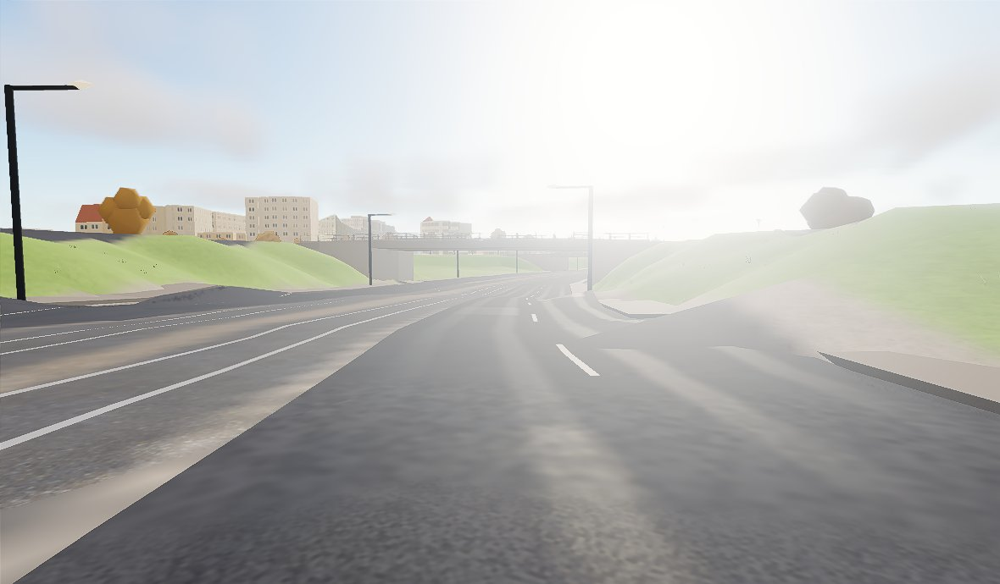
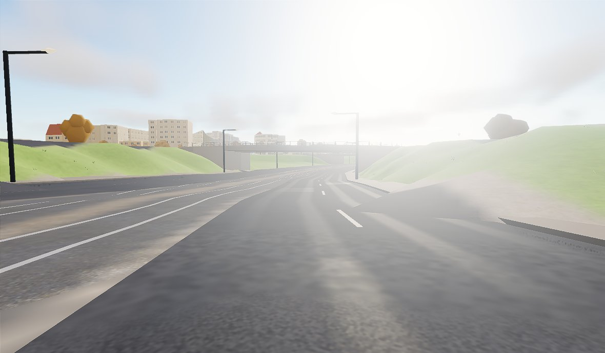

# E49 · Plynulá jízda po silnicích

Na severním příjezdu po Karlovarské byla nejvýraznější vlna ještě před Rondelem. Uprostřed dvanáctimetrového úseku se vozovka v jednom směru odchylovala od spojnice jeho konců o 49 cm, v protisměru o 46 cm. Po opravě v obou směrech vychází nejvýše 4 cm. Při zkušební jízdě zůstala všechna čtyři kola na zemi. Výchozí revize je `80c3688` (E48).

## Jak opravu vyzkoušet

Po Karlovarské jeď od Lochotína směrem do centra. Drž se hlavního jízdního pásu, pokračuj pod Rondelem a vrať se stejnou silnicí opačným směrem. Sleduj pohyb auta a čáry mezi pruhy už na posledních sto metrech před okruhem. Na horní okruh se jako dřív najíždí odbočovacím pruhem.

| Severní příjezd ke stejnému mostu | |
| --- | --- |
|  |  |

## Výsledek na celé mapě

Kontrola zahrnula všech 18 481 dílů silnic pro auta o celkové délce 2 564,03 km. Protisměrné jízdní pásy uložené zvlášť se počítají samostatně. Vzorky leží nejvýše dva metry od sebe na ose a v dalších dvou stopách po stranách. Na délkách 4 a 12 m se počítá odchylka prostředního bodu od spojnice koncových bodů. Rovnoměrné stoupání má proto nulovou odchylku. Kontrola na spojích pokračuje ve stejné stopě na přímo navazující ulici, také tehdy, má-li v mapě opačné pořadí bodů.

| Kde se měřilo | Délka a mez odchylky | Počet vzorků | Nad mezí před | Nad mezí po |
| --- | --- | ---: | ---: | ---: |
| Uvnitř dílů | 4 m, nad 5 cm | 3 707 829 | 16 359 | 3 294 |
| Přes spoje | 4 m, nad 5 cm | 56 463 | 3 957 | 1 135 |
| Uvnitř dílů | 12 m, nad 15 cm | 3 496 455 | 9 800 | 3 533 |
| Přes spoje | 12 m, nad 15 cm | 159 663 | 8 802 | 1 810 |

Po sečtení vnitřních vzorků a spojů ubylo krátkých překročení o 78 % a delších o 71 %. Jedna nerovnost se může objevit ve více sousedních vzorcích. Alespoň jedno překročení mělo před opravou 4 690 dílů, po opravě 1 477. Mezi zbývajícími místy je například úsek Tyršovy (38 cm na 12 m) a účelová cesta u obchvatu Rokycan (105 cm na 12 m). Měření celé sítě čte výšku povrchu jednotlivých jízdních pásů. Skutečnou jízdu a kolize jsme ověřovali na vybraných trasách.

[Tabulka všech úseků, měření před a po a GPS největší delší vlny](E49/silnice.csv). Prázdná buňka znamená, že se na daný díl nevešla spojnice dané délky nebo chybělo průběžné napojení. Měření se dá zopakovat příkazem `node tools/audit_road_ride.mjs`. Přepínač `--rondel` omezí výstup na okolí Rondelu.

## Co určuje výšku silnice

Vyhlazení sleduje směr navazujících ulic přes hranice jednotlivých mapových dílů. U hlavních tahů čte výšky z delšího okolí. V křižovatce se spojí podélný i příčný sklon sousedních pruhů podle vzdálenosti od jejich os. Asfalt a podklad pro kola se na okrajích upravených míst plynule přiblíží k terénu.

Spodní průjezd Karlovarské má vlastní souvislý profil. Horní okruh dál používá měřenou výšku mostovek. U osmi krátkých zakrytých průjezdů určuje výšku podlahy také odkrytá část příjezdu. Podlaha a boky mají vlastní geometrii pro kola i pro obraz, zatímco povrch náspu nese horní cestu. Tam, kde se pod zemí stýkají dva pruhy, sdílejí výšku v místě rozvětvení. Výška těchto podlah je odhad z výškopisu. Samostatná zaměření jednotlivých portálů nejsou součástí dat. [Pohled z průjezdu v Regensburské](E49/regensburska.jpg)

Prodloužené příjezdy k měřeným mostovkám vznikly ze stávajících dat OpenStreetMap, výškopisu a modelu povrchu ČÚZK. Upravená datová vrstva obsahuje 31 766 výškových bodů, 24 horních pásů a 34 částí nájezdů. U Vinohradské nyní navazuje krátká spojka z mostu i protější ulice na stejnou výšku a sklon. [Použité podklady, měření a licence](E48.md)

## Ověření

- Přímo v místech dřívějších vln na Karlovarské byla minimální rychlost ve dvanáctimetrovém okně 89,0 a 89,9 km/h. Na jednom z nich před opravou ztratilo aspoň jedno kolo kontakt ve 37 krocích simulace a ve třech krocích se odlepila všechna kola. Po opravě byl počet kroků bez kontaktu nulový na obou pásech. Na zvoleném dálničním úseku dosáhlo stejné auto 119 km/h a všechna kola držela kontakt.
- Fyzikální zkoušky ověřují průjezdnost všech osmi dodatečně oddělených podjezdů včetně podkladu za oběma portály, oddělení 110 silničních a železničních křížení a návaznost u Wilsonova mostu, Valíku i hlavního nádraží. Ve všech 320 kontrolních místech předchozí etapy zůstává čtyřmetrová nerovnost pod koly menší než 10 cm.
- Prošlo produkční sestavení, 360 testů JavaScriptu, 33 testů Pythonu a 26 cílených zkoušek v Chromiu. Zkoušky zahrnují WebGPU i WebGL 2, rozpočty všech čtyř grafických předvoleb, průjezd pod Rondelem i po horním okruhu a rychlou jízdu na třech úsecích.

## Výkon

Měřeno na stejném počítači jako E48, v Chromiu přes WebGPU (Apple Metal), na nízkou předvolbu při 1920 × 1080. Nástroj `tools/measure_map.mjs` použil `--work --paced`. Při samostatném běhu byl prostřední ze tří časů spuštění 5,00 s proti 4,77 s. Při jízdě vyšlo 58,7 proti 59,2 snímku za sekundu, za letu v obou verzích 60.

| Jízda, 95. percentil | E48 | E49 |
| --- | ---: | ---: |
| Fyzika | 1,1 ms | 1,1 ms |
| Logika | 0,6 ms | 1,0 ms |
| Příprava vykreslení | 2,5 ms | 2,7 ms |
| Celá práce snímku na procesoru | 4,3 ms | 4,8 ms |
| Grafický čip | 9,04 ms | 9,90 ms |

Práce procesoru za jízdy vzrostla o 0,5 ms (12 %). Vyhodnocení jízdní plochy nově zohledňuje překrývající se jízdní pásy i přechody mezi povrchy. Měření celé herní smyčky příspěvek jednotlivých změn nerozlišuje. Všechny dílčí hodnoty zůstaly v rozpočtu. Za letu vyšel 95. percentil práce procesoru 3,1 ms proti dřívějším 3,0 ms. Fyzický telefon jsme v této etapě neměřili.
