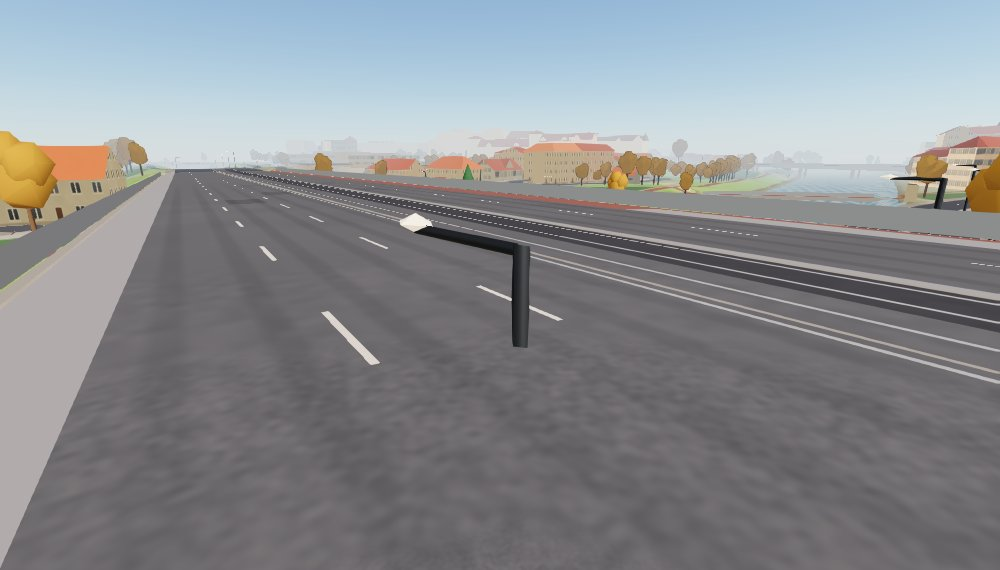
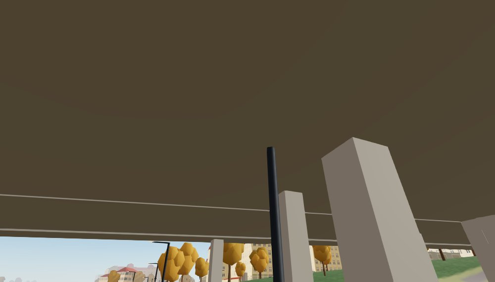

# E50 · Lampy pod mostem Generála Pattona

Lampa na hráčově snímku stojí v Jízdecké u jižního konce mostu. Její výložník přesahoval přibližně 1,7 m nad jízdní pruh. U severního konce vyčnívalo také svítidlo z Lochotínské. Nově se výška sloupu přizpůsobuje spodnímu líci mostovky po celé délce výložníku. Stejnou výšku používá vykreslení, noční světlo i fyzika sloupu.

| Umístění ve hře | Původní výška sloupu | Nová výška | Mezera nad vrcholem svítidla pod deskou |
| --- | ---: | ---: | ---: |
| Jízdecká | 9,00 m | 6,06 m | 17 cm |
| Lochotínská | 6,20 m | 4,78 m | 20 cm |

Výšky jsou měření herních modelů. Pravidlo platí i pro ostatní mosty na mapě a zohledňuje více mostovek nad sebou. Tam, kde ani po zkrácení nezbývá na stojací lampu 4,5 m, hra tento sloup vynechá.

## Stejné místo před opravou a po ní

| Pohled | Před opravou | Po opravě |
| --- | --- | --- |
| Z jízdního pruhu nad Jízdeckou |  |  |
| Z Jízdecké pod mostem |  |  |

Výchozí revize `841827d`. Podkladem jsou stávající herní silnice z OpenStreetMap, výšky terénu ČÚZK a model mostu ve hře. Snímky pocházejí z produkčního sestavení a mají shodnou polohu kamery a denní dobu.

## Ověření ve hře

Auto přejelo po mostě přímo nad každým z obou sloupů. V okamžiku přejezdu mělo rychlost 44,7 km/h, všechna čtyři kola na vozovce a střed vozu minul osu sloupu o méně než 3 cm. V obou případech pokračovalo ještě přes 11 m za sloup. Zkouška proběhla v Chromiu s fyzikou Jolt.

Jednotkový test zahrnuje dvě desky nad sebou, překryv pouze nad výložníkem a nízký podjezd. Prohlížečový test hledá obě konkrétní lampy v datech města, měří mezeru nad svítidlem a ověřuje skutečnou výšku jejich pevných sloupů ve fyzice.

Prošlo produkční sestavení a všech 361 jednotkových testů JavaScriptu. V Chromiu prošlo všech 20 cílených zkoušek osvětlení a rozbitného vybavení, po deseti přes WebGL 2 a WebGPU.

## Výkon

Nástroj `tools/measure_map.mjs` měřil na stejném počítači jako E49 v Chromiu přes WebGPU, v nízké předvolbě při 1920 × 1080. Časy v tabulce jsou 95. percentily.

| Jízda autem | E49 | E50 |
| --- | ---: | ---: |
| Snímky za sekundu | 58,7 | 59,2 |
| Fyzika | 1,1 ms | 1,3 ms |
| Herní logika | 1,0 ms | 0,7 ms |
| Příprava vykreslení | 2,7 ms | 2,5 ms |
| Práce grafického čipu | 9,90 ms | 8,98 ms |
| Celková práce na CPU | 4,8 ms | 4,6 ms |

Čas fyziky při jízdě vzrostl o 0,2 ms (18 %), při letu zůstal na 0,5 ms. Přesnou příčinu rozdílu nelze z jednoho průjezdu určit. Všechny čtyři sledované části snímku se vešly do rozpočtu. Při letu hra v obou verzích dosáhla 60 snímků za sekundu.
