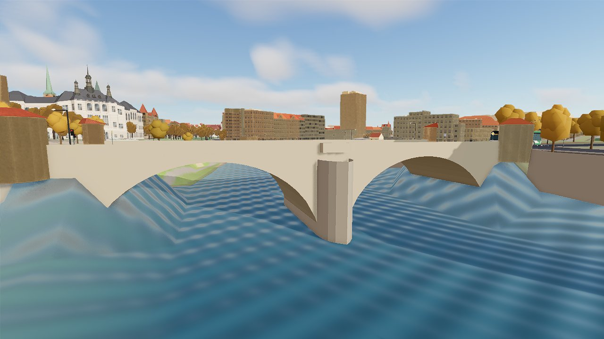
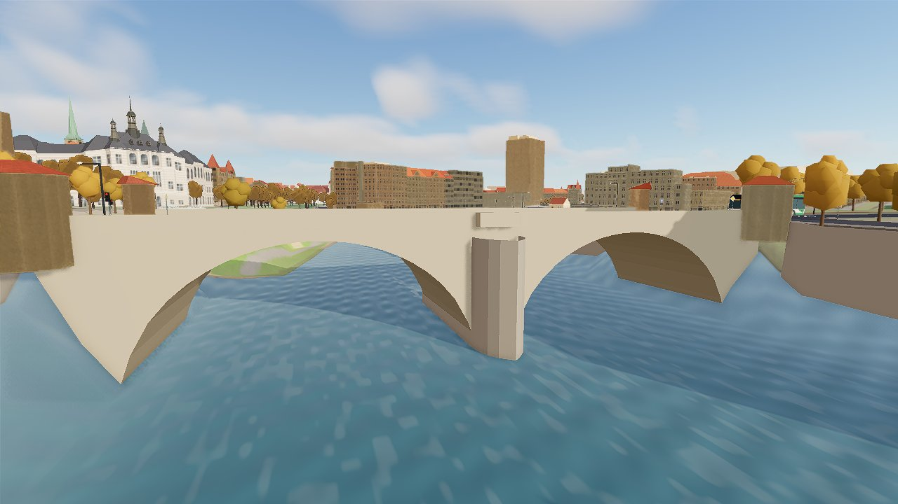
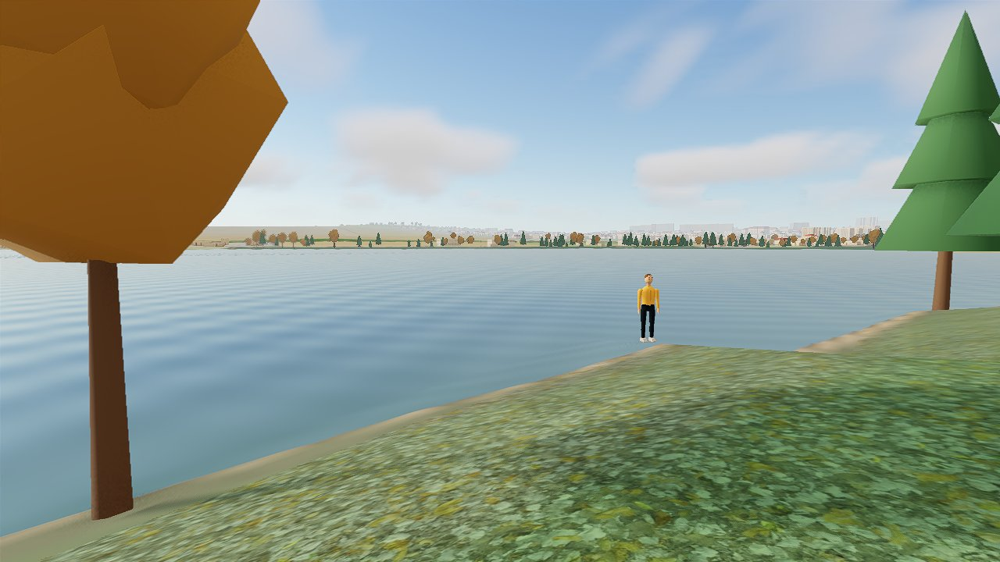
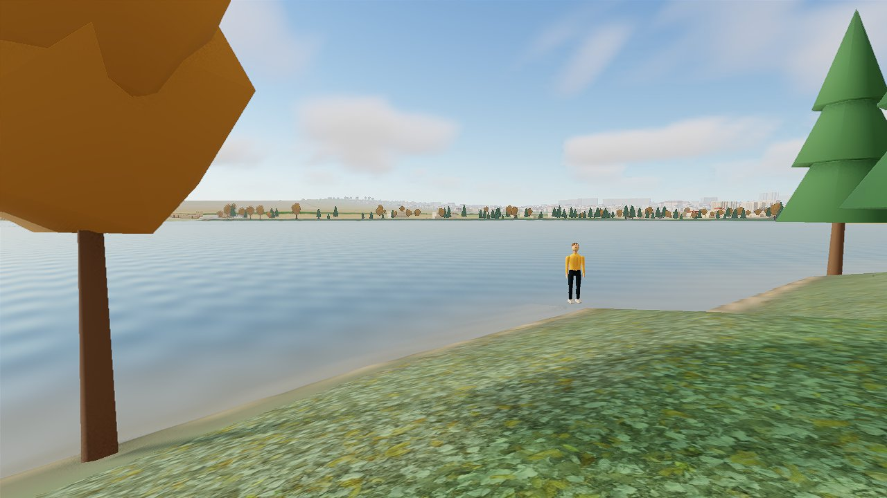

# E51 · Voda u Wilsonova mostu a u Ostende

Výchozí revize je `5eeaae8`, herní revize `8de0482`. Úprava platí na Radbuze v okolí Wilsonova mostu a u severního břehu Boleváku. Hráč se u Ostende nejdřív brodí a v hlubší vodě začne plavat. U Wilsonova mostu jej proud unáší po řece, i když pustí ovládání. Stejný proud působí na plovoucí auta. Voda u Ostende v klidu postavu na stranu neposouvá.

V obou místech vychází výška hladiny pro obraz, plavání, vztlak i dno ze společného výpočtu. U břehů a na koncích obou oblastí se plynule přimíchávají původní výšky. Úsek Radbuzy končí před jezem nad mostem. Voda má rozdílné vlnění pro řeku a rybník, pěnové stopy se pohybují za středním pilířem a mělčina u Ostende má světlejší písčitý odstín. Po vstupu do vody vznikne na střední a vyšší předvolbě tříšť a krátce se šíří kruh. Výška hladiny, brodění a proud fungují i na nízkou kvalitu.

## Stejné pohledy před úpravou a po ní

| Místo | Před úpravou | Po úpravě |
| --- | --- | --- |
| Radbuza, Wilsonův most |  |  |
| Bolevák, břeh u Ostende |  |  |

Snímky jsou z produkčního sestavení v Chromiu na WebGPU. Kamera, nastavení grafiky, počasí a denní doba jsou v každé dvojici stejné.

## Podklady a známé odchylky

Pobřeží a průběh osy Radbuzy pocházejí ze stávajících herních dat OpenStreetMap (ODbL). Výšky jsou odvozené ze stávajícího terénu ČÚZK. Pěna u mostu vychází z polohy středního pilíře ve stávajícím městském modelu. Průměrná rychlost do 0,55 m/s uprostřed řeky, výška hladiny a tvar dna jsou herní aproximace. Plynutí po celém korytě i změny hladiny podle ročního období zůstávají námětem na další etapu. Zobrazení mělčiny využívá barvu podle vzdálenosti od břehu. [Zdroje a licence](../README.md#zdroje-a-licence-dat) · [Profil pláže Ostende](https://mze.gov.cz/public/portal/mze/-q356813---W4Q-lY7b/velky-bolevecky-rybnik)

## Jak novou vodu zkusit ve hře

1. Od Wilsonova mostu sejdi k Radbuze a doplav dost daleko od břehu. Pusť ovládání a sleduj svůj pohyb vzhledem k pilíři. Pak chvíli plav proti proudu a otoč se po proudu.
2. U Ostende vejdi do Boleváku od břehu a chvíli se broď. Pokračuj do hlubší vody a na chvíli zastav. Při návratu na mělčinu by se měla postava znovu postavit na dno.
3. Na střední a vyšší kvalitě sleduj tříšť a kruh při vstupu z břehu nebo při dopadu. Původní podobu pro porovnání otevře přepínač `?voda=puvodni`.

## Ověření

Zkoušky kontrolují, kam se plavec a auto v proudu posunou, přechod postavy z chůze přes brodění do plavání a návrat z vody. Při pádu do Radbuzy sledují vznik kruhu a tříště, polohu plavce i výšku skutečně kreslené hladiny. Prohlížečové zkoušky E20 nadále prověřují vozidlo s vyčnívající střechou na mělčině i úplné potopení v hluboké nádrži.

Zkouška průplavu pod Wilsonovým mostem měří stejných 24 m a zachovává mez 35 cm vůči nově společné hladině i minimální volnou výšku 1,8 m. Proti proudu může plavec použít až 24 sekund. Suchý průchod pod lávkou U Prazdroje si ponechal 16 sekund. Původní měřené rozdíly mezi odstíny vody u mostu také zůstaly zachovány.

Prošlo všech 365 testů JavaScriptu a produkční sestavení. Na stejném sestavení bylo v Chromiu spuštěno 52 cílených zkoušek, po 26 na WebGL 2 a WebGPU. Úspěšných bylo 50. Prošly zkoušky vody, chůze, všech čtyř grafických předvoleb i všech referenčních pohledů. Jediný neúspěšný scénář na obou vykreslovačích měří jas světlometu startovního auta. Stejný výřez klesl přibližně na 182 při minimu 190 i ve čtyřech opakováních na původní E50. Výsledek se zopakoval i s vypnutou novou vodou. Při jedné samostatné zkoušce E50 světlomet prošel.

## Výkon

Chromium s WebGPU (Apple Metal), 1 920 × 1 080, pevná předvolba. Jízdu a let měřil nástroj `tools/measure_map.mjs --work --paced`. Časy jsou 95. percentily v milisekundách.

| Nízká předvolba | Snímky/s před → po | Fyzika před → po | Logika před → po | Příprava obrazu před → po | GPU před → po |
| --- | ---: | ---: | ---: | ---: | ---: |
| Jízda | 56,2 → 59,0 | 1,0 → 1,1 | 0,7 → 0,7 | 2,9 → 2,6 | 9,63 → 9,57 |
| Let | 60,0 → 60,0 | 0,5 → 0,5 | 0,3 → 0,3 | 2,2 → 2,0 | 6,95 → 8,85 |

Nová verze na nízkou předvolbu ve všech čtyřech složkách splnila rozpočet pro jízdu i let. Prostřední čas ze tří spuštění vyšel 5,07 s před změnou a 5,17 s po ní. Při opakování s obráceným pořadím sestavení trval let stejných 250 m při 60 snímcích/s a GPU vyšlo 6,88 → 6,95 ms. První nárůst o 27 % se tedy při opakování neprojevil. Let proběhl mimo upravené úseky se shodnými 55 voláními a 145 496 trojúhelníky. V opakované jízdě obě verze ujely 102 m při 59 snímcích/s. Čas GPU vyšel 12,71 ms v původní verzi a 9,70 ms po úpravě. Rozdíly mezi běhy ukazují kolísání zátěže.

| Vysoká předvolba, pevná kamera | Příprava obrazu před → po | GPU před → po | Volání v posledním snímku před → po |
| --- | ---: | ---: | ---: |
| Wilsonův most | 6,0 → 6,3 | 11,46 → 12,50 | 864 → 911 |
| Ostende | 3,3 → 3,6 | 9,51 → 8,99 | 238 → 244 |

Pětisekundový vzorek na vysokou kvalitu u mostu mírně překročil cíl 6 ms pro přípravu obrazu a 12 ms pro grafický čip. Počet objektů vykreslovaných během dvou běhů se lišil. Samostatné srovnávací snímky z pevné kamery u mostu měly shodně 618 volání a přibližně 1,23 milionu trojúhelníků. U Ostende se kvůli jemnější síti u břehu zvýšil počet trojúhelníků z 421 828 na 446 404 při stejném počtu volání. Měření proběhlo na počítači.
