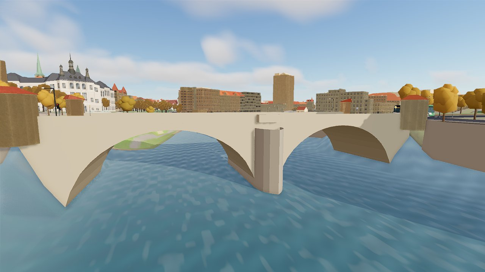
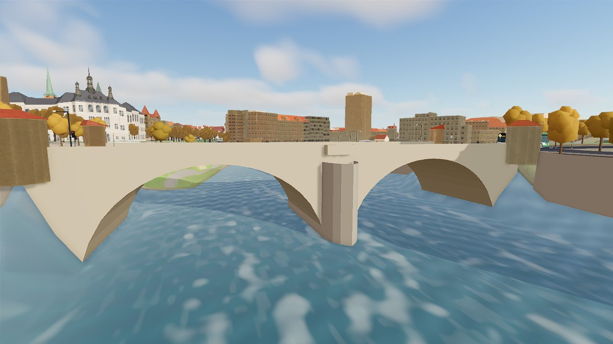

# Viditelný proud v řekách

Navazuje na revizi `5c21c37` z etapy E51. Drobné světlé stopy se pohybují ve směru toku z mapových dat. Jsou čitelnější z břehu a z mostu. V mělké vodě a při pohledu z dálky zeslábnou. Kde mapa žádný proud neurčuje, hladina si ponechá obyčejné vlnění.

Stopy využívají stávající mapu směru vody. Na nízké předvolbě se ta načte pouze u vodních ploch v blízkosti mapovaného toku. Materiál kreslí efekt do samotné hladiny. Obě verze pod Wilsonovým mostem při stejné kameře potřebovaly 618 vykreslovacích volání a přibližně 1,23 milionu trojúhelníků.

| Před zvýrazněním | Po zvýraznění |
| --- | --- |
|  |  |

Prohlížečová zkouška pod stejnou kamerou porovnává snímky s odstupem jedné sekundy. Na Radbuze mají stopy nejvyšší shodu po posunu po proudu. Na Boleváku se při stejném posunu obraz neshoduje lépe než bez posunu. Zkouška běží na nízké předvolbě v obou vykreslovačích.

## Ověření a výkon

Prošlo produkční sestavení a všech 365 testů JavaScriptu. V Chromiu prošlo 28 různých cílených zkoušek na WebGL 2 a WebGPU. Zahrnují směr pohybu stop, barvu vody, plavání, potápění, jezy, referenční pohledy i rozpočet všech čtyř předvoleb.

Měřeno na Apple Metal v Chromiu přes WebGPU při 1 920 × 1 080. U Wilsonova mostu běžela hra s pevnou kamerou a bez automatické změny rozlišení. Hodnoty jsou 95. percentily.

| Předvolba | Příprava obrazu před → po | GPU před → po |
| --- | ---: | ---: |
| Nízká | 2,2 → 2,5 ms | 10,71 → 9,10 ms |
| Vysoká | 6,2 → 6,5 ms | 14,21 → 14,97 ms |

Na nízkou kvalitu přibyly textury směru vody. V závěrečném snímku bylo 114 textur oproti 81. Příprava obrazu přitom zdražila o 0,3 ms a vešla se do cíle 6 ms. Na vysokou kvalitu u mostu překračovaly obě verze cíl 6 ms v přípravě obrazu i 12 ms na GPU. Jde o jednotlivé běhy a počet viditelných vozidel a volání v nich kolísal.

Samostatný průjezd a přelet nástrojem `tools/measure_map.mjs --work --paced` na nízkou předvolbu splnily všechny čtyři časové rozpočty. Při jízdě vyšlo 59,2 snímku/s a GPU 9,57 ms, při letu 60 snímků/s a GPU 6,75 ms.
