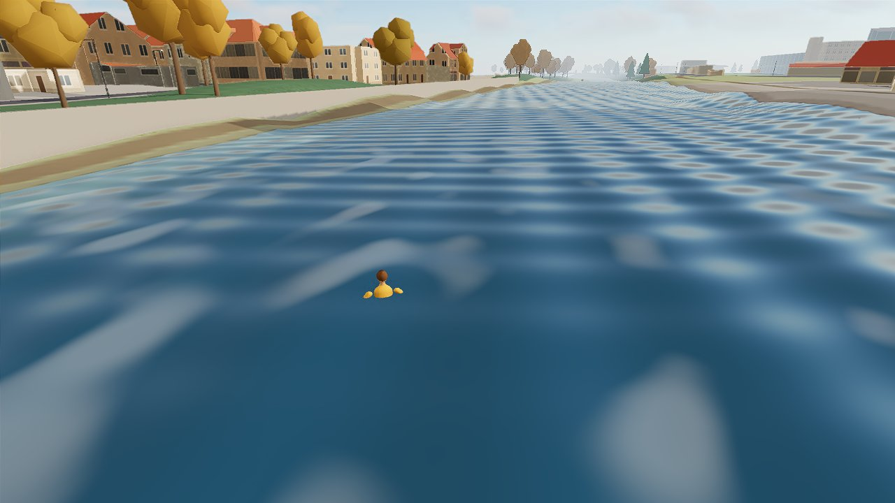

# Fyzika vody na celé mapě

Výchozí revize je `c863230`. V místech, kde podklady OpenStreetMap obsahují plochu vody a osu toku, voda unáší plavce a plovoucí auta ve směru osy. U břehu tah proudu slábne. Osa sousedního toku za hrází rybník nerozhýbe. Na vodních plochách se postava může brodit a podle hloubky přejít do plavání. Brodění a vztlak fungují na všech předvolbách. Po dopadu do vody se na střední a vyšší předvolbě objeví tříšť a krátce se šíří kruh.

Polohu a směr toku dává mapa. Rychlost je herní odhad podle druhu toku. Hloubka se odvozuje od břehu stejnou funkcí jako dno pro kolize. Výšky vody pod Wilsonovým mostem a u Ostende jsou místně doladěné. Jinde výška vychází z výškopisu. Některé úzké potoky jsou v podkladech zakreslené jen čarou a proud se počítá tam, kde je zaznamenaná také vodní plocha. [Zdroje a licence](../../README.md#zdroje-a-licence-dat)

## Pád do Mže

| Před rozšířením fyziky | Po rozšíření fyziky |
| --- | --- |
|  |  |

Snímky mají stejnou kameru, denní dobu a nastavení. Jsou pořízené 43 pevných kroků po umístění postavy tři metry nad vodu.

## Ověření a hraní

- Na Mži postava bez ovládání za pět sekund ujela 2,51 m na východ a 0,57 m na sever.
- V Kamenném rybníku se plavec po puštění ovládání neposunul. Při vstupu ze severu se nejdřív brodil a dál začal plavat.
- Na Radbuze jižně od pilotního úseku proud posunul plovoucí auto přibližně o metr za 2,9 s od jeho umístění nad hladinu. Testy potápění dál pokrývají také mělčinu a hlubokou nádrž.
- Proud lze vyzkoušet na Mži v centru. Stačí doplavat doprostřed a pustit ovládání. Na břehu Kamenného rybníka je vidět přechod z brodění do plavání. Přepínač `?voda=puvodni` otevře původní chování pro srovnání.

Prošlo produkční sestavení, 366 testů JavaScriptu a 42 cílených zkoušek v Chromiu na WebGPU a WebGL 2. Zkoušky zahrnuly vodu, jezy, postavu, referenční pohledy a rozpočty vykreslování.

## Výkon

Měřeno na počítači v Chromiu na WebGPU (Apple Metal), 1 920 × 1 080, na nízkou předvolbu. Jízda a let jsou desetisekundové vzorky z `tools/measure_map.mjs --work --paced`. U plavání se měřilo pět sekund ze stejné pevné kamery. Časy jsou 95. percentily v milisekundách.

| Situace | Fyzika před → po | Logika před → po | Příprava obrazu před → po | GPU před → po |
| --- | ---: | ---: | ---: | ---: |
| Jízda, opakované měření | 1,4 → 1,4 | 0,6 → 0,8 | 2,7 → 2,8 | 9,31 → 11,73 |
| Let, opakované měření | 0,5 → 0,5 | 0,3 → 0,3 | 1,8 → 2,0 | 9,04 → 9,31 |
| Plavání v Mži | 1,1 → 0,9 | 0,6 → 0,4 | 2,2 → 2,1 | 8,45 → 8,66 |

Jízda v opakování vyšla na 59,1 → 59,2 snímku za sekundu, let na 60 v obou verzích. Hranice 12 ms pro GPU byla při první jízdě překročená o 0,52 ms. V opakování splnila nová verze všechny čtyři časové rozpočty. Vyšší naměřený čas GPU při jízdě doprovázelo více práce pro grafiku. V posledním snímku bylo 149 volání a 213 619 trojúhelníků oproti 139 voláním a 207 505 trojúhelníkům před změnou. Běžící provoz a jiné okamžiky snímků mezi průjezdy omezují srovnatelnost. V pevném pohledu na Mži vzrostl čas GPU o 2,4 %. Skutečný telefon nebyl součástí měření.
