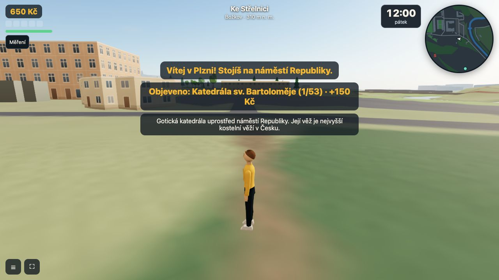
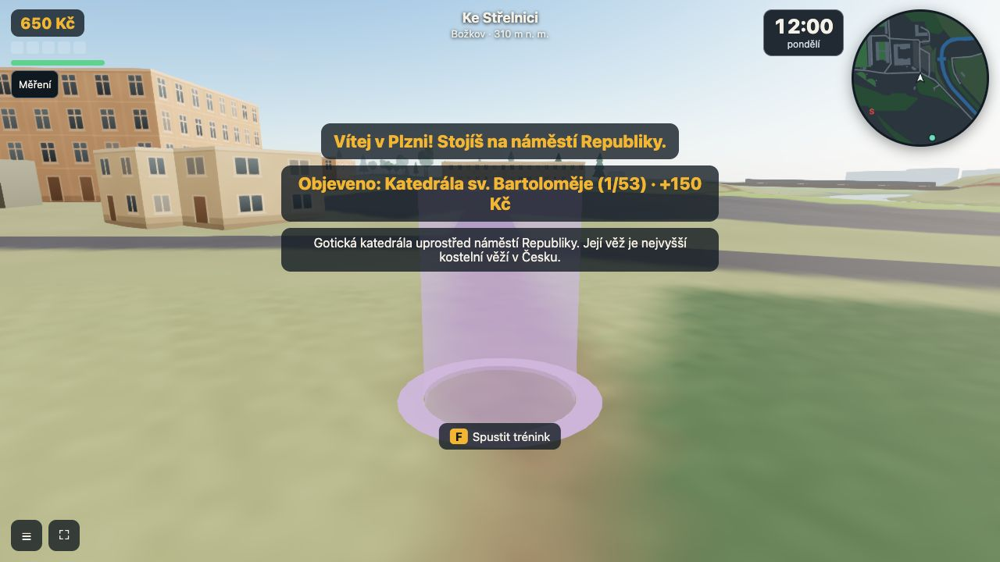
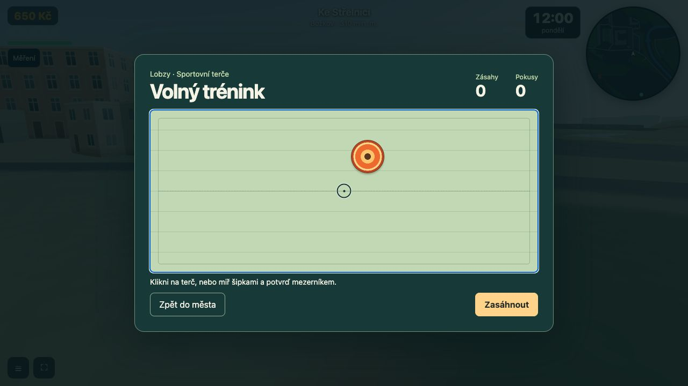

# E58 · Volný trénink terčů v Lobzích

První krok etapy vznikl na větvi `etapa/E58` z revize `b2c8a60`. Na mapě vyhledej **terče**, vyber **Sportovní terče v Lobzích** a klepni na **Navigovat sem**. Dojdi pěšky k fialové značce u ulice Ke Střelnici. Klávesa **F** nebo tlačítko **Spustit trénink** otevře hrací plochu.

## Jak si zahrát

- Na počítači klikni na oranžový kotouč. Můžeš také posouvat kroužek šipkami a potvrdit mezerníkem.
- Na telefonu klepnutím nebo tažením nastav kroužek a potom stiskni **Zasáhnout**. Kotouč se během míření dál pohybuje.
- Plocha počítá pokusy a zásahy. Po zásahu se za 0,65 sekundy objeví další kotouč. Tlačítko **Zpět do města** nebo klávesa **Esc** trénink ukončí. Další trénink začne od nuly. Po obnovení stránky během tréninku se hráč vrátí ke vstupu.

## Místo a podklady

Pro herní stanoviště jsme vybrali bod (2874, 1142) na pěší cestě podle stávající místní kopie OpenStreetMap (ODbL). V prohlížeči postava ušla s běžnou fyzikou přibližně 42 metrů od bodu (2838, 1117) ke vstupu a dostala výzvu na pěšině mimo vozovku. Stanoviště je smyšlené. Hrací plocha, kotouč a kroužek jsou vlastní grafika projektu.

| Před změnou | Po změně |
| --- | --- |
|  |  |

[Volný trénink v dotykovém zobrazení 375 × 667](E58/dotyk.jpg)

## Ověření a výkon

Prošlo produkční sestavení a 424 testů JavaScriptu. Čtyři cílené zkoušky v Chromiu pokryly mapu, pěší příchod, pohyb kotouče, minutí, zásah, další kotouč a nový začátek v režimech WebGL 2 a WebGPU. Myš a emulovaný dotyk prošly v obou režimech. Na počítači prošlo také posunutí kroužku šipkou a potvrzení mezerníkem. Dvě další zkoušky ověřily původní vyhledání Škodalandu. Na dotyku zkouška ověřila návrat ke vstupu po obnovení stránky. Ovládání na fyzickém telefonu zbývá vyzkoušet.

Samotný trénink během desetisekundového měření na nízkou předvolbu (1280 × 720) běžel při 60 FPS. Z 600 intervalů mezi snímky bylo 95 % nejvýše 16,8 ms. Město po dobu tréninku stojí a hra znovu nevykresluje jeho 3D scénu.

Srovnávací jízda po Prokopově nástrojem `tools/measure_map.mjs --pizza --paced` použila stejný šedesátimetrový úsek jako E69, nízkou předvolbu, Full HD a WebGPU na Apple Metal. Vyšla na 59,0 FPS, v předchozí etapě na 59,0 až 59,1 FPS. Logika se pohybovala mezi hodnotami z obou měření E69. Všechny čtyři časy skutečné práce splnily rozpočet.

| 95. percentil | E69, dvě měření | E58 | Rozpočet |
| --- | ---: | ---: | ---: |
| Fyzika | 1,40 / 1,40 ms | 1,40 ms | 4 ms |
| Logika | 0,70 / 1,10 ms | 0,80 ms | 2 ms |
| Příprava obrazu | 2,20 / 2,30 ms | 2,20 ms | 6 ms |
| GPU | 8,85 / 8,98 ms | 8,91 ms | 12 ms |

## Další krok

Na volný trénink může navázat bodovaná série deseti samostatných terčů s výsledkem a osobním rekordem.
