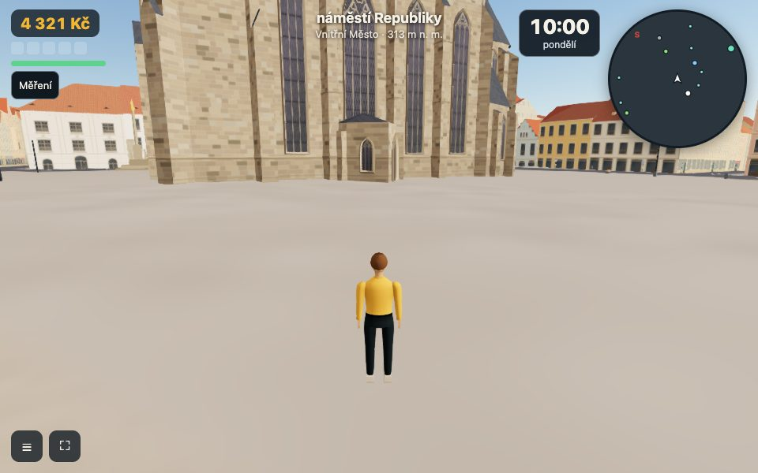
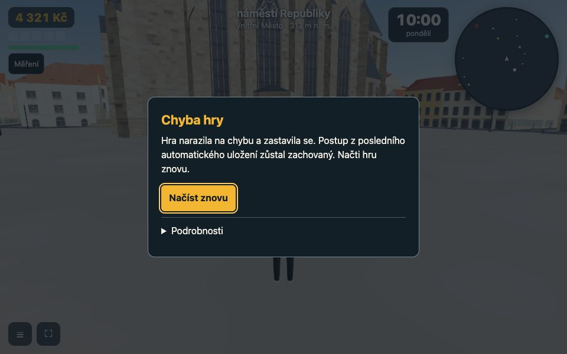

# E85 · Pojistka při chybě za běhu

Výchozí revize je `f390c7b`. Úpravy hry končí revizí `8856d69` a prohlížečové zkoušky
jsou v revizi `27a94a5`. Etapa vychází z [auditu kódu](audit-2026-11-28.md) a
[zadání E85](codex/E85.md). Pojistka obaluje běžnou herní smyčku včetně fotorežimu.
Posledních deset zpráv zůstává v paměti karty.

## Co se děje při chybě

Při chybě se zbytek snímku vynechá. Jednorázové stisky z klávesnice a dotyku se vyčistí
i po výjimce, takže se již provedená akce v dalším snímku neopakuje. Třetí chyba snímku
během dvou sekund zastaví animaci a zvuk, uvolní kurzor a vypne ukládání včetně zápisu
při opuštění stránky. Po stisku **Načíst znovu** hra otevře poslední uložený stav.
Ladicí režim přidává rozbalovací výpis s možností kopírování.

Chyba před dokončením startu se zobrazí na načítací obrazovce. Neošetřené chyby a odmítnuté
sliby mimo hlavní smyčku se během hraní zapisují do historie a konzole. Do počítadla
chyb snímku se nezapočítávají. Ruční ladicí krok `__step` výjimku předá volajícímu.

## Ověření

| Kontrola | Výsledek |
| --- | --- |
| `npm test` | 452 z 452, včetně pěti zkoušek počítání chyb |
| `npm run build` | Prošlo |
| `crash-guard.spec.js` | Všech osm scénářů v obou projektech, celkem 16 ověřených průchodů |
| `foot-controls.spec.js` a `game.spec.js` po změně ovládání | 25 z 26. Prošlo i uložení verze 1 a načtení uloženého postupu |

Zkouška časování měří zvlášť spuštění zkušební chyby a reakci hry. Přepínač začne
vyvolávat chyby po třech sekundách od stisku **Hrát**. Dialog se zobrazí po třetím
chybném snímku. Po otevření dialogu stojí simulační čas a zápis uloženého postupu se
nevolá ani při události `pagehide`. Obnovená hra načetla původní zůstatek 4 321 Kč.

První verze zkoušky globálních chyb současně spouštěla zkušební třísekundové zastavení.
Při souběhu prohlížečů na Macu nestihla simulace nasbírat dost snímků před zastavením.
Zkouška teď nejdřív ověří pokračování hry po neošetřených chybách a potom samostatně
vyvolá chybu snímku. Upravená zkouška prošla ve WebGL 2 i WebGPU.

## Známé odchylky

Zkouška volného rozhlížení ve WebGL 2 na tomto Macu selhala při prvním zachycení
kurzoru. Stejné selhání se zopakovalo na výchozí revizi `f390c7b`, v projektu
WebGPU zkouška prošla. Případ zůstává k samostatnému ověření na počítači s viditelným oknem prohlížeče.
Dotykové zkoušky běžely na emulovaném telefonu.

## Výkon

`tools/measure_map.mjs --work --paced` měřil jízdu a let na nízké předvolbě.
Špičku na Klatovské měřil `--rush --paced` při vysoké předvolbě. Každý vzorek trval deset sekund.
Obě revize běžely na Macu ve WebGPU (Apple Metal 3), při rozlišení 1920 × 1080,
za jasného počasí a bez souběžných prohlížečových zkoušek. Časy jsou 95. percentily
v milisekundách. V každé buňce je výsledek před úpravou a po ní.

| Scénář | FPS | Logika | Fyzika | Příprava obrazu | GPU |
| --- | ---: | ---: | ---: | ---: | ---: |
| Nízká předvolba, jízda | 59,1 → 59,0 | 0,8 → 0,7 | 1,3 → 1,1 | 2,5 → 2,5 | 10,68 → 9,76 |
| Nízká předvolba, let | 60,0 → 60,0 | 0,3 → 0,3 | 0,5 → 0,5 | 2,0 → 1,9 | 6,69 → 6,62 |
| Vysoká předvolba, ranní špička | 58,7 → 59,8 | 1,2 → 1,1 | 2,8 → 2,6 | 8,1 → 8,0 | 15,14 → 13,50 |

Na nízké předvolbě se medián času logiky udržel na 0,3 ms při jízdě a 0,1 ms při letu.
Všechny čtyři rozpočty snímku byly v obou verzích splněné. Ve špičce oba běhy
shodně překročily rozpočet přípravy obrazu 6 ms a rozpočet GPU 12 ms. Měření zachytilo
v obou bězích 40 vozidel. Počet jezdících vozidel se lišil, časy grafiky proto slouží
ke kontrole rozpočtu snímku.

## Snímky před úpravou a po ní

Srovnání je z náměstí Republiky v 10.00 na nízké předvolbě ve WebGL 2. Na obou revizích
vyvolávala stejná závada chybu v každém snímku. Do zachycení původního obrazu přibylo
20 neošetřených výjimek a simulační čas dál běžel. Po úpravě se zaznamenaly tři chyby a
hra ukázala možnost obnovení. Na emulovaném telefonu se šířkou 320 px je vidět celý dialog.

| Před úpravou | Po úpravě |
| --- | --- |
|  |  |

[Snímek dialogu na emulovaném telefonu](E85/telefon-320.jpg)

## Kontrola ve hře

1. Za adresu hry přidej `?debug&chyba=trvala` a spusť hraní. Po několika sekundách
   se objeví dialog. Klepni na **Načíst znovu** a ověř, že se vrátí uložený postup.
2. S `?debug&chyba=jednorazova` se hra po prvním chybném snímku dál pohybuje a vykresluje.
3. Na telefonu zkus přečíst celou zprávu a obnovit hru dotykem.
