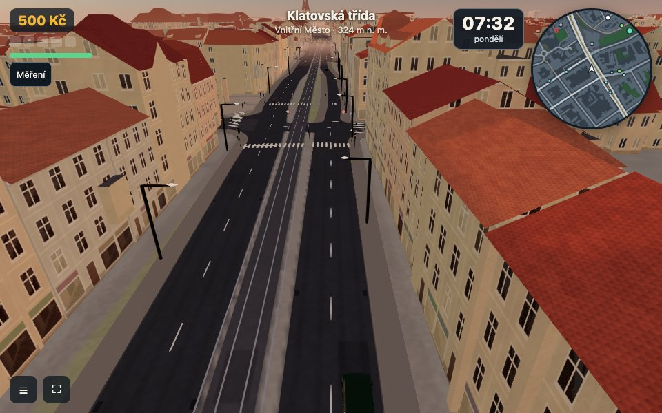

# E86 · Opakovatelný provoz a otisk simulace

Výchozí revize je `ccbf222`, ve které byla převzata E85. Změny hry končí revizí
`13886df` a vzor otisku vznikl v `54deb14`. Zadání navazuje na
[audit kódu](audit-2026-11-28.md). [Zadání E86](codex/E86.md)

## Výchozí opakovatelnost

Na Macu ve WebGPU jsem dvakrát spustil čistou kartu s nízkou předvolbou, jasným
počasím a časem 7.30 dne 9. 11. 2026. Prohlížeč dostal při startu stejný dosavadní
generátor náhody se semínkem 1. Simulace běžela 3 600 kroků po 1/60 s. Záznam vznikal
každých pět sekund. Po deseti sekundách chůze následoval přesun ke dveřím startovního
auta, čtyřicet sekund jízdy se stejným řízením, vystoupení a deset sekund čekání.

| Zkouška | První rozdíl poloh aut | První rozdíl poloh chodců | Výsledek po minutě |
| --- | ---: | ---: | --- |
| Dosavadní generátor nastavený před načtením | 5 s | 5 s | Stejná poloha hráče i 650 Kč. Polohy aut a chodců se lišily |
| Stejné nastavení s obnovou generátoru těsně před prvním krokem | 10 s | 15 s | Poloha hráče se lišila přibližně o 91 m. Oba běhy měly 650 Kč |

Před prvním krokem spotřebovaly původní běhy 18 953 a 18 921 hodnot společné řady.
Hra dříve sdílela tuto řadu s grafikou. Například three.js spotřebuje čtyři hodnoty
pro každý identifikátor objektu. Pořadí tvorby grafických objektů může ovlivnit
síťové načítání detailů a časový rozpočet stavby dlaždic. Obnova generátoru před
prvním krokem odstranila rozdíl při startu a odložila jeho první projev. Rozdíly
v počtu odebraných hodnot se objevily i během simulace.

V obou zkouškách se herní hodiny posunuly shodně o 60 s. Pevné datum a hodina zde
vyloučily přímý vliv skutečného času. Počítadlo rozestavěných dlaždic ukázalo při
všech odečtech nulu. Samostatný vliv síťového detailu na kolize tento pokus neizoloval.

Výchozí měření výkonu je v [protokolu E85](E85.md#výkon). Sestavení použité pro
měření po E85 a výchozí revize E86 mají stejný otisk stromu `5fa0e7d`.

## Referenční minuta

Simulace a vizuální efekty používají dvě samostatné posloupnosti. Rychlost chodce,
volba trasy nebo zakázky používá posloupnost simulace. Barva auta, fáze animace
chůze, třes kamery a částice patří k efektům. Provoz při vytváření vozidel používá
polohu kamery před přidáním otřesu. Ve dvou minutových zkouškách se stejným semínkem
vyšly stejné polohy i po vypnutí částic.

Referenční scénář začíná pěšky na straně ulice u startovního auta. Po deseti sekundách
hráč nastoupí, čtyřicet sekund řídí podle stejné sekvence povelů, vystoupí a deset
sekund čeká. Celkem 13 odečtů zachycuje polohu hráče, režim, peníze, auto, až 20 aut
v provozu, vozy MHD a počet chodců. Polohy jsou uložené v celých milimetrech.

První vzor vznikl ve WebGL 2 s `OTISK_ZAPSAT=1`. Je to výchozí záznam pro další
etapy. WebGPU porovnalo svůj výsledek se stejným souborem. Kontrola patří mezi
základní zkoušky pull requestu. [První vzor](../tests/e2e/otisk/zakladni.json)

Všech pět běhů ve WebGL 2 a všech pět v projektu WebGPU s nativní grafikou
Apple Metal dalo shodný otisk. Při souběhu s dlouhými testy se původní série WebGPU
se zkušebními přepínači pro softwarové vykreslování po třech úspěšných opakováních
přestala posouvat. Celou pětici
WebGPU jsem proto spustil znovu s nativní grafikou. Oba projekty ověřují skutečný
režim vykreslování před porovnáním.

## Hustota dopravy

Na Klatovské a Domažlické se zopakoval [postup E83](E83.md#srovnání-v-ranní-špičce).
Při třech herních minutách od 7.30 na střední předvolbě se po úvodních 30 sekundách
počítala auta v ulici a průjezdy stejným profilem. Na výchozí i upravené revizi
se použila semínka 42, 73, 102 a 330.
Tabulka uvádí průměr ze čtyř vzorků a v závorce jejich rozsah.

| Ulice | Auta v ulici před → po | Průjezdy před → po |
| --- | ---: | ---: |
| Klatovská | 11,08 (10,17–11,63) → 11,40 (9,58–15,12) | 26,50 (25–30) → 24,25 (21–27) |
| Domažlická | 3,81 (2,95–5,13) → 4,00 (2,95–6,04) | 21,25 (20–23) → 20,75 (15–25) |

Rozdíly průměrů jsou menší než rozpětí jednotlivých běhů. Domažlická při semínku 42
měla i po úpravě dlouhé stání. Nejdelší v tomto běhu trvalo 140 s proti 74 s na výchozí
revizi. Čtyři semínka na každou revizi beru jako kontrolní vzorek.

| Před úpravou | Po úpravě |
| --- | --- |
| [](E86/pred.jpg) | [](E86/po.jpg) |

## Známé odchylky v provozu

Desetiminutová ranní špička u Klatovské se semínkem 20261118 zaznamenala nejdelší
stání 479 s na výchozí revizi ve WebGL 2. V posledních třech minutách se auta stojící
v měřeném okolí nepohnula. Po změně ve WebGL 2 i WebGPU stál sedan 316,5 s na Americké
(herní souřadnice přibližně x −216, z 432). Diagnostika v koloně zachytila trolejbusy
12, 16 a 10 a cyklus vzájemného blokování. V obou režimech se zopakovalo i vyjetí
auta mimo vozovku v sadech Pětatřicátníků ve 121,5 s. Limit stání je 120 s
a požadovaný počet vyjetí je nula. Jde o podklady pro samostatnou opravu provozu.

```bash
PLZEN_TRAFFIC_SEED=20261118 npm run test:e2e -- --project=webgl2 --trace off tests/e2e/traffic-observation.spec.js --grep 'deset minut ranní špičky, Klatovská'
```

## Ověření

| Kontrola | Výsledek |
| --- | --- |
| `npm test` a `npm run build` | 459 zkoušek prošlo a produkční sestavení se vytvořilo |
| `npm run test:python` | 34 prošlo, jedna zkouška přeskočila chybějící úplný archiv staveb |
| Zkoušky ladicích náhrad náhody | Osm průchodů ve WebGL 2 a WebGPU |
| Minutový otisk | 5 z 5 ve WebGL 2 a 5 z 5 ve WebGPU na Apple Metal |
| Převedené zkoušky jízd MHD, chůze, zakázek, rozpočtu a mapy | Všech 24 ověřeno po samostatném zopakování referenčních pohledů ve WebGL 2 |
| Delší scénáře dopravy | Čtyři z šesti prošly. Dvě selhání ranní špičky u Klatovské jsou popsaná výše |
| Semínko v ladicích výstupech a obnovení hry | Čtyři ověřené průchody ve WebGL 2 a WebGPU |

Referenční pohledy ve WebGL 2 při souběhu testů překročily pětiminutový limit.
V samostatném průchodu s nativní grafikou prošlo všech osm pohledů za přibližně
25 sekund. Stejné pohledy prošly také ve WebGPU.

Při opakování zkoušky z E85 jsem posunul měření okamžiku stisku **Hrát** před obsluhu
tlačítka. Původní měření při zatíženém startu započalo až po přípravě kamery a zvuku.
Očekávaný čas v testu zůstal stejný. Upravená zkouška ve WebGPU prošla.

## Výkon

Stejné desetisekundové scénáře nástroje `tools/measure_map.mjs` před úpravou a po ní
běžely ve WebGPU na Apple Metal při rozlišení 1920 × 1080 a semínku 1729. Jízda a let
na nízké předvolbě používaly `--work --paced`, vysoká předvolba v ranní špičce na
Klatovské používala `--rush --paced`. Časy jsou 95. percentily v milisekundách.

| Scénář | FPS před → po | Logika | Fyzika | Příprava obrazu | GPU |
| --- | ---: | ---: | ---: | ---: | ---: |
| Nízká předvolba, jízda | 58,3 → 58,3 | 0,5 → 0,5 | 0,6 → 0,5 | 1,8 → 1,7 | 8,06 → 8,65 |
| Nízká předvolba, let | 60,0 → 60,0 | 0,2 → 0,2 | 0,2 → 0,2 | 0,5 → 0,6 | 6,29 → 6,23 |
| Vysoká předvolba, první pár | 46,4 → 46,3 | 2,7 → 2,5 | 11,3 → 11,4 | 16,5 → 18,3 | 26,87 → 27,53 |
| Vysoká předvolba, obrácené pořadí | 46,5 → 47,2 | 2,8 → 2,6 | 11,2 → 11,2 | 18,8 → 17,7 | 27,13 → 26,94 |

Na nízké předvolbě se jízda i let v obou verzích vešly do rozpočtů. Příprava
obrazu při letu se posunula o 0,1 ms při stejných 60 FPS a stejných počtech
vykreslovacích volání a trojúhelníků. Ve špičce měly všechny běhy 40 fyzikálních vozidel.
Počet jedoucích vozidel a jejich rozmístění se mezi běhy lišily.

Při prvním páru ve špičce vzrostla příprava obrazu o 1,8 ms. V obráceném pořadí
klesla o 1,1 ms. Absolutní časy špičky překročily rozpočty v obou verzích.
V době měření vykazovala aplikace Codex na Macu vysokou souběžnou zátěž procesoru.
Pro srovnání, dřívější měření výchozí verze v [E85](E85.md#výkon) dosáhlo 59,8 FPS.
Výsledky špičky zde proto slouží jako párové srovnání za stejné zátěže.

[Nová reference nízké předvolby](E86/nizka.json) ·
[Nová reference ranní špičky z opakování](E86/spicka.json)

## Kontrola ve hře

1. Otevři hru s `?debug&seed=42`, spusť hraní a otevři **Měření**. Panel ukáže číslo 42.
2. Při hlášení chyby dopravy připiš semínko, datum, čas a místo. Když hra sama
   zobrazí chybový dialog, semínko najdeš v **Podrobnostech**.
