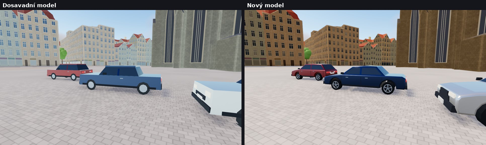
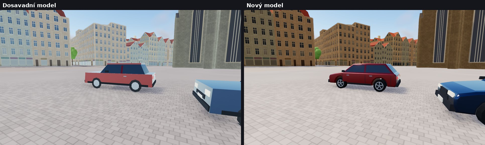
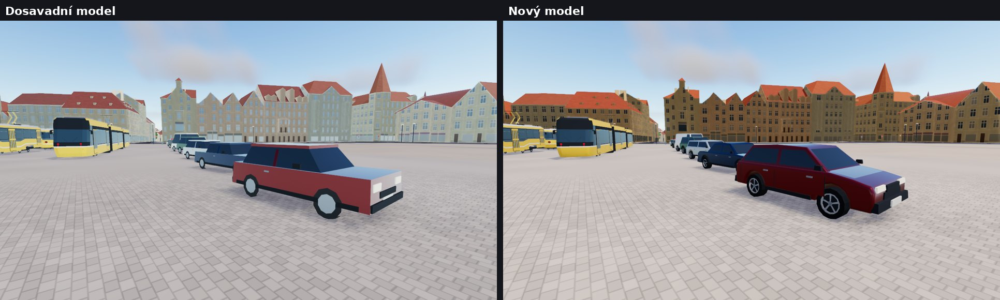
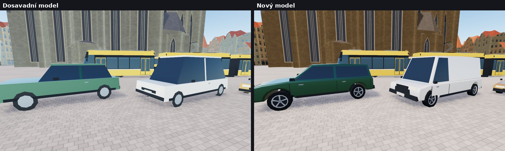
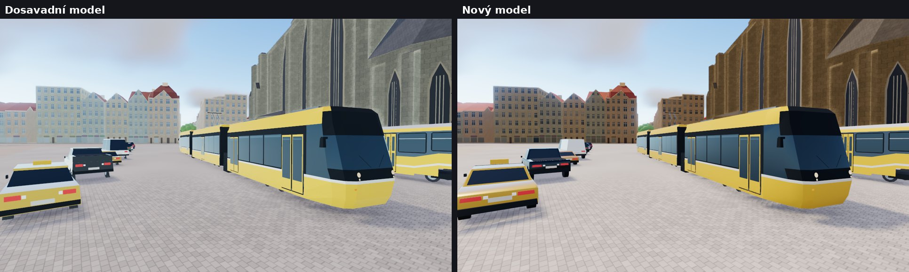
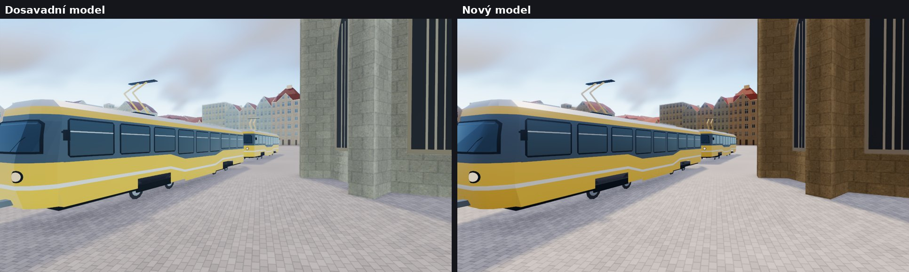
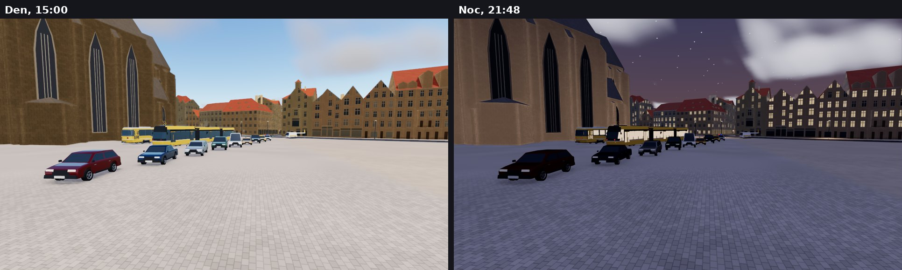

# Auta a MHD · podrobnější modely

Navazuje na [vzhledovou zkoušku](vzhledova-zkouska.md). Autor chtěl pokračovat auty a tramvajemi. Všechny modely jsou vlastní, vznikají v kódu hry a nepřibyl žádný cizí podklad ani knihovna.

## Co se změnilo

- **Auta** (`src/entities/car-body.js`, `detailedCarGeometry` v `src/entities/models.js`). Karoserie vzniká z bokorysu. Spodek s podběhy kol a kabina se vytahují do šířky se zaoblenými hranami. Kabina se ke střeše zužuje. Auto má boční okna s prostředním sloupkem, čelní a zadní sklo, sklopenou kapotu, tvarovaná světla, masku, zrcátka, kliky, prahy a spáry dveří. Kola mají pneumatiku, ráfek s pěti paprsky a náboj. Malé auto má skosenou záď, sedan kufr, dodávka svislé čelo a pick-up korbu.
- **Rozměry a fyzika** se nemění. Obrys karoserie má stejnou délku, šířku i výšku jako dosud, kola stejný poloměr i polohu.
- **Poškození** funguje i u nových aut. Kapota a dvoje dveře jsou samostatné díly, které se dají promáčknout a odtrhnout. Nárazníky zůstávají v části detailů. Pořadí předních, zadních a couvacích světel i obou polovin směrovek je stejné jako dřív, takže světla svítí podle stejných pravidel.
- **Výkon:** nové auto má zhruba 1 300 trojúhelníků místo dosavadních asi 500. Na nízké předvolbě (telefon) a s parametrem `?vzhled=puvodni` zůstávají dosavadní jednoduchá auta.
- **Tramvaje, Tatry a autobusy** mají vyhlazené stínování. Plošky čela svírající méně než 28° sdílejí normálu, takže čelo působí oble. Ostré hrany oken a dveří zůstávají ostré.

## Ověření

- Nové testy v [tests/car-body.test.js](../tests/car-body.test.js) ověřují čtyři věci. Kola mají ve všech devíti typech volný podběh a karoserie nepřesahuje rozměry typu. Díly poškození i skupiny světel jsou na svém místě. Podrobné auto se promáčkne a dveře odpadnou stejně jako u jednoduchého. Vyhlazení zachová ostrou hranu.
- `npm test`: prošlo 202 testů JavaScriptu.
- **Prohlížečové testy na WebGL 2:** vzhled aut a světlometů, rozbitné předměty a nárazy, materiály, rozpočet vykreslování pro čtyři předvolby, fyzikální provoz a hra. V prvním běhu prošlo 48 z 49 testů. Neprošel test nočních světlometů. Porovnává jas světla s tmavou plochou pod ním a u nového předku na tom místě byla světlá značka a lak. Přední značka je proto na nárazníku jako u skutečných aut a mezi maskou a nárazníkem přibylo tmavé sání. Test zůstal beze změny a s ostatními testy materiálů a vzhledu aut prošel (8 z 8).
- WebGPU se v cloudovém prostředí nedá ověřit. Softwarové WebGPU tu hlásí chybu „createBuffer failed“ i na revizi před úpravou (viz [vzhledová zkouška](vzhledova-zkouska.md)).

## Snímky před a po

Předváděcí plocha na náměstí Republiky, 15. června v 15:00, vysoká předvolba, softwarové WebGL 2. Levé snímky jsou s parametrem `?vzhled=puvodni` (dosavadní modely), pravé bez něj.

| Pohled | Porovnání |
|---|---|
| Sedan zblízka |  |
| Malé auto |  |
| Řada aut zepředu |  |
| Kombi, SUV a dodávka |  |
| Tramvaj Škoda |  |
| Tatra T3 |  |
| Den a noc s novými auty |  |

## Známé odchylky a další kroky

- Kola se při jízdě neotáčejí, stejně jako dosud.
- Okna MHD jsou ve dne tmavá. Vnitřek je vidět jen v noci, kdy svítí.
- Na předváděcí ploše stojí auta i tramvaje mimo provoz. Ve hře je kolem hráče dál doprava podle jízdního řádu a rytmu ulic.
