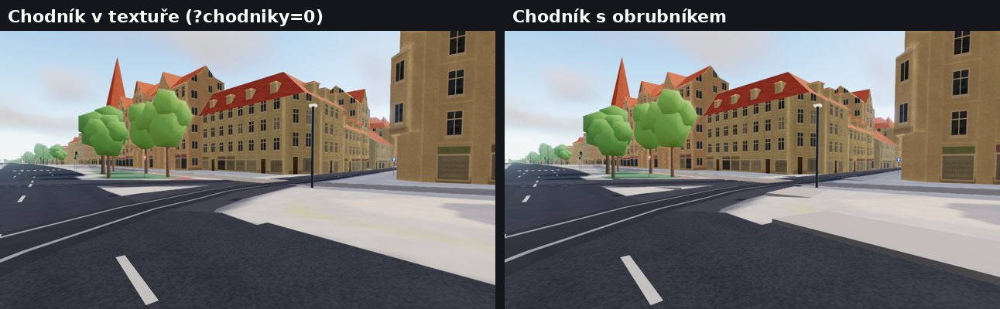
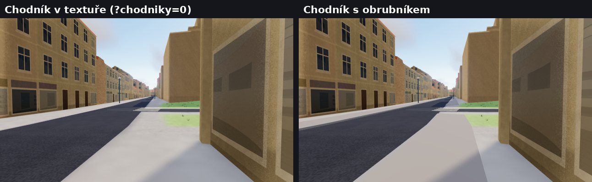
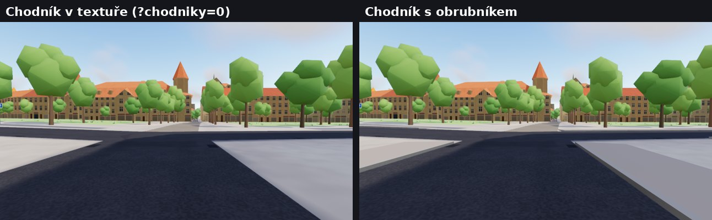
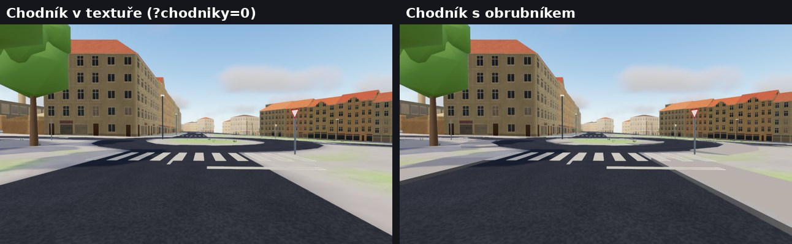
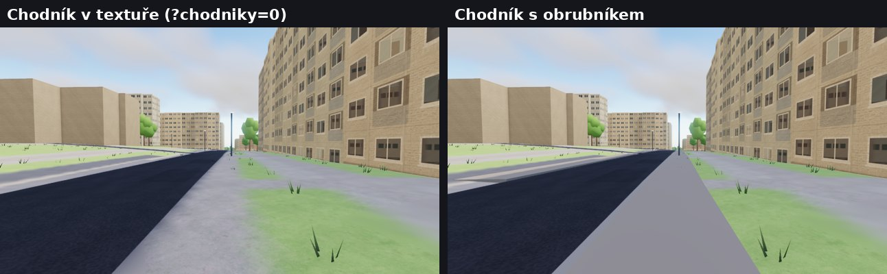
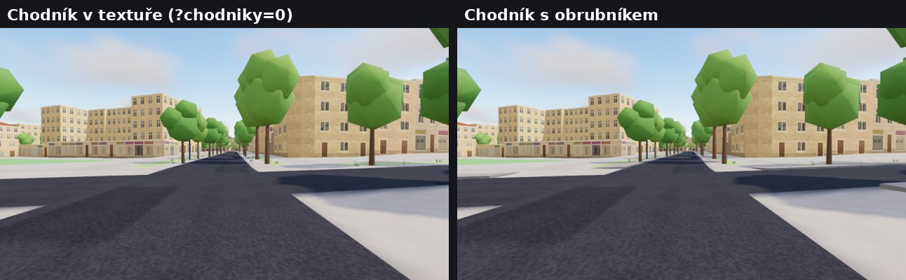

# Chodníky a obrubníky

Navazuje na [hladký profil silnic](silnice.md). Autor si u silnic stěžoval i na krajnice a ulice celkově. Ze tří možností si vybral chodníky a obrubníky. Změna je na větvi `claude/lucid-bohr-y3rlwb`. Nepřibyl žádný nový podklad ani knihovna a distribuovaná data v `public/` zůstala beze změny.

## Jak to bylo

Chodník byl jen šedý nebo béžový pruh v textuře země, široký 2 m po každé straně ulice. Ležel ve stejné výšce jako asfalt, takže ulice neměla obrubník. Okraj asfaltu byl nepravidelný a auto mohlo z vozovky plynule sjet na chodník. Chodci chodili po terénu.

## Co se změnilo

- **Chodník jako samostatná plocha** (`src/world/sidewalks.js`). Podél ulic od hlavní silnice po obytnou ulici v zástavbě vznikne po obou stranách chodník široký 2 m, v měřených čtvrtích centra 2,5 m. Obytné zóny, rampy, mosty, tunely a volná krajina chodník nemají.
- **Obrubník.** U vozovky je žulový obrubník široký 15 cm a vysoký 10 cm nad asfaltem. Jeho líc sahá pod asfalt, aby pod ním nebyla mezera.
- **Výška chodníku.** Od obrubníku se chodník svažuje k terénu na vnějším okraji, nejvýš o 8 % nahoru a o 6 % dolů. Vchody domů tak zůstávají ve své výšce. Kde je terén níž, než chodník smí klesnout, dostane okraj chodníku sokl dolů k terénu.
- **Kde chodník končí.** U stěny domu (užší zbytek než 60 cm se nekreslí), v ústí jiné silnice, na vodě a v ručně vymodelovaných úsecích z E25 (Americká, Dřevěná, nádraží). V rohu křižovatky má chodník jen důležitější z obou ulic. Na konci chodníku je čelo obrubníku.
- **Barvy.** V měřených čtvrtích má chodník barvu dlažby, jinde šedého asfaltu. Obrubník je světle šedý, jeho líc tmavší.
- **Fyzika** (`src/physics/terrain.js`). Stejné řezy tvoří i kolizní síť: líc obrubníku natočený k vozovce, obrubník a plocha chodníku nahoru, sokl ven. Auto o obrubník drcne, postava po chodníku chodí.
- **Chodci** (`World.walkY`). Chodci ve hře chodí ve výšce chodníku, jinde po terénu a mostovkách jako dřív.
- **Vypnutí.** Chodníky platí od střední předvolby. Na nízké předvolbě (telefon) zůstává dosavadní chodník v textuře země. Parametr adresy `?chodniky=0` je vypne i na vyšších předvolbách. Změna předvolby se projeví po novém načtení hry, aby vykreslení a fyzika zůstaly shodné.

## Ověření

- Nové testy v [tests/sidewalks.test.js](../tests/sidewalks.test.js) ověřují šest věcí. Chodník mají jen městské ulice. Obrubník je 10 cm nad asfaltem a sklon chodníku zůstává v mezích. Chodník končí u stěny domu. Mezi řezy vzniká líc, obrubník i chodník, na koncích čela a v ústí ulice mezera. Plochy pro fyziku jsou správně natočené. Řezy podél ulice mají obě strany, končí u domu a vynechají ústí jiné silnice.
- `npm test`: prošlo všech 218 testů JavaScriptu. `npm run build` prošlo.
- **Prohlížečové testy na WebGL 2:** 19 souborů zkoušek (rozpočet vykreslování, hra, chodci, srážky s vybavením ulic, rozvoz, podrobnosti ulic, rozbitné předměty, fyzika, fyzikální provoz, fyzika silnic, doprava, postava, stavby, MHD, směny, asfalt, materiály, mimoúrovňová křížení a Rondel). Ze 105 případů prošlo 104. Neprošel jen Wilsonův most, který selhává stejně už před úpravou silnic (viz [protokol silnic](silnice.md#ověření)).
- **Rozpočet vykreslování:** v první verzi se chodníky kreslily do všech dálek a řezy byly po 4 m. Pohled na Lochotín z výšky 300 m pak měl na střední předvolbě o 31 % víc trojúhelníků, než dovoluje rozpočet (+10 %). Teď jsou řezy nejvýš po 8 m a chodník se kreslí do 380 m od kamery, dál zůstává chodník v textuře země. Všechny čtyři předvolby se do rozpočtu vešly.
- **Kontrola ve hře** (Kralovická, vysoká předvolba): paprsek fyziky 5 cm za obrubníkem trefí výšku 78,119 m, asfalt je ve výšce 78,02 m, obrubník tedy 10 cm. Výška chodníku pro chodce se s fyzikou shoduje do 6 mm.

### Výkon

Medián stejným měřicím nástrojem jako u [silnic](silnice.md#výkon), vysoká předvolba, softwarové WebGL 2.

| Ukazatel | Bez chodníků | S chodníky |
|---|---:|---:|
| Příprava fyziky jedné dlaždice | 23 ms | 27 ms |
| Silnice a chodníky jedné dlaždice grafiky | 2,0 ms | 3,1 ms |

Chodníky přidají do fyziky dlaždice zhruba 4 ms a do grafiky asi 1 ms na dlaždici v okolí kamery. Start hry se nemění.

## Snímky před a po

Levé snímky jsou s `?chodniky=0`, pravé bez něj. 15. června v 11:00, vysoká předvolba, softwarové WebGL 2.

| Místo | Porovnání |
|---|---|
| Prešovská, pohled z chodníku |  |
| Kollárova, pohled z chodníku |  |
| Jungmannova, pohled řidiče do křižovatky |  |
| Husova u kruhového objezdu, pohled řidiče |  |
| Kralovická na Lochotíně, pohled z chodníku |  |
| Habrmannova na Slovanech, pohled řidiče |  |

## Známé odchylky a další kroky

- V rozích křižovatek chodník u vedlejší ulice končí a roh dokresluje textura země. Plynulé oblouky obrubníku v rozích by vyžadovaly tvar křižovatky, který data zatím nemají.
- Vjezdy do dvorů a garáží mají plný obrubník, nikoli snížený.
- Chodník má jednolitou barvu, dlaždice ani zrnitost povrchu nejsou vidět. Dosavadní chodník v textuře země byl zrnitější.
- Přechody pro chodce nemají snížený obrubník.
- Lampy, značky a stojany stojí na výšce terénu, u obrubníku mohou být o několik centimetrů zapuštěné do chodníku.
