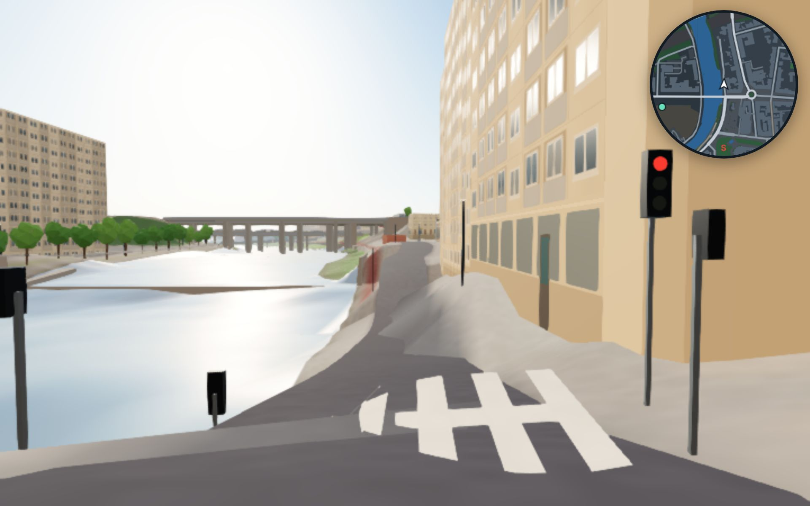
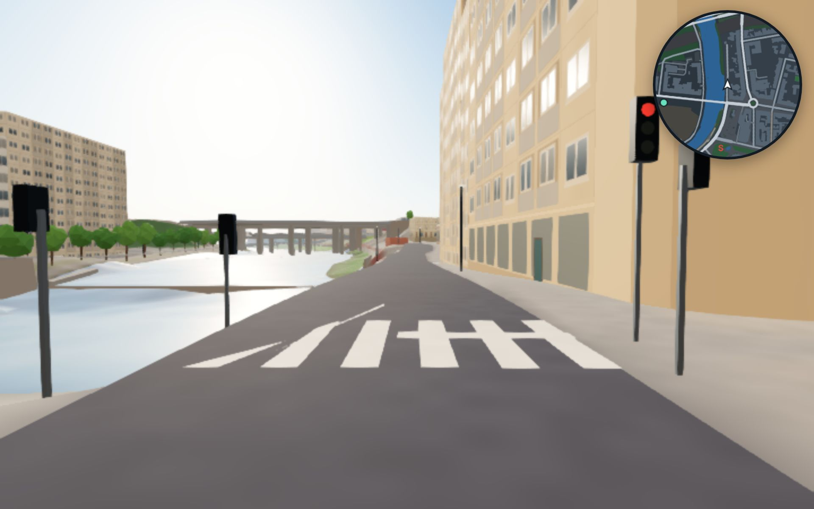
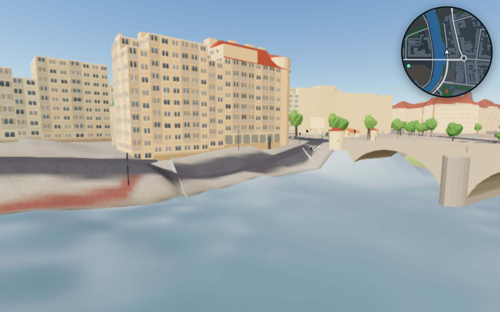
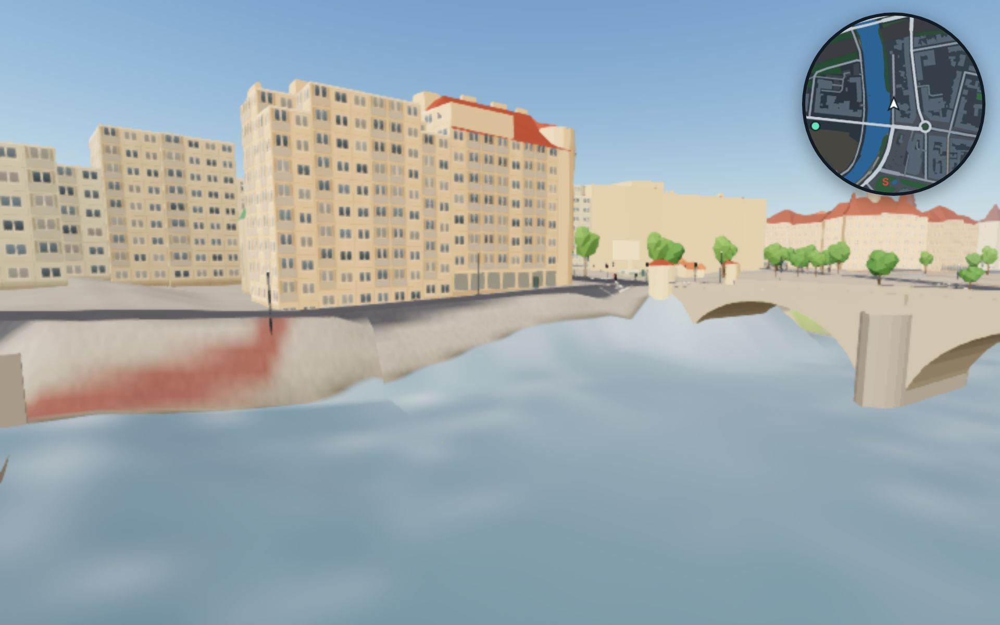

# Anglické nábřeží a další silnice na hraně břehu

Mimo etapu, na přání autora. Navazuje na opravu nájezdu Wilsonova mostu (větev
`claude/determined-volta-o7e9t2`, revize `6e3e924`). Práce je na větvi `claude/stoic-hopper-46xgy0`.

## Co bylo špatně

Na nízké předvolbě se sklonem silnic ležel asfalt Anglického nábřeží u Wilsonova mostu v jámě. Silnice 13188 (šířka 6 m) mezi body (168,1; 519) a (161,8; 457,6) měla hladký profil,
který od Americké klesal až na −9,06 m a u křižovatky s další částí nábřeží zase stoupal. V bodě
(161,7; 486,4) ležel asfalt asi 2,4 m pod terénem u okraje vozovky.

**Směr.** V zadání i v dřívějším zápisu (`docs/sklon.md`) se úsek popisuje jako „severně od mostu“.
Herní souřadnice z ale rostou k jihu (`World.gpsToWorld()`), most leží na z 458 a úsek na
z 458–519. Úsek tedy vede od Americké **na jih** po levém břehu Radbuzy, bod (165; 490) má
GPS 49,74309° s. š., 13,37989° v. d. Na sever od Americké pokračuje silnice 8440, která se
opravou také zvedla (o 1,87 m, viz tabulka níže).

## Proč

Hladký profil silnice vzniká z výšek terénu v ose silnice. Výškový model hry má body po 8 m
a vzniká z DMR 5G (ČÚZK) vyhlazeného oknem asi 10 m (`tools/terrain.py`). Ulice nad Radbuzou
leží na terase asi −3 m, hladina řeky asi −12 m, mezi nimi je nábřežní zeď.

Řez terénem napříč silnicí v z = 505 (od vody k domům, po 1 m, osa silnice = 0):

| Vzdálenost od osy | −8 m | −4 m | −1 m | 0 | +2 m | +4 m | +6 m | +7 m | +10 m |
|---|---:|---:|---:|---:|---:|---:|---:|---:|---:|
| Výška modelu | −11,4 | −11,1 | −10,7 | −9,7 | −7,8 | −5,8 | −3,9 | −3,2 | −3,0 |

- Voda začíná 7,3 m od osy (−11,4 m). Terén mezi osou a terasou stoupá o 1 m na každý metr,
  terasa začíná 7 m od osy a dál je rovná.
- Mezi dvěma body modelu, z nichž jeden leží na ulici a druhý u vody, výška klesá rovnoměrně.
  Celá vozovka tak leží na rozmazané nábřežní zdi. Na místě je přitom podle mapy u silnice
  chodník a za ním hned voda: zeď stojí až u řeky, ne pod silnicí.
- Hypotéza ze zadání se potvrdila jen zčásti: model nezachytil koryto přímo v ose silnice, ale
  pád terénu z ulice k řece. U jižního konce úseku (z 511–517) je pod silnicí ještě nižší stupeň
  −8 až −10 m.
- Totéž se stalo jinde ve městě u silnic, které vedou po hraně břehu nebo nad zatopeným lomem.

## Oprava (`src/world/road-grade.js`, `src/world/world.js`)

1. **Profil na terase.** Pro každý vzorek profilu (po 2 m) se hledá voda z boku silnice nejvýš
   8 m za okrajem vozovky (`shoreLiftAt`). Terén se změří napříč po 1 m od 3 m na straně vody až
   do 8 m za okrajem na straně souše (`shoreLift`). Vzorek se zvedne na nejvyšší místo terasy, jen
   když:
   - u osy nebo mezi osou a terasou terén stoupá prudce (aspoň 25–50 % na metr, rozmazaná zeď),
   - za terasou terén už nestoupá (jinak jde o úbočí kopce a platí výška v ose).
   Zvednutí se ztrácí plynule podle vzdálenosti vody a směru, ze kterého voda je. Potom se profil
   vyhladí stejně jako dřív a v křižovatkách napojí na společnou výšku.
2. **Rovná vozovka napříč.** Na zvednuté vozovce se příčný sklon „podle svahu“ neměří z rozmazané
   zdi, vozovka je napříč rovná. Klopení zatáček zůstává.
3. **Terén pod vozovkou.** Pod zvednutou vozovkou se terén dosype i u domů a směrem k vodě až
   k okraji pásu kolem silnice, ne však do vody. Jinak by asfalt visel nad svahem.
4. **Vypínač.** Původní profil vrátí `?nabrezi=0`.

## Body na břehové čáře ve fyzice (`src/physics/terrain.js`)

Síť terénu ve fyzice vkládá na rozhraní vody a souše body na břehovou čáru (`shore()`). Ty se
dřív nesrovnávaly pod pás vozovky jako ostatní vrcholy (`roadClampAt`). Nově ano.

- Ve 239 dlaždicích s vodou a silnicemi do 4 km od středu je 34 235 takových bodů. Nad pás
  vozovky jich prorůstalo 14, nejvíc o 19 cm u Radbuzy pod Tyršovou (568; 94). Po opravě žádný.
- Na Anglickém nábřeží žádný takový bod nebyl. Prorůstání o 2,2 m kolem (161,7; 486,5), které
  bylo naměřeno, způsobil uzel sítě fyziky (160; 488) 4,7 m od osy. Ten leží už mimo pás 1,5 m za
  okrajem vozovky, který se pod pás srovnává, a nesl ulici −2,9 m nad propadlou vozovkou
  (−6,7 m). Trojúhelník od něj k vozovce proto u okraje vystupoval nad pás. Po zvednutí profilu
  už vozovka leží výš než tento uzel.

## Výsledky na Anglickém nábřeží (silnice 13188)

| Ukazatel | Před opravou | Po opravě |
|---|---:|---:|
| Profil silnice (nejnižší … nejvyšší) | −9,06 … −2,08 m | −3,41 … −2,05 m |
| Asfalt v ose v z 505 (ulice 10 m od osy leží na −3,0 m) | −9,01 m | −3,02 m |
| Asfalt v ose nejvýš pod terénem u okraje na straně domů, z 470–515 | 2,76 m | asfalt je výš (o 0,31 m a víc) |
| Asfalt nejvýš pod okolním terénem v z 470–515 (u okraje, 1,5 m a 5 m za ním) | 5,72 m | 0,00 m |
| Fyzika terénu nad pásem vozovky v z 470–515 | 2,25 m | −0,05 m (všude pod pásem) |

## Jízda a snímky ve hře

Nízká předvolba, WebGL 2, 9. 11. 2026 v 10.00, jasno, bez MHD a cizích aut. Auto jede pravým
pruhem od křižovatky s Americkou po celém úseku 13188 rychlostí do 43 km/h.

| Ukazatel | Před opravou (`?nabrezi=0`) | Po opravě |
|---|---:|---:|
| Dojelo na konec úseku | ne | ano |
| Zdraví auta | 90 | 100 |
| Největší odchylka kola od asfaltu | 1,61 m | 0,005 m |
| Kroky kola bez dotyku se zemí | 13 270 | 0 |

| Pohled | Před opravou | Po opravě |
|---|---|---|
| Řidič od Americké na jih |  |  |
| Z protějšího břehu |  |  |

Před opravou vozovka klesá do jámy mezi domy a řekou, terén u domů ji převyšuje. Po opravě
vede rovně v úrovni ulice a ke vodě klesá jen svah za okrajem vozovky.

## Které silnice se zvedly

Ve městě se zvedlo 14 silnic. Jiné silnice se nezměnily. „Pod terénem“ je největší výška okolního
terénu (u okraje, 1,5 m a 5 m za ním, mimo vodu a křižovatky) nad asfaltem u okraje.

| Silnice | Největší zvednutí | Pod terénem před → po | Fyzika nad pásem před → po |
|---|---:|---:|---:|
| 13188 Anglické nábřeží, jih od Americké | 6,03 m | 5,15 → 0,00 m | 0,05 → −0,05 m |
| 3762 Karlovarská u zatopeného lomu (−1456; −2821) | 4,08 m | 4,60 → 2,12 m | 0,02 → 0,08 m |
| 20555 účelová cesta u vody (1832; −1950) | 3,00 m | 2,85 → 0,14 m | −0,03 → −0,03 m |
| 4853 Mlýnské nábřeží (778; 2602) | 1,89 m | 3,51 → 3,51 m | 0,34 → 0,15 m |
| 8440 Anglické nábřeží, sever od Americké | 1,87 m | 0,23 → 0,23 m | 0,01 → 0,01 m |
| 18629 účelová cesta u vody (1870; −1973) | 1,67 m | 2,23 → 1,21 m | 0,14 → 0,04 m |
| 32224 účelová cesta u vody (−926; −366) | 1,05 m | 1,48 → 0,93 m | 0,24 → −0,01 m |
| 249 Anglické nábřeží, další úsek na jih | 1,03 m | 0,74 → 0,09 m | −0,01 → −0,04 m |
| 20525 účelová cesta u vody (1907; −1958) | 0,64 m | 0,61 → 0,44 m | 0,07 → 0,02 m |
| 4034 Denisovo nábřeží (247; 517) | 0,47 m | 0,28 → 0,28 m | −0,03 → −0,03 m |
| 29441 Pražská (224; 10) | 0,43 m | 0,60 → 0,46 m | 0,00 → 0,01 m |
| 1556 Doubravecká (2051; −840) | 0,37 m | 0,83 → 0,81 m | −0,02 → −0,02 m |
| 32416 K Valše (−2110; 5092) | 0,32 m | 0,89 → 0,58 m | −0,02 → −0,03 m |
| 22232 Ke Krkavci (−629; −4034) | 0,30 m | 1,57 → 1,57 m | −0,02 → −0,02 m |

Zbývající hodnoty „pod terénem“ u Karlovarské, Mlýnského nábřeží, Ke Krkavci a dalších jsou
v jiných částech silnic, kde stoupá kopec vedle silnice, ne u vody. Karlovarská má fyziku nad
pásem o 8 cm 300 m od zvednutého místa (−1756; −2754), kde se profil posunul jen nepatrně;
podobná drobná místa po 4 m síti fyziky jsou ve městě i jinde.

## Ověření

- Nový test v Node ([tests/physics-terrain.test.js](../tests/physics-terrain.test.js)):
  na Anglickém nábřeží v z 470–515 leží asfalt nejvýš 0,3 m pod okolním terénem (u okraje,
  1,5 m a 5 m za ním), fyzika terénu leží v celé šířce pod pásem a profil kolísá méně než o 1,6 m.
  Na původním kódu (`?nabrezi=0`) selže s rozdílem 5,72 m.
- Druhý nový test: body na břehové čáře u Tyršovy a u Anglického nábřeží leží pod pásem vozovky.
  Na původním `terrain.js` selže s rozdílem 0,186 m.
- Testovací svět v Node má nově vodní plochy a břehy (`_initWater`), dřív je vynechával a fyzika
  řeky ani břehové body se v Node netestovaly.
- `npm test`: prošlo 231 z 231. `npm run build` prošlo.
- `npm run test:e2e -- physics-roads.spec.js physics.spec.js river-detail.spec.js water.spec.js --trace off`
  (vzor zahrnuje i `structure-water.spec.js`): prošlo 32 z 34. Na WebGL 2 všech 17, včetně
  Wilsonova mostu v obou směrech. Na WebGPU selhaly obě zkoušky `river-detail.spec.js` chybou
  `OperationError: A valid external Instance reference no longer exists` (ztráta softwarového
  zařízení WebGPU). Na původní revizi `6e3e924` selhávají v tomto prostředí stejně.

## Výkon

Sestavení profilů silnic při startu (Node, medián 8 opakování): 1 180 ms bez úpravy, 1 333 ms
s úpravou (+0,15 s, +13 %). Silnice daleko od vody se vyřadí podle buněk s hranami břehu po 32 m,
napříč se měří jen asi 11 000 vzorků profilu u vody. V herní smyčce se nic nepočítá.

## Známé odchylky a návrhy

- Dům 1545 u Anglického nábřeží (x 146–163, z 498–523) stojí na průměrné výšce původního modelu
  pod půdorysem, který na východní straně také zachytil svah ke zdi. Proto může stát o něco níž
  než ulice. Oprava domů do úkolu nepatřila.
- Výškový model zůstává beze změny. Čistší oprava by byla v `tools/terrain.py` (`burn_lines`):
  u silnic podél vody brát výšku z terasy, ne z osy. Data v `public/` se ale mění jen skripty
  z `tools/` a surová data DMR 5G v tomto prostředí nejsou, proto je oprava v herním kódu.
- Nábřežní zeď se nevykresluje. Mezi okrajem vozovky a vodou klesá terén strmým svahem po síti 4 m.
