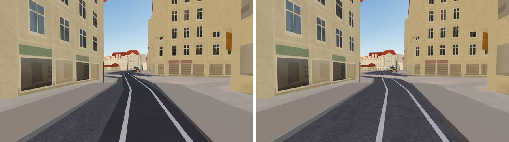
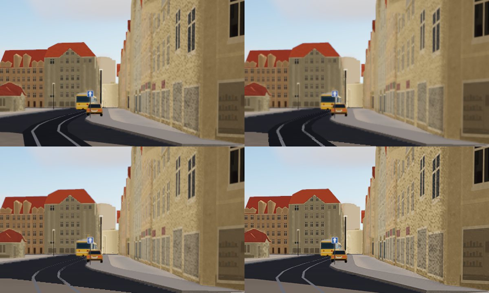

# Ostrý a klidný obraz · blikání, rozmazání a okraje silnic

Autor hrál na počítači a hlásil tři věci: textury při jízdě problikávají a rozmazávají se, mezi
asfaltem a obrubníkem zůstává pruh jiného povrchu a u okraje silnice vystupuje terén přes asfalt.
Úpravy vycházejí z revize `3e46e6b` (verze 0.2.0) a týkají se jen webové hry. Nové podklady ani
knihovny nepřibyly. Doostření používá efekt SharpenNode, který je součástí three.js 0.187.

## Co bylo špatně

1. **Jemné vzory mizely pozdě.** Asfalt má zrno s buňkou 3 cm, omítka zrno s buňkou 14 cm, cihly
   a tašky spáry široké asi centimetr. Vzor slábl, až když pixel na zemi měřil 2 až 10 cm (u omítky
   10 až 48 cm). Ve výšce řidiče měří pixel 5 m před autem asi 2,6 cm, takže na jednu buňku zrna
   připadal jeden pixel. Při každém pohybu kamery padl pixel na jiné místo vzoru a barva přeskakovala.
   Zrno navíc hýbalo i odlesky slunce na asfaltu.
2. **Překryv dlaždic se prohazoval.** Asfalt a čáry se kreslí bez zápisu hloubky, takže o tom, který
   povrch je navrchu, rozhoduje pořadí kreslení. Dlaždice světa se stejným druhem povrchu se řadily
   podle vzdálenosti od kamery. Kde se povrchy dvou dlaždic překrývají, například v křižovatce na
   hranici dlaždic, se za jízdy prohazovalo, který je navrchu, a místo poblikávalo.
3. **Tramvajový pás přes asfalt ulice.** V Prešovské leží kolej v dlaždici 5668, ulice v sousední
   dlaždici 5667. Tmavý hladký pás pod kolejí (2,5 m) se kreslil přes asfalt ulice, byl o 1,3 cm výš
   a nevedl přesně v ose. Vedle něj vykukoval světlejší asfalt ulice jako pruh jiného povrchu až
   k obrubníku. Tramvajový pás se nakonec ukázal jako jediná příčina pruhu: měření podél
   61 334 míst u obrubníků (1,8 km kolem centra) nenašlo žádnou díru mezi asfaltem a obrubníkem.
4. **Rozmazání.** Nízká předvolba kreslila i na počítači jen ve 3/4 rozlišení a obraz zvětšovala.
   Textury země se filtrovaly nejvýš čtyřnásobně, takže v dálce pod ostrým úhlem rozmazaly. Vysoká
   a ultra předvolba skládají snímky přes sebe (časové vyhlazení TRAA) a za jízdy obraz změkčí.
5. **Terén přes okraj silnice.** Uzly sítě terénu leží po 2 až 8 m. Uzel na vozovce se srovná pod
   asfalt, uzel za okrajem ale zůstává ve své výšce (svah, násep). Na hraně trojúhelníku mezi nimi
   terén stoupá rovnoměrně, takže vystoupí nad asfalt už uvnitř vozovky. Okraj je pak zubatý a za
   jízdy bliká, protože asfalt a terén leží skoro ve stejné výšce.

## Co se změnilo

- **Mizení vzorů podle velikosti buňky** ([src/world/image-quality.js](../src/world/image-quality.js)).
  Vzor slábne, když pixel dosáhne čtvrtiny buňky, a zmizí u poloviny (dva pixely na buňku). Platí
  pro zrno asfaltu a mříže vpustí ([asphalt.js](../src/world/asphalt.js)), šum země a dlažbu náměstí
  ([materials.js](../src/world/materials.js)) a tahy štětce, zrno omítky, cihly, tašky a prkna
  ([building-nodes.js](../src/world/building-nodes.js)). Asfalt má navíc hrubší zrno s buňkou
  12,5 cm, aby pár metrů před autem nebyl hladký. Spáry cihel, tašek a prken se nad svou šířkou
  nahradí průměrnou tmavostí, takže zeď z dálky zůstane stejně tmavá.
- **Pevné pořadí sousedních dlaždic** ([chunks.js](../src/world/chunks.js)). Asfalt a čáry sousedních
  dlaždic se liší v pořadí kreslení podle šachovnice (o 0,5), takže se jejich překryv neprohazuje.
  Pořadí druhů povrchů zůstává: asfalt, čáry.
- **Koleje v asfaltu ulice.** Tramvajový pás se nekreslí tam, kde kolej vede po vozovce. Povrchem je
  tam asfalt ulice a koleje leží v něm. Kde má tramvaj vlastní těleso, pás zůstává. První pokus
  kreslil pás jako samostatnou vrstvu pod asfaltem, ta ale přidala vykreslovací volání a pohled na
  Lochotín na nízké předvolbě překročil rozpočet (111 volání, mez 110). Vynechání pásu naopak
  trojúhelníky ubírá.
- **Ostřejší obraz.** Textury země se filtrují osminásobně na střední a šestnáctinásobně na vysoké
  a ultra předvolbě (nízká zůstává na čtyřnásobku). Nízká předvolba kreslí na počítači v plném
  rozlišení, na telefonu dál ve 3/4. Při pomalé grafice rozlišení dál snižuje automatika hry.
  Vysoká a ultra předvolba po časovém vyhlazení obraz mírně doostří (SharpenNode, síla 0,35).
- **Terén u okraje vozovky** ([road-edge-terrain.js](../src/world/road-edge-terrain.js)). Uzel sítě
  terénu za okrajem silnice se sníží právě tolik, aby terén na hraně trojúhelníku zůstal aspoň 1 cm
  pod asfaltem. Uzly pod vozovkou a na okraji dlaždice se nemění, takže dlaždice dál navazují.
  Fyzika terénu se nemění.

Původní obraz pro porovnání vrátí adresa s `?obraz=puvodni` (všechny body výše). Samotné doostření
vypne `?ostreni=0`. Uložené hry se nemění.

## Měření

Všechna měření proběhla v Chromiu na softwarovém WebGL 2 (SwiftShader) v okně 1280 × 720, v pondělí
9. 11. 2026 v 10.00 za jasného počasí. Srovnání „původně“ používá stejné sestavení s `?obraz=puvodni`.

### Okraje silnic

Po 2 m podél obou okrajů každé silnice (mimo mosty a tunely, 3 m od křižovatek) se měří, zda síť
terénu 0,15 m uvnitř okraje leží výš než asfalt, a zda 0,05 m před lícem obrubníku je asfalt.
Střední předvolba, 32 dlaždic do 800 m od středu, 27 008 míst na okrajích a 17 575 u obrubníků.

| Ukazatel | Původně | Po úpravě |
|---|---:|---:|
| Terén nad asfaltem u okraje | 0,71 % | 0,30 % |
| z toho o víc než 5 cm | 0,14 % | 0,04 % |
| Nejvyšší převýšení terénu nad asfaltem | 0,74 m | 0,09 m |
| Díra mezi asfaltem a obrubníkem | 0 | 0 |
| Stavba 32 dlaždic (celkem, všechny kroky) | 12,50 s | 12,43 s |

Na vysoké předvolbě v okruhu 1,8 km (156 dlaždic, 116 489 míst) leželo před úpravou nad asfaltem
0,94 % okrajů (0,21 % o víc než 5 cm), z toho asi polovina v křižovatkách. Po úpravě zůstávají
místa hlavně tam, kde se uzly nemění (okraje dlaždic), a v křižovatkách.

### Ostrost a zubatost proti ideálu

Každý ze čtyř pohledů z vozovky (Prešovská, Husova, Anglické nábřeží, Mikulášská) se vykreslí
v běžném rozlišení a ve dvojnásobném rozlišení zmenšeném na stejnou velikost (ideál). Ostrost je
průměrný rozdíl jasu sousedních pixelů proti ideálu (1,00 = stejně ostré). Odchylky jsou podíl
pixelů, které se od ideálu liší o víc než 48 úrovní (součet RGB): zuby, třpyt a chybějící tenké detaily.

| Nízká předvolba | Původně | Po úpravě |
|---|---:|---:|
| Ostrost proti ideálu | 0,82 | 0,93 |
| Odchylky od ideálu | 2,41 % | 1,17 % |

Původní nízká předvolba kreslila ve 3/4 rozlišení, nová v plném. Na střední předvolbě vyšla ostrost
proti ideálu 1,00 → 0,92 při stejných odchylkách 1,47 %. To není rozmazání: ideál ve dvojnásobném
rozlišení má poloviční pixel, takže jemné zrno v něm zůstává, zatímco v běžném obraze už zmizí.
Měřítko pak bere třpyt zrna jako ostrost. Blikání proto měří třepot níže.

### Třepot při nepatrném pohybu

Kamera se posune o 6 mm do strany (asi půl pixelu 7 m před autem) a měří se průměrná změna
pixelu (0–255 v každé barvě). Klidný obraz se při tak malém posunu skoro nezmění, blikající zrno
ano. Střední předvolba, stejné čtyři pohledy.

| Střední předvolba | Původně | Po úpravě |
|---|---:|---:|
| Průměrná změna pixelu na vozovce (spodní polovina obrazu) | 0,80 | 0,48 |
| Průměrná změna pixelu v celém obraze | 0,57 | 0,41 |
| Pixely se změnou nad 20 úrovní | 0,33 % | 0,30 % |

Na vozovce je obraz o 40 % klidnější, v celém obraze o 28 %. Pixely s velkou změnou leží hlavně
na hranách domů, sloupů a čar, které vyhlazení hotového obrazu (SMAA) nezklidní.

### Ostrost za jízdy

Kamera jede 50 km/h (30 snímků za sekundu) Husovou, Prešovskou a Mikulášskou ve výšce řidiče.
Po 24 snímcích se obraz uloží a porovná se se stejným místem, kde kamera stála a obraz se ustálil
(původní obraz bez doostření). Vysoká předvolba, horní tři čtvrtiny obrazu.

| Vysoká předvolba | Původně | Po úpravě |
|---|---:|---:|
| Ostrost za jízdy proti původnímu obrazu vestoje (průměr tří ulic) | 0,93 | 1,22 |
| z toho Prešovská | 0,88 | 1,20 |
| Ostrost vestoje proti původnímu obrazu vestoje | 1,00 | 1,34 |

Za jízdy je obraz po úpravě ostřejší než dřív vestoje. Doostření má sílu 0,35 (SharpenNode
používá výchozí 0,2, menší číslo znamená silnější doostření). Na výřezech nejsou světlé lemy kolem
hran. Kdyby obraz působil přeostřeně, vypne doostření `?ostreni=0`.

## Snímky

Prešovská na střední předvolbě, vlevo původně, vpravo po úpravě. Pruh světlejšího asfaltu u levého
obrubníku zmizel, koleje leží v asfaltu ulice a asfalt je v pár metrech před autem klidnější.

Prešovská na vysoké předvolbě, výřez fasád a vozovky. Vlevo nahoře původně vestoje, vpravo nahoře
původně za jízdy (rozmazané), vlevo dole po úpravě za jízdy, vpravo dole po úpravě vestoje.

## Výsledky zkoušek

Zkoušky a měření výkonu probíhají, výsledky se doplní.

## Známé odchylky a návrhy

- Měření běží jen na softwarovém vykreslování. Skutečný čas grafické karty na autorově počítači
  zbývá změřit (stejně jako ostatní měření verze 0.2.0).
- Na okrajích dlaždic a v křižovatkách zůstává 0,30 % okrajů, kde terén vystoupí nad asfalt, téměř
  vždy do 5 cm. Úplné odstranění by potřebovalo síť terénu, která sleduje okraj silnice.
- V 1,1 % měřených míst není 0,15 m uvnitř okraje asfalt. Jde o vnitřní strany ohybů, kde asfalt
  sleduje vyhlazenou osu a měření hrubou osu z mapy. Je tam vidět tmavá barva silnice v textuře
  země po 0,5 m na pixel. Návrh: kreslit silnici v blízké textuře země podle vyhlazené osy.
- Střední a nízká předvolba dál vyhlazují jen hotový obraz (SMAA, FXAA), tenké sloupy a koleje
  v dálce proto mohou při pohybu mírně naskakovat. Návrh: vyhlazování přímo při kreslení
  (MSAA) na střední předvolbě, pokud to výkon dovolí.
