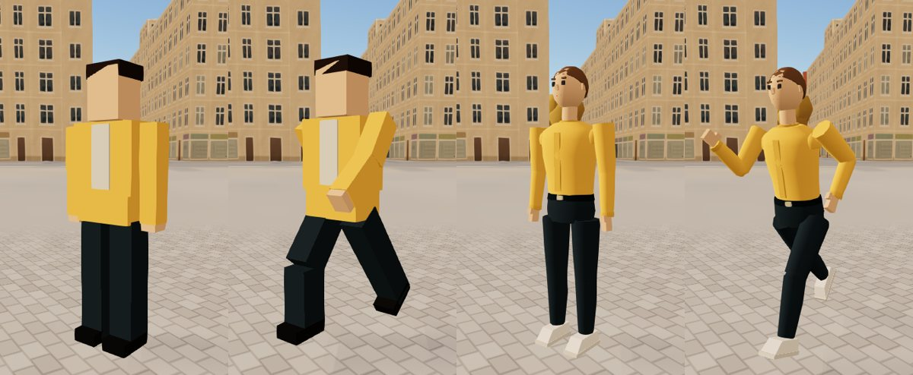
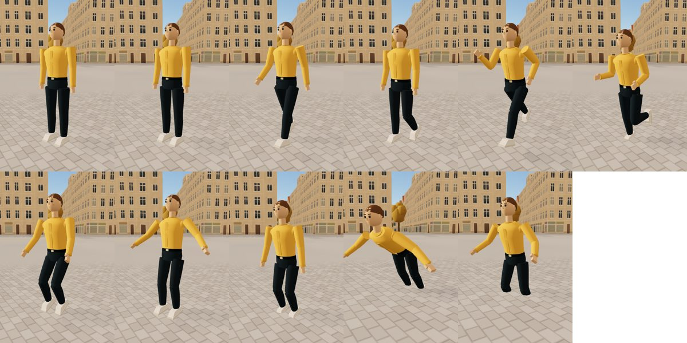
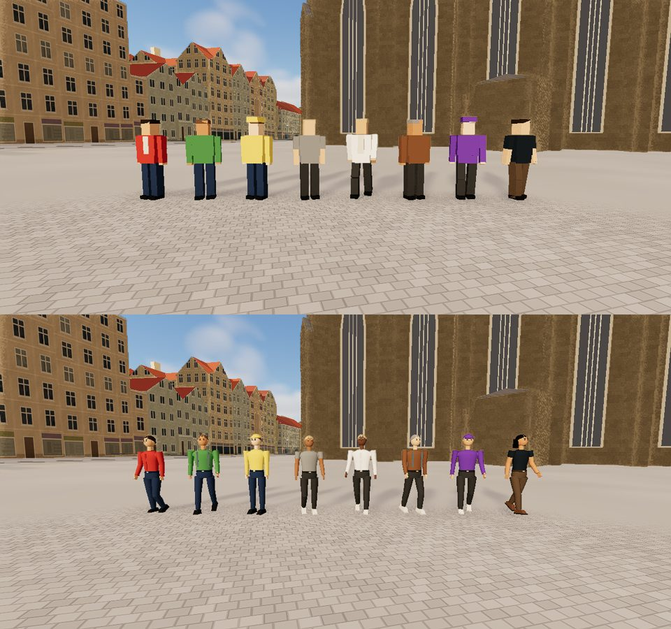
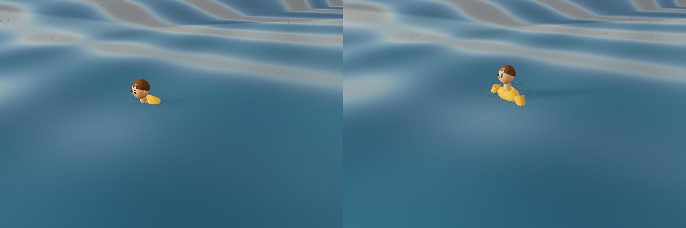
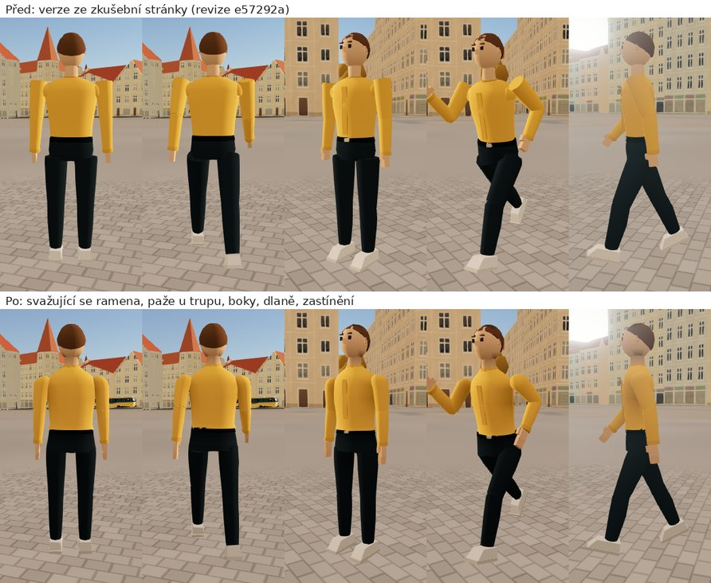
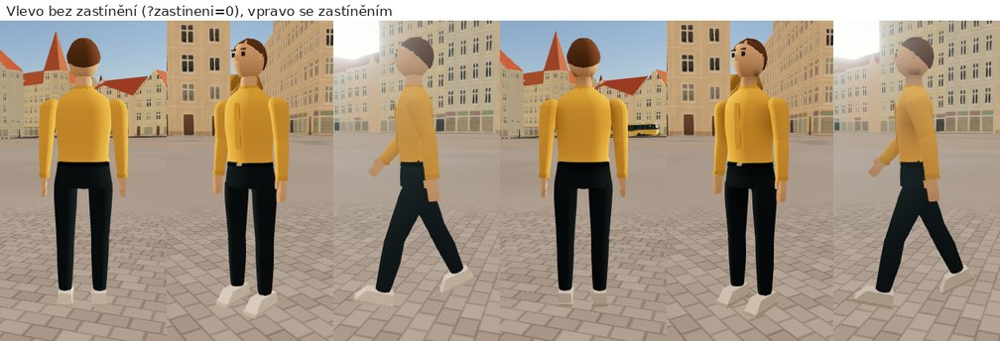
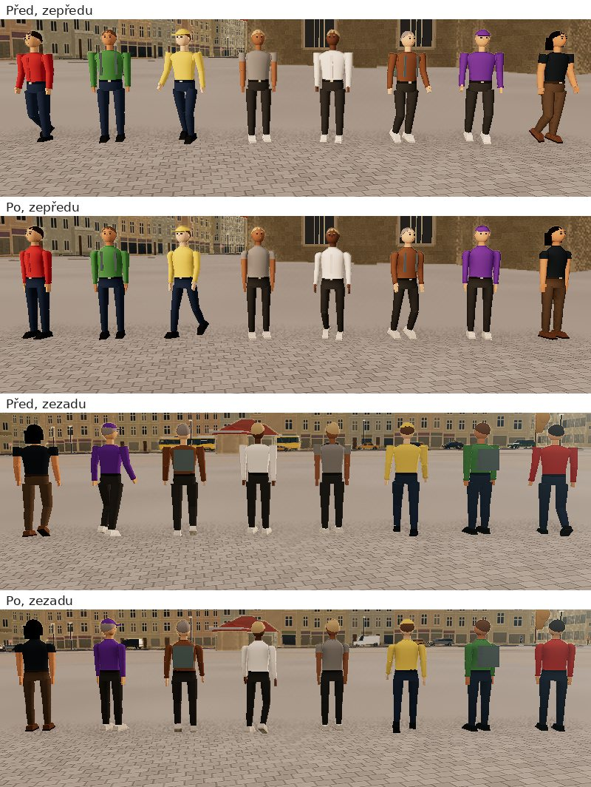
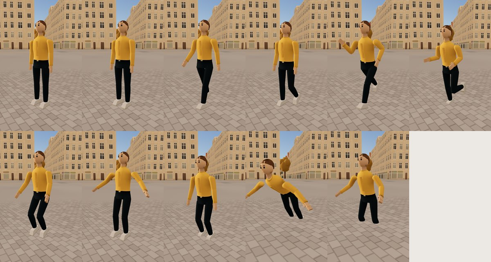

# Postava · vzhled těla a pohyby

Autor chtěl hezčí herní postavu a přirozenější pohyby a zvolil stylizovaný vzhled vytvořený přímo
v kódu hry. Úprava platí pro hráče i chodce, vychází z vydání 0.2.0 (revize `da600ef`). Nové
podklady ani knihovny nepřibyly.

## Co bylo předtím

Postava se skládala z 11 kvádrů (pánev, hrudník, hlava, paže, předloktí, stehna, lýtka) o zhruba
170 trojúhelnících. Pohyb byl jen houpání rukama a nohama, jehož rychlost rostla s rychlostí chůze.
Postava neměla vlastní pohyby vestoje, ve skoku, při dopadu ani ve vodě (ve vodě se jen ponořila
o metr). Stejné kvádry s rozměry a klouby má fyzikální postava pro pády a srážky
(`src/physics/ragdoll.js`).

## Co se změnilo

- **Tělo** (`src/entities/character-shape.js`). Každý díl leží ve stejném kvádru jako díl fyzikální
  postavy, takže pády fungují beze změny. Trup se zužuje do pasu a má zaoblená ramena, pánev pásek,
  hlava krk, oči, obočí, nos, ústa a uši. Vlasy jsou nakloněná čepička, která nechá čelo volné a
  zakryje týl; účesy jsou krátké, dlouhé, drdol a nakrátko. Paže a nohy jsou oblé a zužují se,
  v lokti a koleni je kloub, předloktí končí dlaní s palcem a lýtko botou s podrážkou. Paže se
  kreslí o 4,5 cm blíž k trupu (ramenní klouby fyzikální postavy jsou 0,3 m od osy těla), kolem
  stejného kloubu. Chodci mají šest odstínů pleti, šest barev vlasů a čtyři druhy bot. Kšiltovka,
  batoh, krátký rukáv a košile s légou zůstávají.
- **Pohyby** (`src/entities/character-pose.js`), čisté výpočty:
  - fáze kroku roste s uraženou vzdáleností, takže boty po zemi neklouzají; chodec udělá asi 101
    kroků za minutu, svižná chůze hráče 152 a běh 183,
  - při chůzi se střídají nohy a paže, koleno se ohne při švihu, pánev se dvakrát za krok zhoupne
    a natočí, hrudník se natáčí proti ní,
  - při běhu delší krok, předklon asi 11°, lokty ohnuté asi na 84°, víc pohupování a náklon do
    zatáčky,
  - vestoje dýchání, lehké přenášení váhy a po dvou a půl sekundách rozhlížení,
  - ve skoku pokrčená kolena, při pádu natažené nohy a ruce do stran, po dopadu podřep podle síly
    dopadu (do 0,32 s),
  - ve vodě při pohybu prsa se skloněným tělem, na místě šlapání vody.
- **Meze kloubů.** Natočení se omezuje na meze fyzikální postavy (například stehno nejvýš 60°
  dopředu nebo dozadu, koleno do 135°, loket do 140°).
- `?postava=puvodni` vrátí kvádrovou postavu, původní houpání i původní ponoření ve vodě.

## Snímky

Původní postava vestoje a v běhu, nová postava vestoje a v běhu:

Nové pohyby, zleva shora: vestoje, rozhlížení, dvě fáze chůze, dvě fáze běhu, skok, pád, podřep
po dopadu, plavání a šlapání vody (pozice ve vodě je pro snímek vyfocena na suchu):

Osm chodců vedle sebe, nahoře původní kvádry, dole nová postava se stejnými barvami oblečení:

Ve vodě: plavání a šlapání vody, nad hladinou je hlava a ramena:

## Měření a zkoušky

- **Velikost.** Jedna postava má 1 510 až 1 642 trojúhelníků podle oblečení a účesu (dříve asi 170).
  Počet vykreslovacích volání se nemění, každá postava je dál jeden objekt s kostrou.
- **Rytmus.** Chodec asi 101 kroků za minutu, svižná chůze hráče 152, běh 183. Délka kroku roste
  s rychlostí (0,95 až 4,2 m na dvojkrok), takže chodidlo stojí na zemi, dokud se nezvedne.
- **Ve vodě** je postava ponořená o 1,17 m při plavání a o 1,3 m při šlapání vody (dříve 1,05 m
  vždy), nad hladinou zůstane hlava a ramena.
- **Zkoušky v Node** (`npm test`): 259 z 259. Nové `tests/character-pose.test.js` (8: rytmus bez
  klouzání nohou, meze kloubů v celém rozsahu rychlostí, střídání nohou, běh proti chůzi, stání,
  skok a dopad, plavání, náklon v zatáčce) a `tests/character-shape.test.js` (4: výchozí vzhled,
  plochy otočené ven a uvnitř kvádrů fyzikální postavy, nejvýš 1 800 trojúhelníků a paže u trupu,
  barvy obličeje a oblečení).
- **Zkoušky v prohlížeči** (WebGL 2): rozpočet vykreslování na všech předvolbách včetně počtu
  trojúhelníků, postava, chodci, hra, fyzika a srážky na ulici 29 z 29, po úpravě ponoření
  `water` a `character` 9 z 9.
- `npm run build` prošlo.

## Známé odchylky

- Pohyby se počítají z okamžité rychlosti postavy, nejsou to nahrané animace ani se mezi sebou
  neprolínají. Jak rychle postava zpomalí, tak rychle se jí srovnají nohy.
- Vzdálení chodci (dál než 120 m) se nehýbou, jako dosud.
- Vlasy a kšilt smějí díl fyzikální postavy mírně přesáhnout, při pádu proto mohou krátce
  zajet do země.

## Vylepšení vzhledu (na přání autora)

Autor se zeptal, jestli jde vzhled ještě vylepšit, a schválil úpravu ramen a paží, zad a boků
a jemné zastínění. Vychází z revize `e57292a`, která je na zkušební stránce.

**Co bylo špatně (zjištěno na snímcích zezadu, jak postavu hráč vidí).** Paže stály vedle trupu
jako trubky s rovným vrškem nad rameny, ramena byla vodorovná a celkově široká asi 0,64 m. Stehna
vyčnívala z boků o 4,7 cm (0,212 m proti 0,165 m od osy těla). Každý kus oblečení měl jednu barvu
bez stínů. Ruka byla kvádr dlouhý 9 cm.

**Co se změnilo** (`src/entities/character-shape.js`):

- Ramena se svažují od krku ven. Vršek paže je oblý ramenní sval, jehož nejvyšší bod leží 0,7 cm
  pod kloubem ramene a blíž k tělu než osa paže. Paže se kreslí o 7 cm blíž k trupu (dříve
  4,5 cm), šířka ramen přes paže je asi 0,58 m.
- Trup má vzadu lopatky a v pase prohnutí, tričko má lem přes pásek. Krk je silnější, vlasy
  vzadu sahají níž a čelo je volnější.
- Boky jsou nejširší dole u kyčlí a plynule navazují na stehna, kalhoty mají vzadu hýždě. Stehna
  a lýtka se zužují ke koleni a ke kotníku.
- Ruka má dlaň, prsty a palec a od zápěstí měří 14 cm. Dlaň míří k tělu.
- **Zastínění** (`characterOcclusion`): barvy postavy jsou tmavší tam, kam málo dosvítí obloha,
  protože je zakrývá jiná část těla. Jde o podpaží a boky trupu, vnitřní stranu paží a stehen,
  rozkrok, krk pod bradou a vlasy a pruh pod lemem trička. K zemi postava mírně tmavne (u bot na
  72 %). Počítá se jednou při stavbě postavy, na výkon nemá vliv. Vypne ho `?zastineni=0`.

Všech jedenáct pohybů s novým tvarem (pořadí jako výše). Při pádu s rukama do stran ani při
plavání se paže od ramen neoddělí:

### Měření a zkoušky

- Jedna postava má 1 578 až 1 762 trojúhelníků (dříve 1 510 až 1 642), nejvýš o 7 % víc.
- Nové zkoušky v `tests/character-shape.test.js`: ramena se svažují (trup nad 1,44 m užší než
  0,12 m od osy), vršek paže leží pod kloubem ramene, šířka ramen nejvýš 0,6 m, stehna nevyčnívají
  z boků víc než o 1 cm, ruka měří aspoň 13 cm a zastínění ztmaví podpaží, krk, rozkrok a vnitřní
  stranu stehen a paží, nikde pod 40 % ani nad 110 %. Na předchozí podobě postavy tři z těchto
  zkoušek neprojdou (vršek paže 1,435 m nad kloubem 1,42 m, stehno 0,212 m proti bokům 0,165 m,
  podpaží bez zastínění).
- `npm test` 262 z 262, `npm run build` prošlo.
