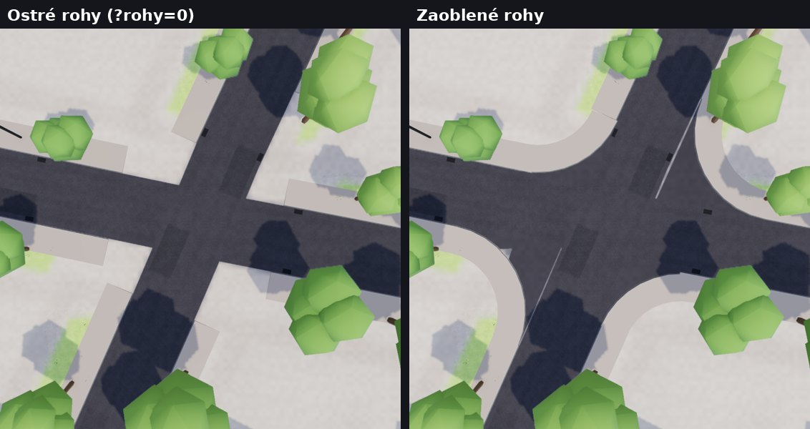
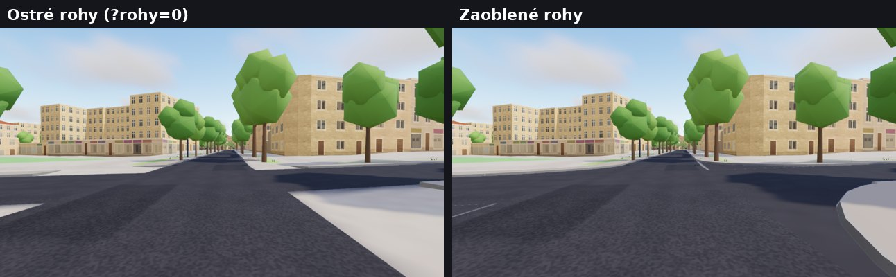
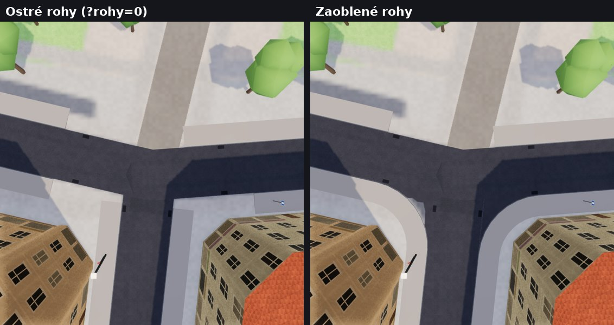
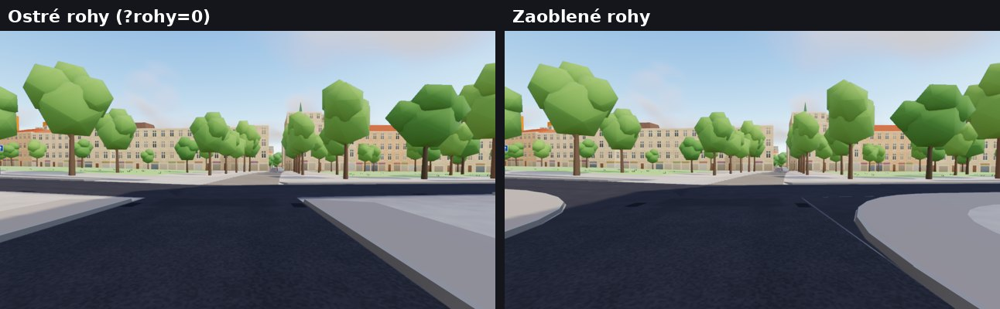
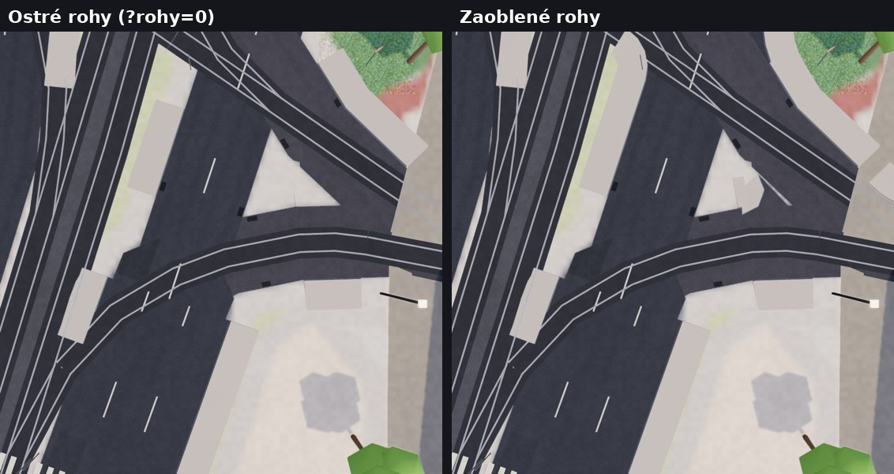

# Zaoblené rohy křižovatek

Navazuje na [hladký profil silnic](silnice.md) a [chodníky s obrubníkem](chodniky.md). Autor chtěl, aby rohy křižovatek a silnic byly zaoblené jako ve skutečnosti a aby se v zatáčkách lépe jezdilo: hra má být v první řadě zábavná. Změna je na větvi `claude/lucid-bohr-y3rlwb`. Nepřibyl žádný nový podklad ani knihovna a distribuovaná data v `public/` zůstala beze změny.

## Jak to bylo

Mapová data popisují silnici jako lomenou čáru se šířkou. Dvě vozovky se proto v křižovatce potkaly v ostrém rohu. S novými chodníky tam navíc obrubník jedné ulice běžel až k okraji druhé a v rohu tvořil pravý úhel. Kdo odbočoval rychleji, najel na roh chodníku. Stejně ostré byly i lomy silnic mimo křižovatky.

## Co se změnilo

- **Oblouk v každém rohu** (`src/world/corners.js`). Ve společném bodě silnic se ramena seřadí podle směru. Každý roh mezi dvěma sousedními rameny s úhlem 25° až 155° vyplní asfaltový oblouk, který se dotýká okrajů obou vozovek. Stejně se zaoblí vnitřní strana ostrého ohybu jedné silnice. Téměř rovné pokračování a velmi ostré úhly (nájezdy) zůstávají beze změny.
- **Poloměr podle šířky ulic.** Poloměr je 1,3násobek součtu polovičních šířek obou vozovek, nejméně 4 m a nejvýš 12 m. Dvě obytné ulice tak mají oblouk 7,8 m, hlavní silnice větší. Ve hře vzniklo 17 950 oblouků s typickým poloměrem 7,8 m.
- **Kde se oblouk zmenší nebo vynechá.** Oblouk se zmenší, aby se vešel na rovnou část obou ramen, nezasáhl do domu ani do vozovky třetí silnice (ostrůvky ve složitých křižovatkách). Směr ramene se měří přes krátké mapové úseky až 20 m od křižovatky, protože data mají u křižovatek často úseky dlouhé jen 1–4 m. Rohy se nedělají na mostech, v tunelech, na Rondelu, v ručních úsecích E25 a v ručně upraveném terénu.
- **Obrubník a chodník kolem rohu.** Chodníky obou ulic končí přesně v bodech dotyku oblouku. Mezi nimi vede obrubník i chodník po oblouku.
- **Pojízdný obrubník.** Líc obrubníku je mírně zkosený (o 6 cm), takže auto při seříznutí zatáčky přes obrubník přejede místo toho, aby se o něj zaseklo.
- **Fyzika a terén.** Asfalt oblouku je součástí kolizní sítě ve stejné výšce jako pás vozovky. Výška asfaltu v oblouku přechází plynule mezi okraji obou vozovek. Terén pod obloukem leží pod asfaltem a fyzika tam má jemnou síť po 4 m.
- **V dálce** je oblouk namalovaný i v textuře země.
- **Vypnutí.** Parametr adresy `?rohy=0` vrátí ostré rohy pro porovnání.

## Ověření

- Nové testy v [tests/corners.test.js](../tests/corners.test.js) ověřují sedm věcí. Oblouk v pravoúhlém rohu se dotýká okrajů obou vozovek. Oblouk se zmenší na krátkém rameni, ostré a téměř rovné úhly se nezaoblují. Krátké mapové úseky u křižovatky se pro oblouk sloučí. Křižovatka čtyř ramen má čtyři rohy, rovné pokračování žádný a ohyb jeden vnitřní. Dům v rohu oblouk zmenší. Chodník končí přesně v bodě dotyku. Oblouk se zmenší, když by zasáhl třetí silnici.
- `npm test`: prošlo všech 225 testů JavaScriptu. `npm run build` prošlo.
- **Prohlížečové testy na WebGL 2:** 24 souborů zkoušek (rozpočet vykreslování, hra, chodci, srážky s vybavením ulic, rozvoz, podrobnosti ulic, rozbitné předměty, fyzika, fyzikální provoz, fyzika silnic, doprava, postava, stavby, MHD, směny, asfalt, materiály, mimoúrovňová křížení, Rondel, Prazdroj, řeka, jemný terén a stopy kol). Ze 111 případů prošlo 109. Neprošel Wilsonův most, který selhává už před úpravou silnic. Jednou neprošlo odbočení fyzikálního auta z Kardinála Berana do Husovy: auto zůstalo stát před křižovatkou, kde dává přednost. Samostatně test prošel třikrát po sobě a při přehrání s rohy i bez nich auto odbočilo stejně, jde tedy o náhodu v okolním provozu.
- Rozpočet vykreslování prošel na všech předvolbách.

### Výkon

Medián stejným měřicím nástrojem jako u [silnic](silnice.md#výkon), vysoká předvolba, softwarové WebGL 2.

| Ukazatel | Před rohy | S rohy |
|---|---:|---:|
| Příprava fyziky jedné dlaždice | 27 ms | 32 ms |
| Síť terénu jedné dlaždice | 6,6 ms | 7,7 ms |
| Silnice a chodníky jedné dlaždice | 3,1 ms | 3,8 ms |
| Výpočet rohů při startu | – | 0,3 s |

## Snímky před a po

Levé snímky jsou s `?rohy=0`, pravé bez něj. 15. června ve 12:00, vysoká předvolba, softwarové WebGL 2.

| Místo | Porovnání |
|---|---|
| Habrmannova na Slovanech, shora |  |
| Habrmannova, pohled řidiče do křižovatky |  |
| Jungmannova u Smetanových sadů, shora |  |
| Jungmannova, pohled řidiče |  |
| Prešovská u sadů Pětatřicátníků (složitá křižovatka s tramvají), shora |  |

## Známé odchylky a další kroky

- Na hraně asfaltu oblouku a vozovky je místy vidět tenká světlá čára.
- Ve složitých křižovatkách s tramvajemi a ostrůvky zůstávají v ostrůvcích drobné kousky chodníku.
- Auta řízená hrou zatáčejí po stejných obloucích jako dřív. Širší roh jim dává víc místa, jejich dráhy se ale podle něj zatím neupravují.
- Výpočet oblouků přidá ke startu hry asi 0,3 s.
