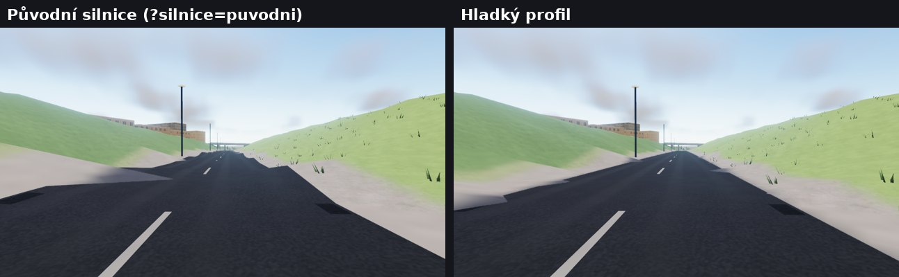
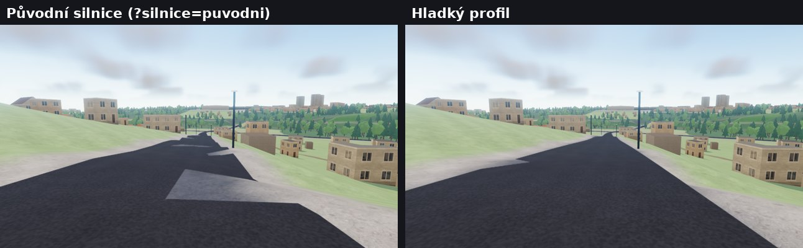
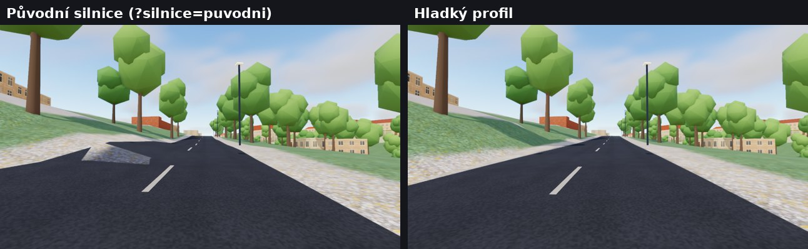
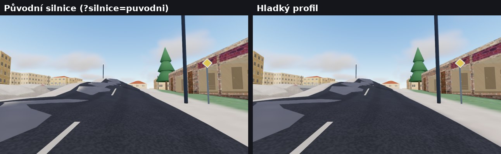
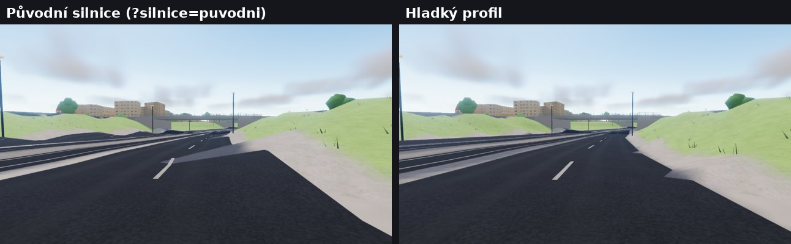
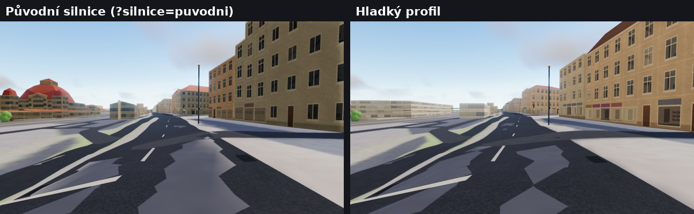

# Silnice a ulice · hladký podélný profil

Autor napsal, že největší slabinou hry jsou silnice, krajnice a ulice: hlavně při jízdě z kopce a do kopce jsou hrbolaté. Úkolem bylo zkontrolovat, jak se silnice zpracovávají, a navrhnout lepší postup. Změna je na větvi `claude/lucid-bohr-y3rlwb` a navazuje na [vzhledovou zkoušku](vzhledova-zkouska.md) a [nové modely aut](auta-a-mhd.md). Nepřibyl žádný nový podklad ani knihovna. Distribuovaná data v `public/` zůstala beze změny, nový profil se počítá ve hře při načtení.

## Proč byly silnice hrbolaté

Silnice ve hře nemá vlastní výšku. Mapová data OSM udávají jen čáru ve vodorovné rovině a výška se brala z terénu. Terén je síť bodů po 8 m (v části města po 4 m) rozdělená na trojúhelníky. Z toho plynuly tři problémy:

1. **Zlom sklonu každých 8 m.** Na hraně každého trojúhelníku se sklon skokem mění. Na rovině to nevadí, ve svahu z toho vznikají malé schody. Při 50 km/h dostávalo auto v kopci zhruba každou šestinu vteřiny ráz.
2. **Vozovka a terén se rozcházely.** Pás asfaltu je jen „nátěr“ položený na terén. Fyzika ale jela po trojúhelnících terénu, které mezi body silnice ležely jinak. Ve svazích proto terén prorůstal asfaltem v šedých zubech a kola jela po něčem jiném, než bylo vidět.
3. **Příčný náklon se střídal.** Trojúhelníky nakláněly silnici střídavě doleva a doprava, takže se auto na rovné ulici kolébalo.

### Měření před úpravou

Nový měřicí skript projel všechny silnice od dálnice po obytné ulice do 6 km od centra, celkem 3 286 úseků a 586 km. Mosty a tunely mají vlastní výšky a do měření nepatří. Výška povrchu se brala po 0,5 m v obou stopách kol ze stejných trojúhelníků, po kterých jede fyzika. Z druhé diference na základně 2 m skript spočítal svislé zrychlení auta při 50 km/h. Za ráz se počítá okamžik nad 2 m/s², tedy zhruba 0,2 g.

## Co se změnilo

Každá silnice má teď vlastní **hladký podélný profil** a terén se mu přizpůsobí. Silnice tak jede jako skutečná stavba v krajině a nekopíruje už každý zub sítě.

- **Profil silnice** (`src/world/road-grade.js`). Ve hře se po 2 m podél osy odečte výška terénu. Klouzavý průměr ve třech průchodech ji vyhladí na zhruba 7 m, takže zmizí zlomy po 8 m a stoupání zůstane. Za koncem silnice se profil prodlouží se stejným sklonem, aby se svah u křižovatky nezploštil.
- **Křižovatky a mosty.** Všechny silnice, které se potkávají v jednom bodě, se srovnají na společnou výšku. Oprava se mezi dvěma křižovatkami mění lineárně a za poslední z nich během 40 m odezní. U běžného mostu z mapy silnice přesně navazuje na výšku mostovky. Pokud by se lišila o víc než 40 cm, nebo by se dvě silnice v křižovatce lišily o víc než 2 m, zůstane konec silnice na terénu (viz přechod níže).
- **Terén pod silnicí** (`World._buildRoadTerrain`). V pásu vozovky a půl metru za ní leží terén přesně na profilu. Do 3,5 m se plynule vrací k původnímu tvaru. Svah, který by nad silnicí přečníval přes krajnici, se u paty zařízne. Kolem domů zůstává terén do 4 m beze změny, aby nevznikly chybné prahy.
- **Křižovatky ve svahu.** Pás každé silnice je napříč vodorovný, takže se v křižovatce ve svahu pásy dvou silnic překrývaly v různé výšce a na okraji hlavní silnice vznikal schod. V ploše křižovatky teď na vozovce důležitější silnice (vyšší třída, širší) platí její profil a vedlejší silnice se k jejímu okraji napojí během 6 m. Hlavní silnice si tak zachová svůj sklon. Strmá vedlejší ulice dostane v křižovatce rovnou plošinu, podobně jako ve skutečném městě.
- **Fyzika** (`src/physics/terrain.js`, `colliders.js`). Podél silnic s profilem má terén ve fyzice síť po 4 m (buňky do 3 m od vozovky a jejich sousedé), jinde zůstává původní síť. Navíc přibyl pás jízdního povrchu po 2 m přes celou šířku vozovky, v křižovatkách rozdělený napříč na čtyři díly. Leží ve výšce vykresleného asfaltu, tedy 5 cm nad profilem, takže kola necítí drobné nerovnosti sítě terénu pod ním. Tam, kde pás začíná, a u napojení na mostovku se na 6 m plynule zvedá z terénu, aby kola nenarazila na schod.
- **Vykreslení** (`src/world/chunks.js`). Pás asfaltu i čáry kopírují profil. Body terénu, které by vystoupily nad vozovku, se srovnají pod ni. Ve strmých úsecích, kde se silnice zařezává do svahu, má terén jemnější síť po 4 m. Asfalt v textuře země má plnou šířku silnice.
- **Ručně doladěná místa zůstávají.** Podjezdy, rampa u hlavního nádraží, Rondel, nájezdy k tunelům a terén upravený pro mimoúrovňová křížení se nemění. Silnice tam a ještě 10 m za tím kopíruje původní terén. Stejně zůstává 8 m kolem konců měřených a kamenných mostů (například Wilsonova mostu a desky v Radčické), tunelů a ramp, kde je napojení na terén kalibrované. Teprve potom se během 15 m plynule přidává úprava podle profilu. Stejný přechod mají konce silnic, které se nedají napojit (jiná výška, navazující ručně doladěný nájezd). Slepé ulice zůstávají na profilu až do konce. Na takto chráněná místa a přechody připadají necelá 2 % délky silnic.
- **Vypnutí.** Parametr adresy `?silnice=puvodni` vrátí původní silnice pro porovnání. Uložené hry se nemění.

### Co odhalily testy a měření

První verze srovnávala profil i u konců měřených mostů a pás silnice končil u ručně upraveného terénu náhle. Dvě prohlížečové zkoušky to odhalily:

- Na měřené silniční desce v Radčické stála kola za koncem mostovky až 21 cm nad výškou terénu, kterou hra v tom místě počítá. Síť terénu po 4 m tam nedokáže přesně sledovat profil, protože pod mostem terén prudce klesá. Měřené mosty proto mají kolem konců původní terén.
- Na příčném svahu Železniční u mostu Milénia končil rovný pás silnice v ručně upraveném svahu se sklonem napříč asi 25 %. Jedno kolo dodávky viselo ve vzduchu a druhé hnací kolo prokluzovalo. Po zelené se dodávka skutálela dozadu a sjela z vozovky. Proto vznikl přechod popsaný výše.

Obě zkoušky potom prošly beze změny podmínek. Mezikrok, kdy pás ležel přímo na profilu bez 5 cm nad terénem, ukázal, proč je výška pásu důležitá. Hrbolatost tehdy stoupla na 41 rázů na km, protože terén místy vystoupil o pár centimetrů nad pás.

Měření paprsky přímo ve fyzice hry odhalilo ještě jednu věc, kterou první výpočet neviděl. Ten počítal jen s pásem vlastní silnice. Ve skutečnosti kolo jede po nejvyšším povrchu, a v křižovatce ve svahu to byl pás hlavní silnice. Na strmé vedlejší ulici tak na okraji hlavní silnice vznikal schod. Proto vznikla společná výška v křižovatkách. Bez ní by v křižovatkách bylo o něco méně rázů, ale byly by prudší (průměrné zrychlení 2,07 místo 1,81 m/s²).

## Výsledky měření

### Skutečná fyzika ve hře

Měřicí skript ve hře pouští paprsky Joltu svisle dolů do obou stop kol, po 0,5 m. Trefí tedy přesně to, po čem jede kolo: pás silnice, terén, mostovku i jiný předmět. Vzorek tvoří silnice do 300 m od deseti míst ve městě a na Borech, Lochotíně a Slovanech (Regensburská, Na Brůdku, Samaritská, Sokolovská, Janáčkova a další). Je to 14,3 km stop, z toho 3,4 km v křižovatkách (do 15 m od společného bodu tří silnic). Jako ráz se počítá svislé zrychlení nad 2 m/s² při 50 km/h, jako schod skok o víc než 6 cm na půl metru.

| Ukazatel | Před | Po |
|---|---:|---:|
| Rázů na km mezi křižovatkami | 180,3 | 50,6 |
| Rázů na km mezi křižovatkami na silnicích se sklonem od 4 % | 463,9 | 78,9 |
| Rázů na km v křižovatkách | 160,8 | 157,0 |
| Průměrné zrychlení v křižovatkách (RMS) | 1,59 m/s² | 1,81 m/s² |
| Schodů na km mezi křižovatkami | 66,1 | 48,8 |
| Schodů na km v křižovatkách | 17,8 | 26,9 |

Zbylé rázy mezi křižovatkami jsou z velké části v místech, kde profil záměrně neplatí (chráněná místa, přechody, silnice bez profilu), a tam, kde terén u okraje vystoupí nad pás. V křižovatkách je hrbolatost zhruba stejná jako dřív a schodů je víc. Část z nich nejspíš vzniká při měření v ostrých zlomech silnic, kde měřená stopa kola přeskočí mimo pás. Podrobně to zatím rozebrané není.

### Výpočet povrchu vlastní silnice

Druhý měřicí skript počítá výšku ve stopách kol z pásu vlastní silnice a terénu pod ním, bez ostatních silnic a předmětů. Pokrývá všech 3 286 úseků od dálnice po obytné ulice do 6 km od centra (586 km). Ukazuje, jak hladký je samotný profil.

| Ukazatel (586 km silnic) | Před | Po |
|---|---:|---:|
| Rázů na km, všechny silnice | 158,9 | 38,4 |
| Rázů na km, silnice se sklonem od 4 % | 309,6 | 109,8 |
| Průměrné svislé zrychlení ve stopě kol (RMS) | 1,35 m/s² | 0,56 m/s² |
| Odchylka povrchu od hladké čáry (RMS) | 2,8 cm | 1,3 cm |

Do tohoto čísla se počítají i plošiny a přechody vedlejších ulic v křižovatkách. Před sjednocením výšky v křižovatkách vycházelo 9,3 rázu na km, ten výpočet ale neviděl schody na okrajích hlavních silnic (viz výše).

## Ověření

- Nové testy v [tests/road-grade.test.js](../tests/road-grade.test.js) ověřují deset věcí. Vyhlazení odstraní schody po 8 m a zachová stoupání i přímku na koncích. Profil v křižovatce trefí společnou výšku a oprava se dál ztrácí. Pás kolem silnice má plnou váhu na vozovce a k okraji klesá k nule. Dvě navazující silnice mají ve společném bodě stejnou výšku a silnice u mostu navazuje na mostovku. Ručně doladěný podjezd zůstane v profilu. U konce mostu v chráněném místě se profil nenapojuje a platí původní terén. U nenapojeného konce a za chráněným místem přechází silnice do terénu plynule, slepý konec zůstává na profilu. Pás se u mostovky a na začátku zvedá plynule. Křižovatka se pozná, pouhé pokračování silnice ne.
- `npm test`: prošlo všech 212 testů JavaScriptu. `npm run build` prošlo.
- **Prohlížečové testy na WebGL 2:** 22 souborů zkoušek, které se týkají silnic, fyziky, provozu, MHD, chodců a vzhledu: rozpočet vykreslování, hra, mimoúrovňová křížení, fyzikální provoz, fyzika silnic, Prazdroj, řeka, Rondel, materiály, asfalt, fyzika, doprava, stavby, srážky s vybavením ulic, jemný terén, stopy kol, MHD, chodci, rozbitné předměty, směny, postava a rozvoz. Ze 108 případů prošlo 107. Neprošla zkouška „kola unesou auto přes Wilsonův most v obou směrech“: auto skončí se zdravím 82,3 místo 100. Stejně selhává i na revizi `d868511` před všemi úpravami (82,37), a to i s `?silnice=puvodni`, takže s profilem silnic nesouvisí. Po zapnutí rychlé stavby kolizních sítí prošlo ze 45 případů fyzikálních zkoušek znovu 44, neprošel jen týž most. V jednom z předchozích kol neprošel rozjezd auta v testu hry o 0,004 m/s. Rozjezd je na dálnici bez profilu, test míchá pevné kroky se skutečným časem prohlížeče a v dalších kolech prošel.
- Audit mimoúrovňových křížení (`tools/audit_grade_separations.mjs`) porovnává hru s výchozím stavem. Výchozí stav se nyní počítá s `?silnice=puvodni`, aby audit dál měřil úpravy pro křížení, ne nový profil.
- WebGPU se v cloudovém prostředí nedá ověřit, softwarové WebGPU tu hlásí chybu „createBuffer failed“ i na revizi před úpravou (viz [vzhledová zkouška](vzhledova-zkouska.md)).

### Výkon

Medián ze 112 dlaždic fyziky a 274 kroků stavby dlaždic grafiky, softwarové WebGL 2, osm míst ve městě. Měřeno nástrojem ve hře na stejném sestavení s parametrem `?silnice=puvodni` a bez něj.

| Ukazatel | Původní silnice | Hladký profil |
|---|---:|---:|
| Příprava fyziky jedné dlaždice | 11 ms (7 ms s rychlou stavbou) | 23 ms |
| Síť terénu jedné dlaždice, vysoká předvolba | 3,8 ms | 6,8 ms |
| Síť terénu jedné dlaždice, nízká předvolba | 2,7 ms | 4,1 ms |
| Silnice jedné dlaždice | 0,7 ms | 2,0 ms |
| Výpočet profilů při startu (celá mapa, 1,28 mil. vzorků) | – | 0,75 s |

Zhoršení je nad 10 %. Důvody: fyzika má podél silnic jemnější síť terénu a navíc pás silnice, v křižovatkách dělený na čtyři díly. Grafika hledá v křižovatkách společnou výšku a ve strmých úsecích má jemnější síť. Příprava se děje po dlaždicích při jízdě, ne v každém snímku. Statické kolizní sítě se nově staví rychleji, což zkrátilo přípravu fyziky dlaždice z 36 na 23 ms. Počet trojúhelníků a vykreslovacích volání ve snímku hlídá test rozpočtu, ten prošel na všech předvolbách. V paměti zůstává nejvýš 512 dlaždic s úpravou terénu.

## Snímky před a po

Pohled řidiče 8 m za autem, 15. června v 11:00, vysoká předvolba, softwarové WebGL 2. Levé snímky jsou s `?silnice=puvodni`, pravé bez něj.

| Místo | Porovnání |
|---|---|
| Regensburská (zářez ve svahu) |  |
| Na Brůdku (stoupání) |  |
| Samaritská |  |
| Lobezská (přes vrchol) |  |
| Karlovarská |  |
| Železniční u mostu Milénia (ručně upravený svah, záměrně beze změny) |  |

## Známé odchylky a další kroky

- **Křižovatky** jsou zhruba stejně hrbolaté jako dřív. Hlavní silnice je napříč vodorovná, takže strmá vedlejší ulice v ní dostane plošinu a za ní prudší úsek. Pomohl by příčný sklon silnic podle terénu (dnes ho silnice nemají a nemají ani klopení v zatáčkách).
- **Chráněná místa** u měřených mostů, tunelů a ručně upravených křížení mají dál původní hrbolatý terén. Jejich vyhlazení by vyžadovalo nové měření a kalibraci těch míst.
- U okraje zářezů je místy vidět malý zub terénu u krajnice a terén tam občas vystoupí nad pás silnice. Vzniká tam, kde se jemná síť po 4 m potkává s okolní sítí po 8 m.
- **Výkon:** příprava dlaždice trvá déle (viz tabulka) a start hry se prodlouží zhruba o 0,75 s. Na telefonu je to nutné ověřit.
- Chodníky a obrubníky zatím nejsou samostatná stavba, u běžných ulic je chodník jen pruh v textuře země.
- Profil vychází z výškového modelu terénu. Kde má model chybu (násyp nebo zářez, který v něm chybí), sleduje ji profil také, jen hladce.
- WebGPU se v tomto prostředí nedá ověřit.
