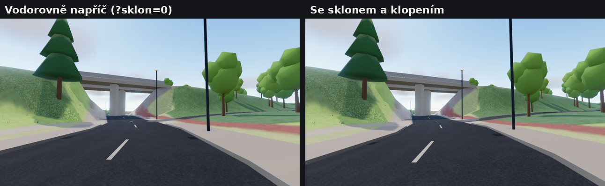
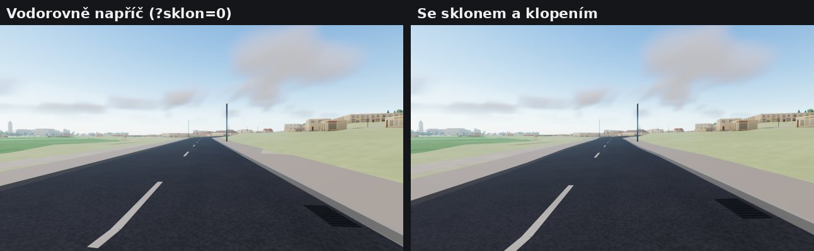
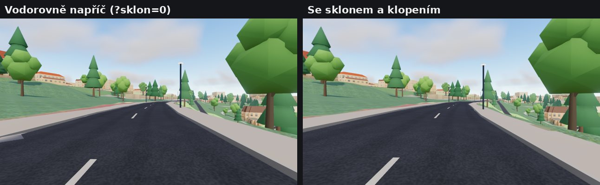
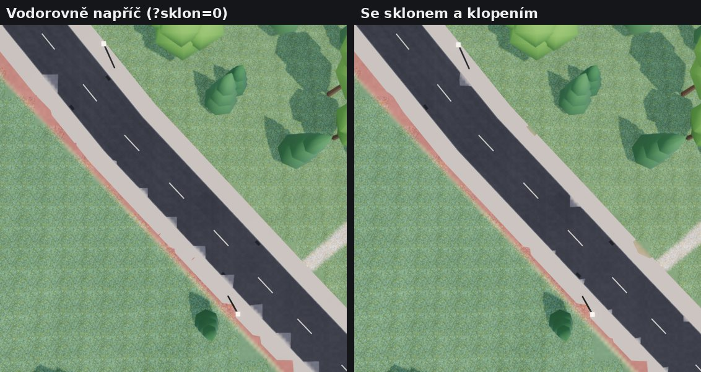

# Příčný sklon silnic a klopené zatáčky

Navazuje na [hladký profil silnic](silnice.md), [chodníky s obrubníkem](chodniky.md) a [zaoblené rohy](rohy.md). Autor chtěl silnice se sklonem napříč: na svahu mají kopírovat terén a v zatáčkách být klopené, aby se v nich lépe a zábavněji jezdilo. Změna je na větvi `claude/lucid-bohr-y3rlwb`. Nepřibyl žádný nový podklad ani knihovna a distribuovaná data v `public/` zůstala beze změny.

## Jak to bylo

Hladký profil určoval výšku silnice jen v její ose. Napříč byla vozovka vodorovná po celé šířce. Na svahu proto jedna strana silnice ležela v zářezu a druhá na náspu, i když terén kolem klesal plynule. Zatáčky nebyly klopené, auto v nich drželo jen třením pneumatik.

## Co se změnilo

- **Sklon podle svahu** (`src/world/road-grade.js`). Hra po 8 m porovná terén vlevo a vpravo za okrajem vozovky a silnici napříč nakloní stejně jako svah. Sklon se podél silnice vyhladí a nejvýš je 4 %.
- **Klopené zatáčky.** Silnice mimo obytné ulice (dálnice až nezařazené silnice) mají v zatáčkách vnitřní stranu níž. Klopení roste s ostrostí zatáčky (zatáčka o poloměru 60 m a ostřejší má plných 6 %). U křižovatek, na koncích silnic a mezi domy (dům do 6 m za okrajem, typicky ulice ve městě) klopení během 15 m plynule zmizí. Kruhové objezdy a Rondel se neklopí. Svah a klopení dohromady dávají nejvýš 7 %.
- **Návaznost.** Kde jedna silnice pokračuje druhou, mají ve společném bodě stejný sklon. Na mostovku se silnice napojí bez příčného sklonu.
- **Stejný povrch všude.** Sklon platí pro vykreslený asfalt a značení, pás vozovky ve fyzice, výšku pro auta řízená hrou, chodníky, zaoblené rohy i společnou plochu křižovatek. Auta se na skloněné vozovce naklánějí podle povrchu.
- **Terén vedle silnice.** Terén pod vozovkou leží pod skloněným pásem. Na nižší straně se měří od roviny vozovky prodloužené za okraj, jinak by svah zasahoval do pásu. Kde je zářez u silnice hlubší než 30 cm, má dlaždice od střední předvolby jemnější síť terénu (4 m místo 8 m). Dřív to platilo až od 40 cm. Okraj asfaltu tak méně často překrývá tráva.
- **Vypnutí.** Parametr adresy `?sklon=0` vrátí silnice vodorovné napříč pro porovnání.

## Ověření

- Nové testy v [tests/road-grade.test.js](../tests/road-grade.test.js) ověřují čtyři věci. Příčný sklon kopíruje svah vedle silnice a nepřekročí 4 %. V zatáčce je níž vnitřní strana, u konců klopení mizí a mezi domy se zatáčka neklopí. Dvě navazující silnice mají ve společném bodě stejný sklon, i když jsou v mapě nakreslené opačným směrem. Bez zapnutí zůstane silnice napříč vodorovná.
- `npm test`: prošlo všech 228 testů JavaScriptu. `npm run build` prošlo.
- **Prohlížečové testy na WebGL 2:** stejných 23 souborů zkoušek jako u rohů (rozpočet vykreslování, hra, chodci, srážky s vybavením ulic, rozvoz, podrobnosti ulic, rozbitné předměty, fyzika, fyzikální provoz, fyzika silnic, doprava, postava, stavby, MHD, směny, asfalt, materiály, mimoúrovňová křížení, Rondel, Prazdroj, řeka, jemný terén a stopy kol). Ze 111 případů prošlo 110. Neprošel jen Wilsonův most, který selhává už před úpravou silnic (auto dojede se zdravím 82 místo 100, stejně jako bez sklonu).
- Rozpočet vykreslování prošel na všech předvolbách i s jemnější sítí terénu u zářezů.

### Rozložení sklonu

Ze 2 569 km silnic s hladkým profilem má 48 % sklon do 1 %, 34 % mezi 1 a 3 % a 12 % mezi 3 a 4 % (svah). Sklon nad 5 % (klopené zatáčky) má 75 km silnic. U 99 % délky se sklon mění pomaleji než o 0,52 % na metr, takže se auto naklápí plynule.

### Hrbolatost a terén u okraje

Stejné měření paprsky fyziky Jolt ve hře jako u [silnic](silnice.md) a [rohů](rohy.md): 10,9 km stop kol mezi křižovatkami a 3,4 km v křižovatkách na deseti místech města. Drncnutí je zrychlení nad 2 m/s² při 50 km/h.

| Ukazatel | Bez sklonu (`?sklon=0`) | Se sklonem |
|---|---:|---:|
| Drncnutí na km mezi křižovatkami | 50,6 | 51,6 |
| z toho v kopcích (stoupání aspoň 4 %) | 78,9 | 79,5 |
| Drncnutí na km v křižovatkách | 157,4 | 132,0 |
| Místa, kde terén ve fyzice přečnívá nad pás vozovky | 280 | 244 |

Mezi křižovatkami zůstala hrbolatost prakticky stejná (+2 %). V křižovatkách ubylo 16 % drncnutí, protože navazující silnice mají stejný sklon a vedlejší silnice nenarážejí na hranu hlavní. Celkem je na měřených trasách o 7 % drncnutí méně.

Vykreslený terén u okraje vozovky: ve 2 m krocích po obou okrajích 221 km silnic do 3 km od středu se měří, zda síť terénu leží nad asfaltem (vysoká předvolba).

| Ukazatel | Před úpravou | Se sklonem a jemnější sítí u zářezů |
|---|---:|---:|
| Délka okrajů, kde terén přečnívá nad asfalt | 3,44 % | 2,62 % |
| z toho o víc než 5 cm | 0,76 % | 0,51 % |

Bez jemnější sítě u zářezů by sklon prosvítání mírně zvýšil (na 3,75 %), protože vnitřní okraj klopené zatáčky leží v zářezu.

### Výkon

Medián stejným měřicím nástrojem jako u [silnic](silnice.md#výkon), softwarové WebGL 2.

| Ukazatel | Bez sklonu | Se sklonem |
|---|---:|---:|
| Příprava profilů silnic při startu (vysoká / nízká předvolba) | 0,71 / 0,73 s | 1,08 / 1,25 s |
| Příprava fyziky jedné dlaždice (vysoká) | 29,4 ms | 30,3 ms |
| Síť terénu jedné dlaždice (vysoká) | 8,3 ms | 8,1 ms |
| Silnice a chodníky jedné dlaždice (vysoká) | 3,8 ms | 4,3 ms |

Silnice dlaždice se staví o 0,5 ms (13 %) déle, protože se příčný sklon počítá v každém bodě asfaltu a značení. Stavba probíhá jednou při načtení dlaždice, ne v každém snímku.

## Snímky před a po

Levé snímky jsou s `?sklon=0`, pravé bez něj. 15. června v 11:00 (shora ve 12:00), vysoká předvolba, softwarové WebGL 2. Sklon je malý (nejvýš 7 %), na snímcích je proto vidět hlavně na okrajích vozovky a na chodnících.

| Místo | Porovnání |
|---|---|
| Karlovarská před mostem, klopená zatáčka |  |
| Jateční před podjezdem, zatáčka mimo zástavbu |  |
| Na Roudné, silnice na svahu |  |
| Doudlevecká, klopená zatáčka na rovině |  |
| Doudlevecká shora: méně míst, kde okraj asfaltu překrývá tráva |  |

## Známé odchylky a další kroky

- Výpočet sklonu prodlouží start hry asi o 0,5 s (příprava profilů silnic 0,82 s → 1,31 s, medián šesti měření na softwarovém WebGL 2).
- Klopí se i silnice na širokých místech ve středu města, kde domy stojí dál než 6 m od okraje (Palackého náměstí, Anglické nábřeží).
- Na nízké předvolbě zůstává hrubší síť terénu, okraj asfaltu tam místy překrývá tráva o něco častěji.
- Na velmi krátkých spojkách mezi dvěma silnicemi se sklon mění rychleji (nejvýš o 5,6 % na metr), protože musí navázat na obě strany.
- Auta řízená hrou kopírují povrch a naklánějí se, jejich rychlost v zatáčce se ale podle klopení nemění.
