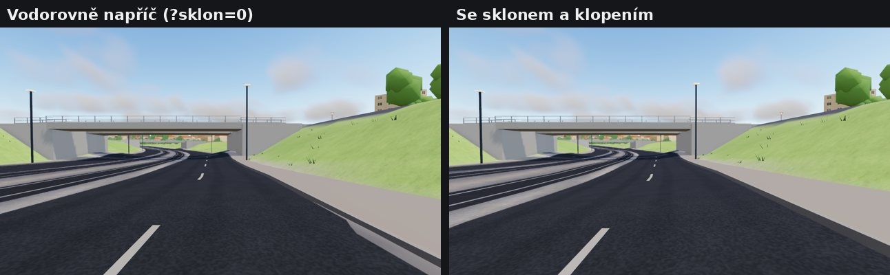

# Příčný sklon silnic a klopené zatáčky

Navazuje na [hladký profil silnic](silnice.md), [chodníky s obrubníkem](chodniky.md) a [zaoblené rohy](rohy.md). Autor chtěl silnice se sklonem napříč: na svahu mají kopírovat terén a v zatáčkách být klopené, aby se v nich lépe a zábavněji jezdilo. Změna je na větvi `claude/lucid-bohr-y3rlwb`. Nepřibyl žádný nový podklad ani knihovna a distribuovaná data v `public/` zůstala beze změny.

## Jak to bylo

Hladký profil určoval výšku silnice jen v její ose. Napříč byla vozovka vodorovná po celé šířce. Na svahu proto jedna strana silnice ležela v zářezu a druhá na náspu, i když terén kolem klesal plynule. Zatáčky nebyly klopené, auto v nich drželo jen třením pneumatik.

## Co se změnilo

- **Sklon podle svahu** (`src/world/road-grade.js`). Hra po 8 m porovná terén vlevo a vpravo za okrajem vozovky a silnici napříč nakloní stejně jako svah. Sklon se podél silnice vyhladí a nejvýš je 4 %.
- **Klopené zatáčky.** Silnice mimo obytné ulice (dálnice až nezařazené silnice) mají v zatáčkách vnitřní stranu níž. Klopení roste s ostrostí zatáčky (zatáčka o poloměru 60 m a ostřejší má plných 6 %). U křižovatek, na koncích silnic a mezi domy (dům do 6 m za okrajem, typicky ulice ve městě) klopení během 15 m plynule zmizí. Kruhové objezdy a Rondel se neklopí. Svah a klopení dohromady dávají nejvýš 7 %.
- **Návaznost.** Kde jedna silnice pokračuje druhou, mají ve společném bodě stejný sklon. Na mostovku se silnice napojí bez příčného sklonu.
- **Stejný povrch všude.** Sklon platí pro vykreslený asfalt a značení, pás vozovky ve fyzice, výšku pro auta řízená hrou, chodníky, zaoblené rohy i společnou plochu křižovatek. Auta se na skloněné vozovce naklánějí podle povrchu.
- **Terén vedle silnice.** Terén pod vozovkou leží pod skloněným pásem. Na nižší straně se měří od roviny vozovky prodloužené za okraj, jinak by svah zasahoval do pásu. Kde je zářez u silnice hlubší než 30 cm, má dlaždice od střední předvolby jemnější síť terénu (4 m místo 8 m). Dřív to platilo až od 40 cm. Okraj asfaltu tak méně často překrývá tráva.
- **Vypnutí.** Parametr adresy `?sklon=0` vrátí silnice vodorovné napříč pro porovnání.

## Ověření

- Nové testy v [tests/road-grade.test.js](../tests/road-grade.test.js) ověřují čtyři věci. Příčný sklon kopíruje svah vedle silnice a nepřekročí 4 %. V zatáčce je níž vnitřní strana, u konců klopení mizí a mezi domy se zatáčka neklopí. Dvě navazující silnice mají ve společném bodě stejný sklon, i když jsou v mapě nakreslené opačným směrem. Bez zapnutí zůstane silnice napříč vodorovná.
- `npm test`: prošlo všech 228 testů JavaScriptu. `npm run build` prošlo.
- **Prohlížečové testy na WebGL 2:** stejných 23 souborů zkoušek jako u rohů (rozpočet vykreslování, hra, chodci, srážky s vybavením ulic, rozvoz, podrobnosti ulic, rozbitné předměty, fyzika, fyzikální provoz, fyzika silnic, doprava, postava, stavby, MHD, směny, asfalt, materiály, mimoúrovňová křížení, Rondel, Prazdroj, řeka, jemný terén a stopy kol). Ze 111 případů prošlo 110. Neprošel jen Wilsonův most, který selhává už před úpravou silnic (auto dojede se zdravím 82 místo 100, stejně jako bez sklonu).
- Rozpočet vykreslování prošel na všech předvolbách i s jemnější sítí terénu u zářezů.

### Rozložení sklonu

Ze 2 569 km silnic s hladkým profilem má 48 % sklon do 1 %, 34 % mezi 1 a 3 % a 12 % mezi 3 a 4 % (svah). Sklon nad 5 % (klopené zatáčky) má 75 km silnic. U 99 % délky se sklon mění pomaleji než o 0,52 % na metr, takže se auto naklápí plynule.

### Hrbolatost a terén u okraje

Stejné měření paprsky fyziky Jolt ve hře jako u [silnic](silnice.md) a [rohů](rohy.md): 10,9 km stop kol mezi křižovatkami a 3,4 km v křižovatkách na deseti místech města. Drncnutí je zrychlení nad 2 m/s² při 50 km/h.

| Ukazatel | Bez sklonu (`?sklon=0`) | Se sklonem |
|---|---:|---:|
| Drncnutí na km mezi křižovatkami | 50,6 | 51,6 |
| z toho v kopcích (stoupání aspoň 4 %) | 78,9 | 79,5 |
| Drncnutí na km v křižovatkách | 157,4 | 132,0 |
| Místa, kde terén ve fyzice přečnívá nad pás vozovky | 280 | 244 |

Mezi křižovatkami zůstala hrbolatost prakticky stejná (+2 %). V křižovatkách ubylo 16 % drncnutí, protože navazující silnice mají stejný sklon a vedlejší silnice nenarážejí na hranu hlavní. Celkem je na měřených trasách o 7 % drncnutí méně.

Vykreslený terén u okraje vozovky: ve 2 m krocích po obou okrajích 221 km silnic do 3 km od středu se měří, zda síť terénu leží nad asfaltem (vysoká předvolba).

| Ukazatel | Před úpravou | Se sklonem a jemnější sítí u zářezů |
|---|---:|---:|
| Délka okrajů, kde terén přečnívá nad asfalt | 3,44 % | 2,62 % |
| z toho o víc než 5 cm | 0,76 % | 0,51 % |

Bez jemnější sítě u zářezů by sklon prosvítání mírně zvýšil (na 3,75 %), protože vnitřní okraj klopené zatáčky leží v zářezu.

### Výkon

Medián stejným měřicím nástrojem jako u [silnic](silnice.md#výkon), softwarové WebGL 2.

| Ukazatel | Bez sklonu | Se sklonem |
|---|---:|---:|
| Příprava profilů silnic při startu (vysoká / nízká předvolba) | 0,71 / 0,73 s | 1,08 / 1,25 s |
| Příprava fyziky jedné dlaždice (vysoká) | 29,4 ms | 30,3 ms |
| Síť terénu jedné dlaždice (vysoká) | 8,3 ms | 8,1 ms |
| Silnice a chodníky jedné dlaždice (vysoká) | 3,8 ms | 4,3 ms |

Silnice dlaždice se staví o 0,5 ms (13 %) déle, protože se příčný sklon počítá v každém bodě asfaltu a značení. Stavba probíhá jednou při načtení dlaždice, ne v každém snímku.

## Snímky před a po

Levé snímky jsou s `?sklon=0`, pravé bez něj. 15. června v 11:00 (shora ve 12:00), vysoká předvolba, softwarové WebGL 2. Sklon je malý (nejvýš 7 %), na snímcích je proto vidět hlavně na okrajích vozovky a na chodnících.

| Místo | Porovnání |
|---|---|
| Karlovarská před mostem, klopená zatáčka |  |
| Jateční před podjezdem, zatáčka mimo zástavbu |  |
| Na Roudné, silnice na svahu |  |
| Doudlevecká, klopená zatáčka na rovině |  |
| Doudlevecká shora: méně míst, kde okraj asfaltu překrývá tráva |  |

## Známé odchylky a další kroky

- Výpočet sklonu prodlouží start hry asi o 0,5 s (příprava profilů silnic 0,82 s → 1,31 s, medián šesti měření na softwarovém WebGL 2).
- Klopí se i silnice na širokých místech ve středu města, kde domy stojí dál než 6 m od okraje (Palackého náměstí, Anglické nábřeží).
- Na nízké předvolbě zůstává hrubší síť terénu, okraj asfaltu tam místy překrývá tráva o něco častěji.
- Na velmi krátkých spojkách mezi dvěma silnicemi se sklon mění rychleji (nejvýš o 5,6 % na metr), protože musí navázat na obě strany.
- Auta řízená hrou kopírují povrch a naklánějí se, jejich rychlost v zatáčce se ale podle klopení nemění.

## Dodatek: proč kolo klesalo pod nájezd Wilsonova mostu

Po sloučení této větve s pevným datem zkoušek (větev `claude/modest-ramanujan-wvjl2i`, revize `faa1a84`) projelo auto ve zkoušce „kola unesou auto přes Wilsonův most v obou směrech“ most se zdravím 100. Jedno kolo ale v první jízdě leželo 5,3 cm pod vozovkou a mez je 5 cm. Zpáteční jízda měla odchylku 0,001 cm. Herní kód je opravený, mez zkoušky se nemění.

### Který vypínač odchylku odstraní

Stejná jízda jako ve zkoušce (9. 11. 2026, 10.00, jasno, nízká předvolba, WebGL 2):

| Adresa | Odchylka kola v první jízdě |
|---|---:|
| beze změny | 5,31 cm |
| `?chodniky=0` | 5,31 cm (na nízké předvolbě chodníky nejsou) |
| `?rohy=0` | 5,31 cm (u konců mostů se rohy nedělají) |
| `?sklon=0` | 2,55 cm |

Pod mez se dostane jen `?sklon=0`. Ani bez sklonu ale kolo neleželo na vozovce, sklon chybu jen zvětšil.

### Proč kolo klesalo

- Nejhorší kolo stálo 1,2 m před západním čelem mostovky (x 170,20, z 456,99). Auto startuje na mostovce, nájezdu se dotknou jen zadní kola v prvních snímcích.
- Americká vede k mostu přes křižovatku s Anglickým nábřežím. Posledních 8 m před mostem leží silnice přímo na terénu, který se podle měření nemění (okolí kalibrovaného konce mostu). Pás jízdního povrchu fyziky tam není, kola jedou po síti terénu.
- Anglické nábřeží od křižovatky prudce klesá k řece, na prvních 16 m o 2,1 m. Se sklonem je napříč skloněné až o 4 %.
- Síť terénu fyziky má body po 4 m. Aby terén neprorůstal pásem silnice, srovná se každý bod do 1,5 m za okrajem vozovky pod její povrch. Výpočet bral **vlastní profil a příčný sklon každé silnice**. V křižovatce ale pás i vykreslený asfalt leží ve **společné výšce vozovek**, kterou tu určuje důležitější Americká.
- Bod sítě (168; 456) na nájezdu leží 0,84 m za okrajem Anglického nábřeží. Podle profilu nábřeží (−2,29 m) a jeho příčného sklonu (okraj o 17 cm níž) se stáhl na −2,49 m, i když nájezd i asfalt křižovatky leží ve výšce −2,10 m. Bez sklonu se stáhl na −2,29 m. Bod (168; 452) u severního okraje nájezdu klesl dokonce o 89 cm.
- Trojúhelníky sítě se proto pod nájezdem propadaly. Zkouška to zachytila jen okrajově. Ve hře by auto přijíždějící z Americké vjelo do skryté jámy pod asfaltem.

Výška fyziky terénu pod vykreslenou vozovkou na posledních 8 m před mostem, největší rozdíl v cm. Vzdálenost od osy je kladná na sever (pruh od mostu do Americké).

| Vzdálenost od osy | −3 m | −2 m | −1 m | 0 | +1 m | +2 m | +3 m |
|---|---:|---:|---:|---:|---:|---:|---:|
| západní nájezd, před opravou | 23,6 | 28,8 | 31,7 | 34,5 | 37,4 | 43,6 | 56,9 |
| západní nájezd, před opravou, `?sklon=0` | 17,3 | 20,3 | 19,9 | 19,5 | 19,2 | 24,0 | 43,7 |
| západní nájezd, po opravě | 0,7 | 0,8 | 0,6 | 0,5 | 0,3 | 0,2 | 0,2 |
| východní nájezd, před opravou | 4,5 | 4,1 | 3,2 | 2,4 | 1,5 | 1,5 | 2,6 |
| východní nájezd, po opravě | 0,0 | 0,0 | 0,0 | 0,0 | 0,0 | 0,2 | 0,7 |

### Oprava (`src/world/world.js`)

1. **V křižovatce podle společné výšky.** Terén pod pásem a do 1,5 m za ním se v křižovatce srovnává podle společné výšky vozovek, tedy podle stejné výšky, ve které leží pás fyziky i asfalt. Bod za okrajem se promítne na okraj pásu. Klesá-li tam pás, terén pokračuje stejným sklonem dál dolů (`stripClampY`). Mimo křižovatky se nic nemění.
2. **Konce mostů, tunelů a ramp.** V jejich okolí (8 m), kde se terén podle měření nemění, už okraj pásu sousední silnice terén nesnižuje. Silnice tam leží přímo na kalibrovaném terénu. Pod pásem samotným se terén snižuje dál. Ručně upravený terén mimoúrovňových křížení se snižuje jako dřív. Bez této výjimky by tam terén prorůstal pásem až o 42 cm, protože vedle silnic bývá násep.
3. **Rychlejší dotaz na společnou výšku.** Vzdálené úseky silnic se vyřadí dřív, než se počítá vzdálenost, a řazení nevytváří pomocná pole. Výsledek je bit po bitu stejný (269 560 náhodných bodů v křižovatkách, žádný rozdíl). Jeden dotaz trvá 4,3 µs místo 5,5 µs.

### Ověření

- **Zkouška Wilsonova mostu:** odchylka kola 5,31 cm → 0,001 cm v obou směrech, se sklonem i s `?sklon=0`. Zdraví 100.
- **Nový test v Node** ([tests/physics-terrain.test.js](../tests/physics-terrain.test.js)): na posledních 8 m před mostem v šířce ±3 m leží fyzika terénu do 2 cm od vozovky. Na původním kódu test selže s rozdílem 57 cm.
- `npm test`: prošlo 229 z 229 testů. `npm run build` prošlo.
- `npm run test:e2e -- physics-roads.spec.js physics.spec.js --trace off`: prošlo všech 22 případů, 11 na WebGL 2 a 11 na WebGPU.

**Celé město.** Vlastním měřicím skriptem ve hře (nízká předvolba, se sklonem):

| Ukazatel | Před opravou | Po opravě |
|---|---:|---:|
| Body pásů, nad které terén ve fyzice prorůstá o víc než 0,5 cm | 11 147 | 4 272 |
| … o víc než 2 cm | 6 594 | 2 123 |
| … o víc než 5 cm | 2 871 | 794 |
| … o víc než 10 cm | 1 064 | 292 |
| Uzly sítě na vozovce bez pásu stažené pod vozovku | 98 | 86 |
| … o víc než 10 cm | 2 | 1 |
| … o víc než 20 cm | 1 | 0 |
| … z toho u konců mostů, tunelů a mimoúrovňových křížení | 12 | 2 |

Prorůstání se měřilo v 1,52 mil. bodech pásů ve 107 dlaždicích do 1,5 km od středu, propady ve všech uzlech sítě po 4 m ve 300 dlaždicích do 2,5 km. Terén už v křižovatkách neprorůstá pásem, protože se srovnává podle skutečné výšky pásu, ne podle vlastního profilu silnice, který bývá výš.

### Výkon

Softwarové WebGL 2, neminifikovaný kód, 68 dlaždic do 1,2 km od středu. Příprava fyziky všech dlaždic od prázdné paměti úprav terénu (úprava terénu i kolizní síť), medián čtyř opakování, tři dvojice měření střídavě před a po opravě:

| Ukazatel | Před opravou | Po opravě |
|---|---:|---:|
| Příprava fyziky 68 dlaždic | 4 326 ms | 4 460 ms (+3 %) |
| Medián jedné dlaždice | 50,3 ms | 51,0 ms (+1,4 %) |
| Úprava terénu jedné dlaždice (bez kolizní sítě) | 0,9 ms | asi 4 ms |

Úprava terénu je pomalejší, protože se v křižovatkách ptá na společnou výšku (asi 770 dotazů na dlaždici centra). Celkem se příprava fyziky dlaždice prodloužila o 1–3 %, což je v rozptylu měření. Část zdržení vyrovná rychlejší dotaz na společnou výšku při stavbě pásů. Úprava se počítá jednou při načtení dlaždice, ne v každém snímku.

### Známé odchylky a návrhy mimo tento úkol

- Na samém okraji Anglického nábřeží 4 m od nájezdu na most (x 167,2, z 452,7) vystoupí terén až 15 cm nad pás, v pásu 15 cm od okraje vozovky, mimo běžnou stopu kol. Podobně u (970,9; 132,9) až 10,5 cm. Síť po 4 m neumí mezi asfaltem nábřeží a nájezdem, které leží 2 m od sebe a 30 cm pod sebou, udělat ostrý schod. Pomohla by jemnější síť fyziky (2 m) tam, kde se okolí konce mostu dotýká pásu.
- **Návrh:** Anglické nábřeží severně od Wilsonova mostu (kolem z 480–510) má profil až 2,5 m pod okolním terénem. Profil sleduje výškový model, který u břehu zřejmě zachytil koryto řeky. Body sítě na břehové čáře řeky (`shore` v `src/physics/terrain.js`) se navíc pod pás nesrovnávají, takže tam terén prorůstá pásem až o 2,2 m. Stejné je to před opravou i po ní.
- **Návrh:** Zbývá 86 menších propadů na vozovkách bez pásu, nejhlubší 10 cm v ručně upraveném terénu mimoúrovňového křížení u (−772; 848). Většinou jde o přechody silnic do terénu (např. silnice 25523 a 25524, kolem 5 cm).
