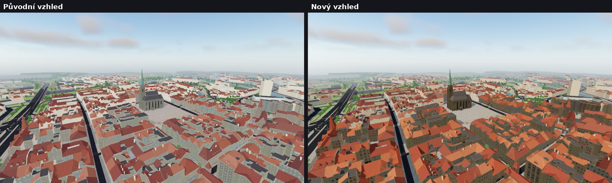
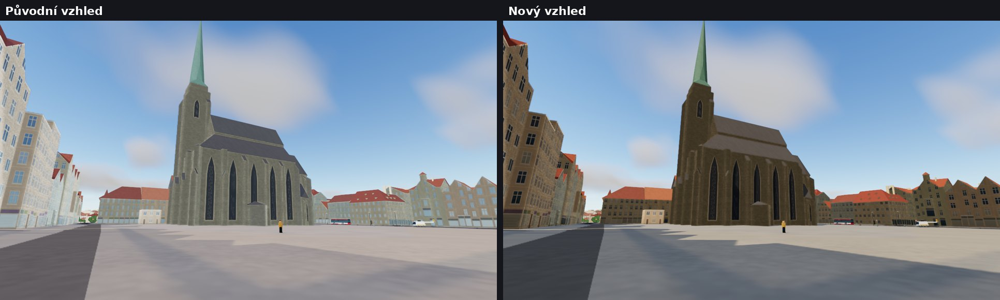
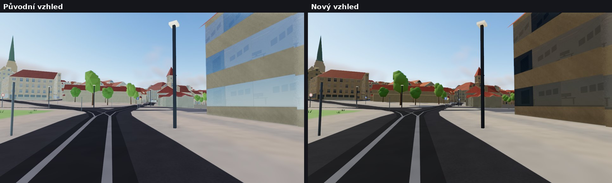
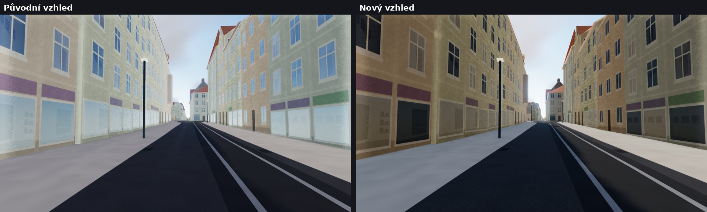
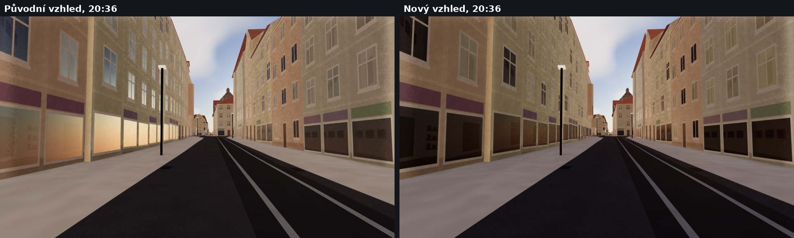

# Vzhledová zkouška · světlo, fasády a stromy

Autor chtěl, aby webová hra působila živěji. Jako měřítko kvality zvolil podobnou prohlížečovou hru HrejBrno 2. Její vzhled se nekopíruje, zkouška hledá vlastní plzeňský vzhled podobné kvality. Zkouška vychází z revize `d868511` a týká se jen webové verze v kořeni repozitáře. Pohledy jsou na náměstí Republiky a v Pražské ulici. Nové podklady ani knihovny nepřibyly, zdroje dat jsou stejné jako dosud.

## Co bylo špatně

Měření ve hře ukázalo tři příčiny vybledlého obrazu.

1. **Světlo oblohy bylo silnější než slunce.** Ve dne svítilo rozptýlené světlo oblohy s intenzitou 2,13 a slunce 1,85. Stíny proto skoro nebyly vidět a domy působily ploše.
2. **Mapa odrazů měla jasnou „zem“.** Obloha pro odrazy se počítá modelem SkyMesh, který pod obzorem kreslí stejně jasnou barvu jako nad ním. Odečet krychlové mapy v 16:30 dal průměrný jas stěny „dolů“ 3,1 až 4,6 a stěny „nahoru“ jen 0,3 až 2,0. Stěny tak dostávaly silné světlo zespodu.
3. **Fasády odrážely oblohu i v úzkých ulicích.** Při pohledu podél ulice se na drsné omítce sčítal odraz jasné oblohy s reliéfem textury. Vznikal mléčný závoj, nejvíc při pohledu proti slunci. Ve skutečnosti by tuto oblohu zakrývaly protější domy. Závoj zmizel, až když se odraz oblohy úplně vypnul. Zeslabení „sluneční záře“ v mapě odrazů nepomohlo.

## Co se změnilo

- **Rozdělení denního světla** je v nové čisté funkci `daylight()` v [src/world/daylight.js](../src/world/daylight.js). Za jasného dne svítí slunce s intenzitou 3,1 a obloha 2,0 v chladnějším tónu. Při zatažení slunce slábne a obloha přebírá jeho podíl. Stín má ve dne plnou sílu. Noc zůstává beze změny.
- **Zem v mapě odrazů** je pod obzorem tmavší, zhruba osmina jasu obzoru ([src/world/sky-light.js](../src/world/sky-light.js)).
- **Fasády mají vlastní slabý odraz oblohy** (`setFacadeEnvironment` v [src/world/materials.js](../src/world/materials.js)). Auta, sklo a voda odrážejí oblohu dál.
- **Omítky jsou o něco světlejší a sytější** (`wallLift` v [src/world/daylight.js](../src/world/daylight.js), použito v [src/world/building-nodes.js](../src/world/building-nodes.js)). Tmavá barva se zesvětlí o 45 %, světlá o 12 %. Bez této úpravy by stěny ve stínu se silnějším sluncem zčernaly.
- **Koruny stromů jsou oblé.** Normály listí míří od středu koruny, odstín se mění plynule. Počet trojúhelníků zůstal stejný. Vzdálené pohledy stromů vznikly znovu nástrojem `tools/build_impostors.mjs`. Nástroj nejdřív ze staré verze vyrobil soubor shodný bajt po bajtu s vydaným atlasem. Teprve potom se nový atlas převzal z `data-raw/kandidat/`. Seznam otisků grafiky obnovil `tools/freeze_graphics.mjs`, změnil se jen řádek atlasu stromů.

Původní světlo, odrazy i barvy omítek zapne adresa s parametrem `?vzhled=puvodni`. Stromy se tímto parametrem nemění. Uložené hry se nemění.

## Snímky před a po

Chromium 159 na softwarovém WebGL 2 (SwiftShader), vysoká předvolba, 1280 × 720, jasno, 15. června 2026 v 16:30. Kamera stojí ve všech dvojicích na stejném místě. Před snímkem proběhlo 24 obnov obrazu, aby se ustálila expozice a vyhlazení. Levý snímek je pořízený s parametrem `?vzhled=puvodni` ještě před úpravou stromů, pravý na výsledné revizi bez parametru.

| Pohled | Porovnání |
|---|---|
| Nad centrem od jihozápadu |  |
| Náměstí Republiky od jihozápadu |  |
| Pražská, východní úsek směrem k centru |  |
| Pražská směrem k náměstí |  |
| Soumrak ve 20:36, Pražská |  |

## Výsledky zkoušek

- `npm test`: prošlo všech 197 testů JavaScriptu. Nové testy hlídají rozdělení světla, původní hodnoty pro `?vzhled=puvodni`, beze změny v noci, zesvětlení omítek a oblé normály korun.
- `npm run build` prošlo. Sestavená hra se z podsložky (stejně jako na GitHub Pages) načetla bez chyb a bez chybějících souborů.
- **Původní vzhled se dá obnovit.** Snímky s `?vzhled=puvodni` se od snímků před úpravou liší jen jemným zrněním na texturách fasád. Způsobuje ho vyhlazování mezi snímky. Odchylka nad čtyři úrovně barvy zasáhla 0,2 až 5,0 % pixelů, nejvýš o 32 úrovní.
- **Noc a déšť:** ve 23 hodin vypadá náměstí stejně jako dřív, jen omítky jsou o něco světlejší. V dešti se mokrá vozovka leskne jako dosud.
- **Výkon:** úprava nepřidává žádný průchod vykreslování ani trojúhelníky. Fasády používají stejnou mapu odrazů jako zbytek scény, jen se slabší vahou. Měření výkonu na autorově zařízení zatím chybí.
- Prohlížečové testy materiálů, oblohy, expozice, fasád, stínů, nočního města, interiérů, památek a rozpočtu vykreslování: běží; výsledek doplní další revize.

## Známé odchylky a další kroky

- Snímky vznikly softwarově. Na skutečné grafické kartě a ve WebGPU mohou barvy vyjít nepatrně jinak. Starší protokol E24 uvádí, že obě cesty vykreslení se liší pod 0,5 % pixelů.
- Měřené domy v centru mají z dat převážně okrové a hnědé omítky. Pestřejší paleta by vyžadovala novou sadu barev v nástroji `tools/build_building_materials.py`.
- Velké rozdíly proti HrejBrnu zůstávají v modelech: postava, tramvaje a auta jsou jednoduché. Ty by byly dalším krokem po schválení vzhledu.
- Výlohy za soumraku odrážejí oranžovou oblohu slaběji než dřív. Mají jen slabý odlesk barvy obzoru.
- Náměstí v přímém slunci je velmi světlé. Expozice se řídí průměrem obrazu, takže domy ve stínu vedle něj působí tmavší.
